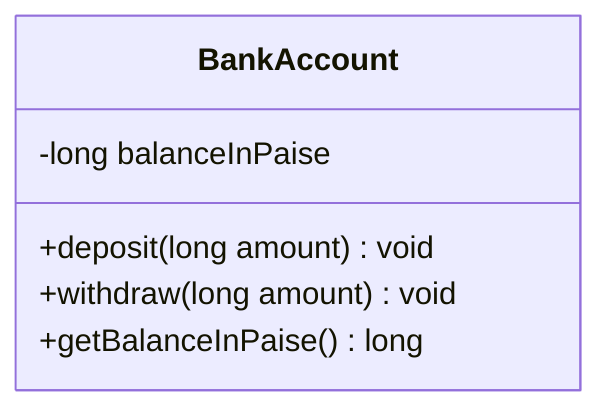
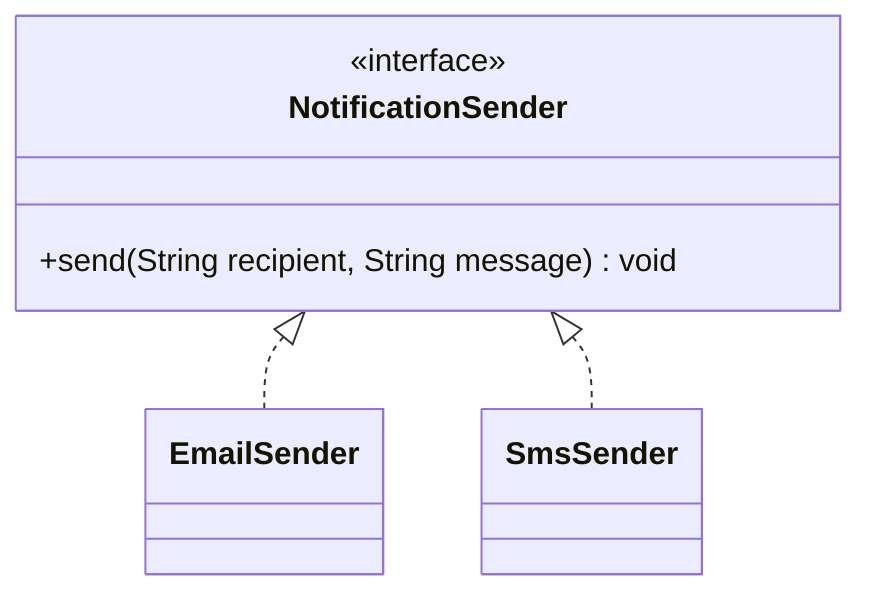
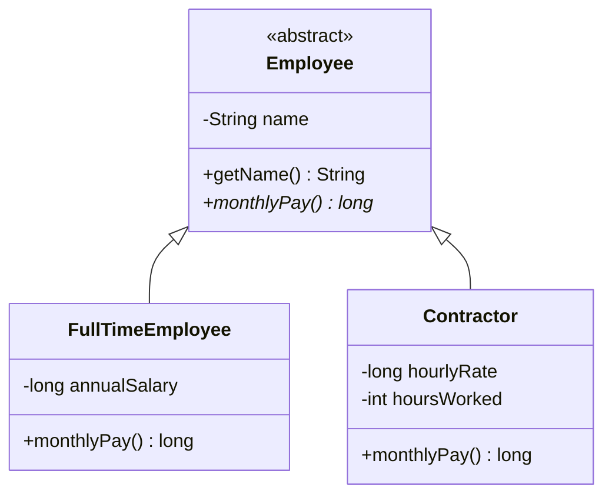

# Object-Oriented Programming (OOP)

A **class** is a blueprint. An **object** is an instance of that blueprint with its own state.

The four pillars:

| Pillar | One-line meaning | Java tools |
|---|---|---|
| Encapsulation | Protect state behind methods | `private`, methods |
| Abstraction | Expose what, hide how | `interface`, `abstract class` |
| Inheritance | Reuse and specialise a parent type | `extends` |
| Polymorphism | One call, many behaviours | overriding, overloading |

## 1. Encapsulation

Keep fields private and let the class enforce its own rules.

```java
public class BankAccount {
    private long balanceInPaise;

    public void deposit(long amount) {
        if (amount <= 0) {
            throw new IllegalArgumentException("Amount must be positive");
        }
        balanceInPaise += amount;
    }

    public void withdraw(long amount) {
        if (amount <= 0 || amount > balanceInPaise) {
            throw new IllegalArgumentException("Invalid withdrawal");
        }
        balanceInPaise -= amount;
    }

    public long getBalanceInPaise() {
        return balanceInPaise;
    }
}
```

There is no `setBalance`, so no caller can put the account into an invalid state.



## 2. Abstraction

Callers depend on a contract, not on the implementation.

```java
public interface NotificationSender {
    void send(String recipient, String message);
}

public class EmailSender implements NotificationSender {
    @Override
    public void send(String recipient, String message) {
        System.out.println("Email to " + recipient + ": " + message);
    }
}

public class SmsSender implements NotificationSender {
    @Override
    public void send(String recipient, String message) {
        System.out.println("SMS to " + recipient + ": " + message);
    }
}
```



### Interface vs abstract class

| | Interface | Abstract class |
|---|---|---|
| Models | A capability ("can do") | A shared base ("is a") |
| Instance fields | No (constants only) | Yes |
| Constructors | No | Yes |
| How many per class | Many | One |

## 3. Inheritance

A subclass reuses the parent's state and behaviour. Use it only for a true **is-a** relationship.

```java
public abstract class Employee {
    private final String name;

    protected Employee(String name) {
        this.name = name;
    }

    public String getName() {
        return name;
    }

    public abstract long monthlyPay();
}

public class FullTimeEmployee extends Employee {
    private final long annualSalary;

    public FullTimeEmployee(String name, long annualSalary) {
        super(name);
        this.annualSalary = annualSalary;
    }

    @Override
    public long monthlyPay() {
        return annualSalary / 12;
    }
}

public class Contractor extends Employee {
    private final long hourlyRate;
    private final int hoursWorked;

    public Contractor(String name, long hourlyRate, int hoursWorked) {
        super(name);
        this.hourlyRate = hourlyRate;
        this.hoursWorked = hoursWorked;
    }

    @Override
    public long monthlyPay() {
        return hourlyRate * hoursWorked;
    }
}
```



## 4. Polymorphism

### Runtime (overriding)

The object's actual type decides which method runs.

```java
import java.util.List;

public class Payroll {
    public long total(List<Employee> employees) {
        long sum = 0;
        for (Employee e : employees) {
            sum += e.monthlyPay(); // resolved at runtime
        }
        return sum;
    }
}
```

Adding a new employee type needs no change to `Payroll`.

### Compile-time (overloading)

The compiler picks a method from the argument list.

```java
public class AreaCalculator {
    public double area(double radius) {
        return Math.PI * radius * radius;
    }

    public double area(double length, double width) {
        return length * width;
    }
}
```

## Interview questions

1. How do encapsulation and abstraction differ?
2. When would you choose an interface over an abstract class?
3. Why can inheritance break encapsulation?
4. Can static methods be overridden? (No, they are hidden.)
5. Why is `Square extends Rectangle` often a bad design?
