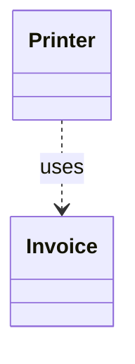
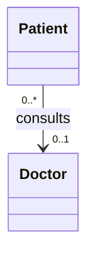
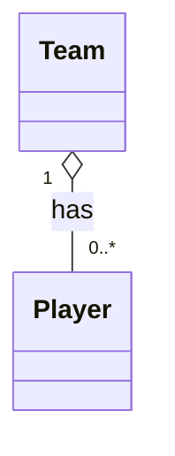
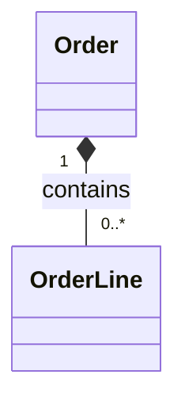
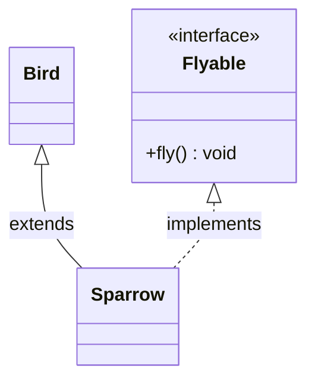
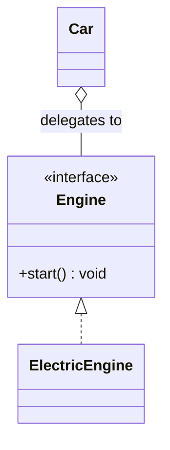
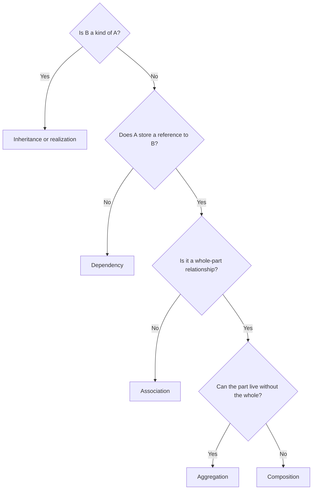

# Class Relationships

From weakest to strongest coupling (for "uses" and "has-a"): **dependency → association → aggregation → composition**.
Inheritance and realization describe "is-a" and "can-do".

| Relationship | Meaning | Lifetime | Mermaid arrow |
|---|---|---|---|
| Dependency | Uses temporarily | Independent | `..>` |
| Association | Knows about | Independent | `-->` |
| Aggregation | Has-a, shared part | Part outlives whole | `o--` |
| Composition | Owns the part | Part dies with whole | `*--` |
| Inheritance | Is-a | Not applicable | `<\|--` |
| Realization | Implements a contract | Not applicable | `<\|..` |

## 1. Dependency

A class uses another as a parameter, local variable or return type, without storing it.

```java
public class Invoice {
    private final String id;

    public Invoice(String id) {
        this.id = id;
    }

    public String getId() {
        return id;
    }
}

public class Printer {
    public void print(Invoice invoice) {
        System.out.println("Printing invoice " + invoice.getId());
    }
}
```



## 2. Association

A class holds a reference to another. Neither owns the other.

```java
public class Doctor {
    private final String name;

    public Doctor(String name) {
        this.name = name;
    }

    public String getName() {
        return name;
    }
}

public class Patient {
    private Doctor doctor;

    public void assignDoctor(Doctor doctor) {
        this.doctor = doctor;
    }

    public Doctor getDoctor() {
        return doctor;
    }
}
```



## 3. Aggregation

A whole groups parts that are created outside it and can exist without it.

```java
import java.util.ArrayList;
import java.util.List;

public class Player {
    private final String name;

    public Player(String name) {
        this.name = name;
    }
}

public class Team {
    private final List<Player> players = new ArrayList<>();

    public void addPlayer(Player player) { // created elsewhere
        players.add(player);
    }
}
```



If the team is disbanded, the players still exist.

## 4. Composition

The whole creates and owns its parts. They do not make sense on their own.

```java
import java.util.ArrayList;
import java.util.List;

public class Order {
    private final List<OrderLine> lines = new ArrayList<>();

    public void addItem(String product, int quantity) {
        lines.add(new OrderLine(product, quantity)); // created inside
    }

    public int lineCount() {
        return lines.size();
    }

    private static class OrderLine {
        private final String product;
        private final int quantity;

        private OrderLine(String product, int quantity) {
            this.product = product;
            this.quantity = quantity;
        }
    }
}
```



## 5. Inheritance and realization

```java
public interface Flyable {
    void fly();
}

public class Bird {
    public void eat() {
        System.out.println("Eating");
    }
}

public class Sparrow extends Bird implements Flyable {
    @Override
    public void fly() {
        System.out.println("Flying");
    }
}
```



## Composition over inheritance

Inheritance fixes behaviour at compile time. Composition lets you swap it at runtime.

```java
public interface Engine {
    void start();
}

public class ElectricEngine implements Engine {
    @Override
    public void start() {
        System.out.println("Silent start");
    }
}

public class Car {
    private final Engine engine;

    public Car(Engine engine) {
        this.engine = engine;
    }

    public void start() {
        engine.start();
    }
}
```



Here the `Engine` is passed in from outside, so in UML terms this is aggregation. "Composition" in the design principle means building behaviour by holding objects instead of extending classes.

## How to decide


