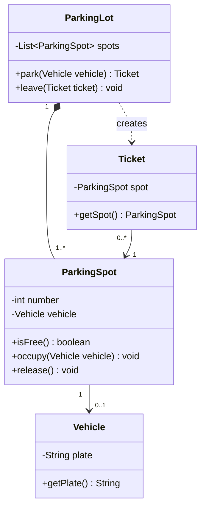
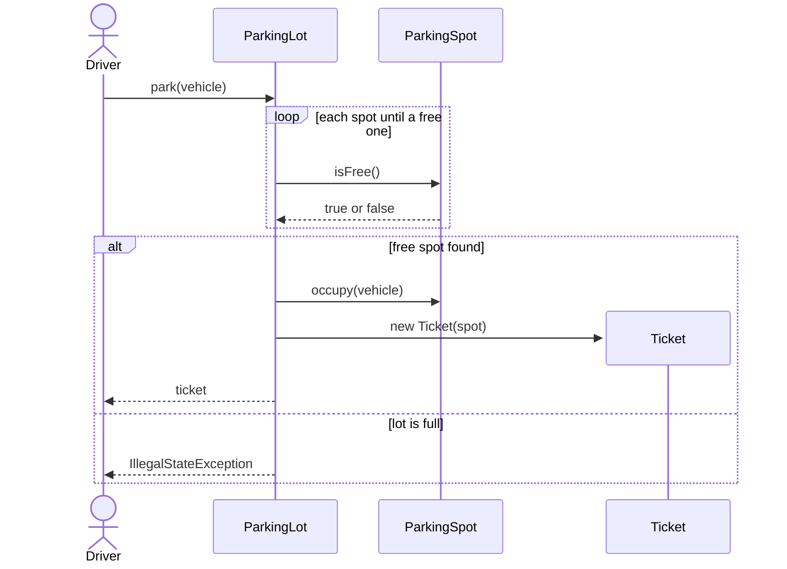

# UML for LLD

In LLD interviews, two diagrams matter most:

- **Class diagram**: the static structure (classes, fields, methods, relationships).
- **Sequence diagram**: the runtime flow (who calls whom, in what order).

## 1. Class diagram notation

### Visibility

| Symbol | Java |
|---|---|
| `+` | `public` |
| `-` | `private` |
| `#` | `protected` |
| `~` | package-private |

In Mermaid, a trailing `*` marks an abstract method and `$` marks a static member.

### Relationships

| Arrow | Relationship |
|---|---|
| `<\|--` | Inheritance |
| `<\|..` | Realization |
| `*--` | Composition |
| `o--` | Aggregation |
| `-->` | Association |
| `..>` | Dependency |

See [relationship.md](relationship.md) for each one in Java.

### Multiplicity

`1` exactly one, `0..1` optional, `0..*` any number, `1..*` at least one.

## 2. Example: parking lot



The same design in Java:

```java
import java.util.ArrayList;
import java.util.List;

public class Vehicle {
    private final String plate;

    public Vehicle(String plate) {
        this.plate = plate;
    }

    public String getPlate() {
        return plate;
    }
}

public class ParkingSpot {
    private final int number;
    private Vehicle vehicle;

    public ParkingSpot(int number) {
        this.number = number;
    }

    public boolean isFree() {
        return vehicle == null;
    }

    public void occupy(Vehicle vehicle) {
        if (!isFree()) {
            throw new IllegalStateException("Spot " + number + " is taken");
        }
        this.vehicle = vehicle;
    }

    public void release() {
        vehicle = null;
    }
}

public class Ticket {
    private final ParkingSpot spot;

    public Ticket(ParkingSpot spot) {
        this.spot = spot;
    }

    public ParkingSpot getSpot() {
        return spot;
    }
}

public class ParkingLot {
    private final List<ParkingSpot> spots = new ArrayList<>();

    public ParkingLot(int capacity) {
        if (capacity < 1) {
            throw new IllegalArgumentException("Capacity must be at least 1");
        }
        for (int i = 1; i <= capacity; i++) {
            spots.add(new ParkingSpot(i));
        }
    }

    public Ticket park(Vehicle vehicle) {
        for (ParkingSpot spot : spots) {
            if (spot.isFree()) {
                spot.occupy(vehicle);
                return new Ticket(spot);
            }
        }
        throw new IllegalStateException("Parking lot is full");
    }

    public void leave(Ticket ticket) {
        ticket.getSpot().release();
    }
}
```

This version is single-threaded and does not guard against a ticket being used twice. Both are good follow-ups to practise.

## 3. Sequence diagram

Parking a vehicle:



| Syntax | Meaning |
|---|---|
| `->>` | Call |
| `-->>` | Return |
| `alt` / `else` | If / else |
| `opt` | Optional step |
| `loop` | Repetition |

## Interview tips

1. Start with entities (nouns), then behaviour (verbs).
2. Draw the class diagram first, then a sequence diagram for the main use case.
3. Show only the fields and methods that matter to the discussion.
4. Say why you chose composition, aggregation or association.
