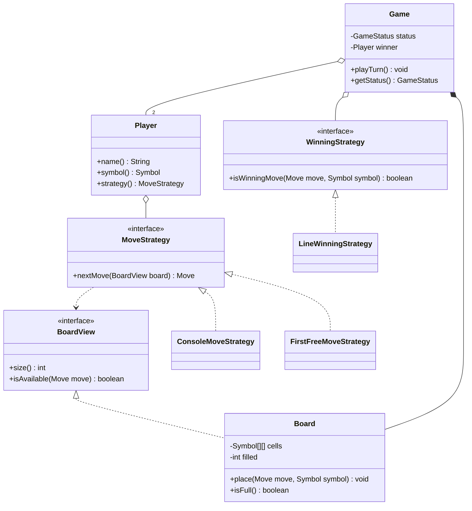
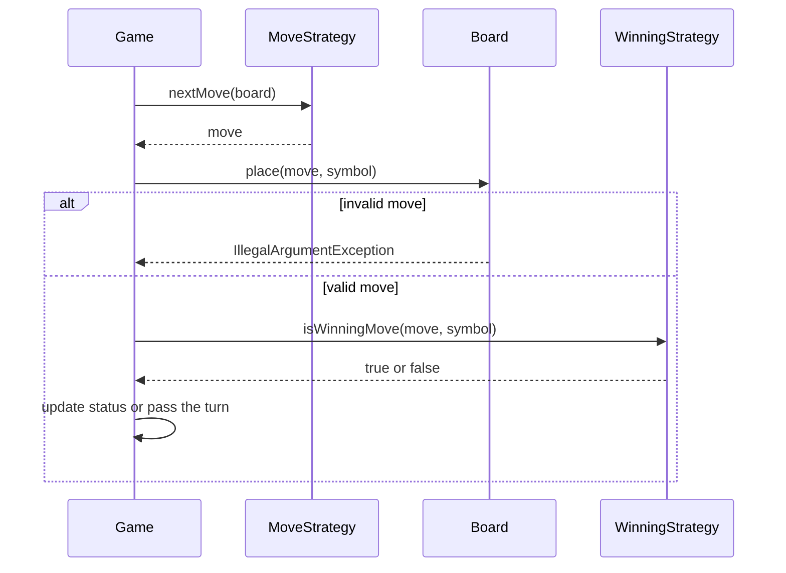

# 1. Tic-Tac-Toe

**Difficulty:** Basic | **Time:** 30 minutes

## 1. Problem statement

Design a Tic-Tac-Toe game for two players on an N x N board (default 3 x 3).

- One player uses `X`, the other `O`. `X` moves first.
- Players take turns placing their symbol in an empty cell.
- A player wins by filling a complete row, column or diagonal.
- If the board is full and nobody has won, the game is a draw.
- An invalid move (outside the board or on a taken cell) is rejected, and the same player moves again.
- A player can be a human or a bot.

**Out of scope:** online play, persistence, graphical UI, undo and smart bots.

## 2. What the interviewer wants to evaluate

| Area | What a strong answer shows |
|---|---|
| Requirement clarification | Asks about board size, player types, win rule and scope before designing |
| Object modelling | Separates `Board`, `Player`, `Game` and the win rule |
| Responsibility split | No single class handles input, rules, state and output |
| Encapsulation | The board changes only through a method that validates the move |
| Algorithm choice | Detects a win in O(1) per move instead of scanning the board |
| Extensibility | Adds a new bot or win rule without editing `Game` |
| Edge cases | Handles invalid input, occupied cells, draws and moves after the game ends |
| Code quality | Clear names, small methods and working code in the time available |

## 3. Design patterns and principles used

### Design patterns

| Pattern | Where | Why |
|---|---|---|
| Strategy | `MoveStrategy` | Human and bot players choose moves differently |
| Strategy | `WinningStrategy` | The win rule can change without touching the game loop |

Singleton, Factory and State are deliberately left out. One game does not need a single global instance, object creation is simple, and three statuses fit in an enum.

### Design principles

| Principle | How it applies |
|---|---|
| Single Responsibility | `Board` stores cells, `WinningStrategy` judges wins, `Game` manages turns |
| Open/Closed | New strategies are new classes, existing ones stay unchanged |
| Liskov Substitution | Any `MoveStrategy` works wherever the interface is expected |
| Interface Segregation | Strategies see only the read-only `BoardView` |
| Dependency Inversion | `Game` depends on the `WinningStrategy` interface, `Player` on `MoveStrategy` |
| Composition over inheritance | `Player` holds a strategy instead of having `HumanPlayer` and `BotPlayer` subclasses |
| Encapsulation | The cell array is private to `Board` |

## 4. Solution

### 4.1 Core entities

| Entity | Responsibility |
|---|---|
| `Symbol` | `X` or `O` |
| `Move` | A row and column |
| `Board` | Holds cells and validates placement |
| `Player` | Name, symbol and move strategy |
| `Game` | Turn order and game status |

### 4.2 Class diagram



### 4.3 Flow of one turn



### 4.4 Java code (Java 17+)

#### Basic types

```java
public enum Symbol { X, O }

public enum GameStatus { IN_PROGRESS, WON, DRAW }

public record Move(int row, int col) { }
```

#### Board

```java
public interface BoardView {
    int size();
    boolean isAvailable(Move move);
}

public class Board implements BoardView {
    private final Symbol[][] cells;
    private int filled;

    public Board(int size) {
        if (size < 3) {
            throw new IllegalArgumentException("Size must be at least 3");
        }
        cells = new Symbol[size][size];
    }

    @Override
    public int size() {
        return cells.length;
    }

    @Override
    public boolean isAvailable(Move move) {
        return move.row() >= 0 && move.row() < size()
                && move.col() >= 0 && move.col() < size()
                && cells[move.row()][move.col()] == null;
    }

    public void place(Move move, Symbol symbol) {
        if (!isAvailable(move)) {
            throw new IllegalArgumentException("Invalid move: " + move);
        }
        cells[move.row()][move.col()] = symbol;
        filled++;
    }

    public boolean isFull() {
        return filled == size() * size();
    }

    @Override
    public String toString() {
        StringBuilder out = new StringBuilder();
        for (Symbol[] row : cells) {
            for (Symbol cell : row) {
                out.append(cell == null ? "." : cell.name()).append(' ');
            }
            out.append('\n');
        }
        return out.toString();
    }
}
```

#### Move strategies

```java
import java.util.Scanner;

public interface MoveStrategy {
    Move nextMove(BoardView board);
}

public class ConsoleMoveStrategy implements MoveStrategy {
    private final Scanner scanner;

    public ConsoleMoveStrategy(Scanner scanner) {
        this.scanner = scanner;
    }

    @Override
    public Move nextMove(BoardView board) {
        System.out.print("Enter row and column (0 to " + (board.size() - 1) + "): ");
        String[] parts = scanner.nextLine().trim().split("\\s+");
        if (parts.length != 2) {
            throw new IllegalArgumentException("Enter two numbers");
        }
        return new Move(Integer.parseInt(parts[0]), Integer.parseInt(parts[1]));
    }
}

public class FirstFreeMoveStrategy implements MoveStrategy {
    @Override
    public Move nextMove(BoardView board) {
        for (int row = 0; row < board.size(); row++) {
            for (int col = 0; col < board.size(); col++) {
                Move move = new Move(row, col);
                if (board.isAvailable(move)) {
                    return move;
                }
            }
        }
        throw new IllegalStateException("No free cell");
    }
}
```

#### Win detection in O(1)

Keep a count per symbol for every row, column and diagonal. A line is complete when its count reaches N.

```java
public interface WinningStrategy {
    /** Call exactly once for every move placed on the board. */
    boolean isWinningMove(Move move, Symbol symbol);
}

public class LineWinningStrategy implements WinningStrategy {
    private final int size;
    private final int[][] rows;
    private final int[][] cols;
    private final int[] diagonal;
    private final int[] antiDiagonal;

    public LineWinningStrategy(int size) {
        this.size = size;
        int symbols = Symbol.values().length;
        rows = new int[symbols][size];
        cols = new int[symbols][size];
        diagonal = new int[symbols];
        antiDiagonal = new int[symbols];
    }

    @Override
    public boolean isWinningMove(Move move, Symbol symbol) {
        int s = symbol.ordinal();
        boolean won = ++rows[s][move.row()] == size;
        won |= ++cols[s][move.col()] == size;
        if (move.row() == move.col()) {
            won |= ++diagonal[s] == size;
        }
        if (move.row() + move.col() == size - 1) {
            won |= ++antiDiagonal[s] == size;
        }
        return won;
    }
}
```

`|=` is used so that every counter is updated, even after a win is found.

#### Player and game

```java
import java.util.ArrayDeque;
import java.util.Deque;

public record Player(String name, Symbol symbol, MoveStrategy strategy) { }

public class Game {
    private final Board board;
    private final WinningStrategy winningStrategy;
    private final Deque<Player> turns = new ArrayDeque<>();
    private GameStatus status = GameStatus.IN_PROGRESS;
    private Player winner;

    public Game(int size, Player first, Player second, WinningStrategy winningStrategy) {
        if (first.symbol() == second.symbol()) {
            throw new IllegalArgumentException("Players need different symbols");
        }
        this.board = new Board(size);
        this.winningStrategy = winningStrategy;
        turns.add(first);
        turns.add(second);
    }

    public void playTurn() {
        if (status != GameStatus.IN_PROGRESS) {
            throw new IllegalStateException("Game is over");
        }
        Player current = turns.peek();
        Move move = current.strategy().nextMove(board);
        board.place(move, current.symbol()); // throws before the turn changes

        if (winningStrategy.isWinningMove(move, current.symbol())) {
            status = GameStatus.WON;
            winner = current;
        } else if (board.isFull()) {
            status = GameStatus.DRAW;
        } else {
            turns.add(turns.remove());
        }
    }

    public GameStatus getStatus() {
        return status;
    }

    public Player getWinner() {
        return winner; // null unless status is WON
    }

    public String render() {
        return board.toString();
    }
}
```

#### Demo

```java
import java.util.Scanner;

public class TicTacToeDemo {
    public static void main(String[] args) {
        int size = 3;
        Player human = new Player("You", Symbol.X, new ConsoleMoveStrategy(new Scanner(System.in)));
        Player bot = new Player("Bot", Symbol.O, new FirstFreeMoveStrategy());
        Game game = new Game(size, human, bot, new LineWinningStrategy(size));

        while (game.getStatus() == GameStatus.IN_PROGRESS) {
            try {
                game.playTurn();
                System.out.println(game.render());
            } catch (IllegalArgumentException e) {
                System.out.println("Try again. " + e.getMessage());
            }
        }

        System.out.println(game.getStatus() == GameStatus.WON
                ? "Winner: " + game.getWinner().name()
                : "Draw");
    }
}
```

### 4.5 Complexity

| Operation | Time |
|---|---|
| Validate and place a move | O(1) |
| Check for a win | O(1) |
| Check for a draw | O(1) |
| Bot picking the first free cell | O(N²) |

Space is O(N²) for the board and O(N) for the counters.

## 5. Follow-up questions

| Question | Answer outline |
|---|---|
| How would you add undo? | Keep a stack of moves (Command pattern). Add undo to the board and win strategy to clear the cell, reduce counters and restore the turn |
| What if only K in a row is needed to win? | Write a new `WinningStrategy` that counts outwards from the last move. It needs read access to the board |
| How would you support more than two players? | Add symbols and pass a list of players to `Game`. The turn queue already rotates |
| How would you make it work online? | Keep `Game` on the server, check which player sent each move, and process moves for one game one at a time |
| How would you add a smarter bot? | Implement another `MoveStrategy`, such as minimax. It needs `BoardView` to expose cell contents |
