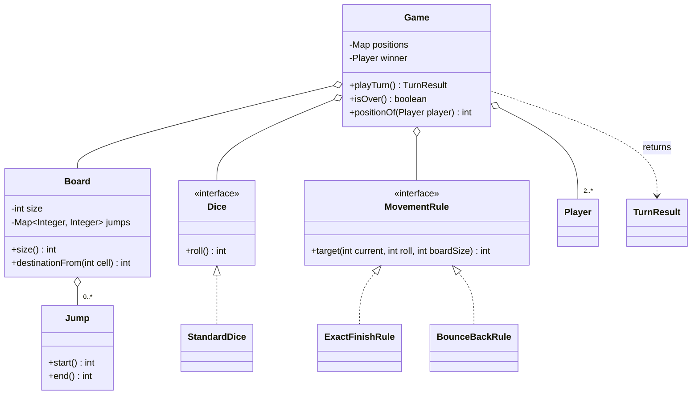
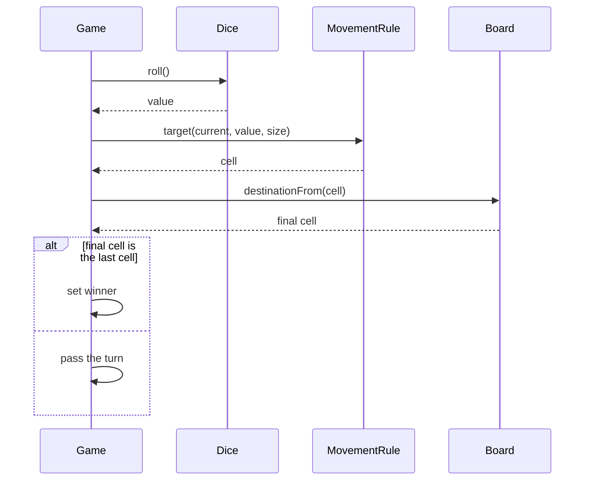

# 2. Snake and Ladder

**Difficulty:** Basic | **Time:** 30 minutes

## 1. Problem statement

Design a Snake and Ladder game for two or more players on a board with cells 1 to N (default 100).

- Every player starts at position 0, outside the board.
- Players take turns rolling the dice and moving forward by the total rolled.
- Landing on the head of a snake moves the player down to its tail.
- Landing on the bottom of a ladder moves the player up to its top.
- A move that goes past cell N is not allowed, so the player stays in place.
- The first player to reach cell N wins and the game ends.
- Several players can share a cell.
- A cell can start at most one snake or ladder, and jumps do not chain.
- Snakes, ladders and the number of dice are configurable.

**Out of scope:** online play, persistence, graphical UI and bonus turns.

## 2. What the interviewer wants to evaluate

| Area | What a strong answer shows |
|---|---|
| Requirement clarification | Asks about dice count, overshooting cell N, bonus turns and chained jumps |
| Object modelling | Separates `Board`, `Dice`, `Player`, movement rules and `Game` |
| Responsibility split | The game loop coordinates and does not hold every rule |
| Data structure choice | Looks up a snake or ladder in O(1) with a map instead of one object per cell |
| Extensibility | Adds new dice or finishing rules without editing `Game` |
| Validation | Rejects bad board setups, such as two jumps from one cell or a loop |
| Testability | Can fix the dice values to reproduce a game |
| Edge cases | Handles overshoot, the winning move and turns after the game ends |

## 3. Design patterns and principles used

### Design patterns

| Pattern | Where | Why |
|---|---|---|
| Strategy | `Dice` | Standard, loaded or scripted dice can be swapped |
| Strategy | `MovementRule` | "Stay in place" and "bounce back" are different finishing rules |

`Snake` and `Ladder` subclasses are not needed. Both are a jump from one cell to another, so one `Jump` record covers them. A Factory or Singleton would add code without solving a problem here.

### Design principles

| Principle | How it applies |
|---|---|
| Single Responsibility | `Board` knows jumps, `Dice` rolls, `MovementRule` calculates, `Game` manages turns |
| Open/Closed | A new rule is a new class, and `Game` stays unchanged |
| Liskov Substitution | Any `Dice` or `MovementRule` can replace another |
| Dependency Inversion | `Game` depends on the `Dice` and `MovementRule` interfaces |
| Composition over inheritance | `Game` is assembled from the board, dice and rule it is given |
| Encapsulation | The jump map and player positions cannot be changed from outside |
| KISS | One `Jump` type instead of a class hierarchy |

## 4. Solution

### 4.1 Core entities

| Entity | Responsibility |
|---|---|
| `Jump` | A snake or ladder, from a start cell to an end cell |
| `Board` | Size and jumps, validated at creation |
| `Dice` | Produces a roll |
| `MovementRule` | Calculates where a roll takes a player |
| `Player` | Identifies a participant |
| `TurnResult` | Describes what happened in one turn |
| `Game` | Turn order, positions and winner |

### 4.2 Class diagram



### 4.3 Flow of one turn



### 4.4 Java code (Java 17+)

#### Jump and board

```java
public record Jump(int start, int end) { }
```

```java
import java.util.HashMap;
import java.util.List;
import java.util.Map;

public class Board {
    private final int size;
    private final Map<Integer, Integer> jumps = new HashMap<>();

    public Board(int size, List<Jump> jumpList) {
        if (size < 2) {
            throw new IllegalArgumentException("Size must be at least 2");
        }
        this.size = size;
        for (Jump jump : jumpList) {
            add(jump);
        }
        for (int end : jumps.values()) {
            if (jumps.containsKey(end)) {
                throw new IllegalArgumentException("Jumps cannot chain at cell " + end);
            }
        }
    }

    private void add(Jump jump) {
        boolean validStart = jump.start() >= 1 && jump.start() < size;
        boolean validEnd = jump.end() >= 1 && jump.end() <= size;
        if (!validStart || !validEnd || jump.start() == jump.end()) {
            throw new IllegalArgumentException("Invalid jump: " + jump);
        }
        if (jumps.putIfAbsent(jump.start(), jump.end()) != null) {
            throw new IllegalArgumentException("Cell already has a jump: " + jump.start());
        }
    }

    public int size() {
        return size;
    }

    public int destinationFrom(int cell) {
        return jumps.getOrDefault(cell, cell);
    }
}
```

Rejecting chains also rules out loops, such as a ladder and a snake that point at each other.

#### Dice

```java
public interface Dice {
    int roll();
}
```

```java
import java.util.Random;

public class StandardDice implements Dice {
    private final int count;
    private final Random random;

    public StandardDice(int count, Random random) {
        if (count < 1) {
            throw new IllegalArgumentException("Need at least one die");
        }
        this.count = count;
        this.random = random;
    }

    @Override
    public int roll() {
        int total = 0;
        for (int i = 0; i < count; i++) {
            total += random.nextInt(6) + 1;
        }
        return total;
    }
}
```

#### Movement rules

```java
public interface MovementRule {
    int target(int current, int roll, int boardSize);
}
```

```java
public class ExactFinishRule implements MovementRule {
    @Override
    public int target(int current, int roll, int boardSize) {
        int next = current + roll;
        return next > boardSize ? current : next;
    }
}
```

```java
public class BounceBackRule implements MovementRule {
    @Override
    public int target(int current, int roll, int boardSize) {
        int next = current + roll;
        return next > boardSize ? Math.max(0, 2 * boardSize - next) : next;
    }
}
```

#### Player and turn result

```java
public record Player(String name) { }
```

```java
public record TurnResult(Player player, int roll, int from, int to) { }
```

#### Game

```java
import java.util.ArrayDeque;
import java.util.Deque;
import java.util.HashMap;
import java.util.List;
import java.util.Map;

public class Game {
    private final Board board;
    private final Dice dice;
    private final MovementRule rule;
    private final Deque<Player> turns = new ArrayDeque<>();
    private final Map<Player, Integer> positions = new HashMap<>();
    private Player winner;

    public Game(Board board, Dice dice, MovementRule rule, List<Player> players) {
        if (players.size() < 2) {
            throw new IllegalArgumentException("Need at least two players");
        }
        this.board = board;
        this.dice = dice;
        this.rule = rule;
        for (Player player : players) {
            if (positions.put(player, 0) != null) {
                throw new IllegalArgumentException("Duplicate player: " + player.name());
            }
            turns.add(player);
        }
    }

    public TurnResult playTurn() {
        if (isOver()) {
            throw new IllegalStateException("Game is over");
        }
        Player current = turns.remove();
        int from = positions.get(current);
        int roll = dice.roll();
        int to = board.destinationFrom(rule.target(from, roll, board.size()));
        positions.put(current, to);

        if (to == board.size()) {
            winner = current;
        } else {
            turns.add(current);
        }
        return new TurnResult(current, roll, from, to);
    }

    public boolean isOver() {
        return winner != null;
    }

    public Player getWinner() {
        return winner; // null while the game is in progress
    }

    public int positionOf(Player player) {
        Integer position = positions.get(player);
        if (position == null) {
            throw new IllegalArgumentException("Unknown player: " + player.name());
        }
        return position;
    }
}
```

#### Demo

```java
import java.util.List;
import java.util.Random;

public class SnakeAndLadderDemo {
    public static void main(String[] args) {
        Board board = new Board(100, List.of(
                new Jump(4, 25), new Jump(13, 46), new Jump(50, 91),   // ladders
                new Jump(27, 5), new Jump(66, 24), new Jump(99, 41))); // snakes

        Game game = new Game(board,
                new StandardDice(1, new Random()),
                new ExactFinishRule(),
                List.of(new Player("Asha"), new Player("Ravi")));

        while (!game.isOver()) {
            TurnResult turn = game.playTurn();
            System.out.printf("%s rolled %d: %d -> %d%n",
                    turn.player().name(), turn.roll(), turn.from(), turn.to());
        }
        System.out.println("Winner: " + game.getWinner().name());
    }
}
```

### 4.5 Complexity

Let J be the number of jumps, P the number of players and D the number of dice.

| Operation | Time |
|---|---|
| Build the board | O(J) average |
| Play one turn | O(D) average |
| Find a jump | O(1) average |

Space is O(J + P). It does not grow with the board size.

## 5. Follow-up questions

| Question | Answer outline |
|---|---|
| How would you add new dice rules without changing the game loop? | Implement `Dice`, for example a loaded die or the higher of two rolls |
| What if a six gives another turn? | Add a turn rule strategy that decides who plays next. `Game` needs one change to use it |
| What if a player must roll a six to start? | Write a `MovementRule` that returns 0 until a six is rolled from position 0 |
| Can a game run forever? | Yes. With two dice, a player on cell 99 can never move to 100 under either rule here. A jump layout can also block the finish. Validate the setup or change the rule |
| How would you generate a random board? | Create jumps with a separate builder and let `Board` validate them |
| How would you support many games online? | Store games by ID and process the turns of each game one at a time |
