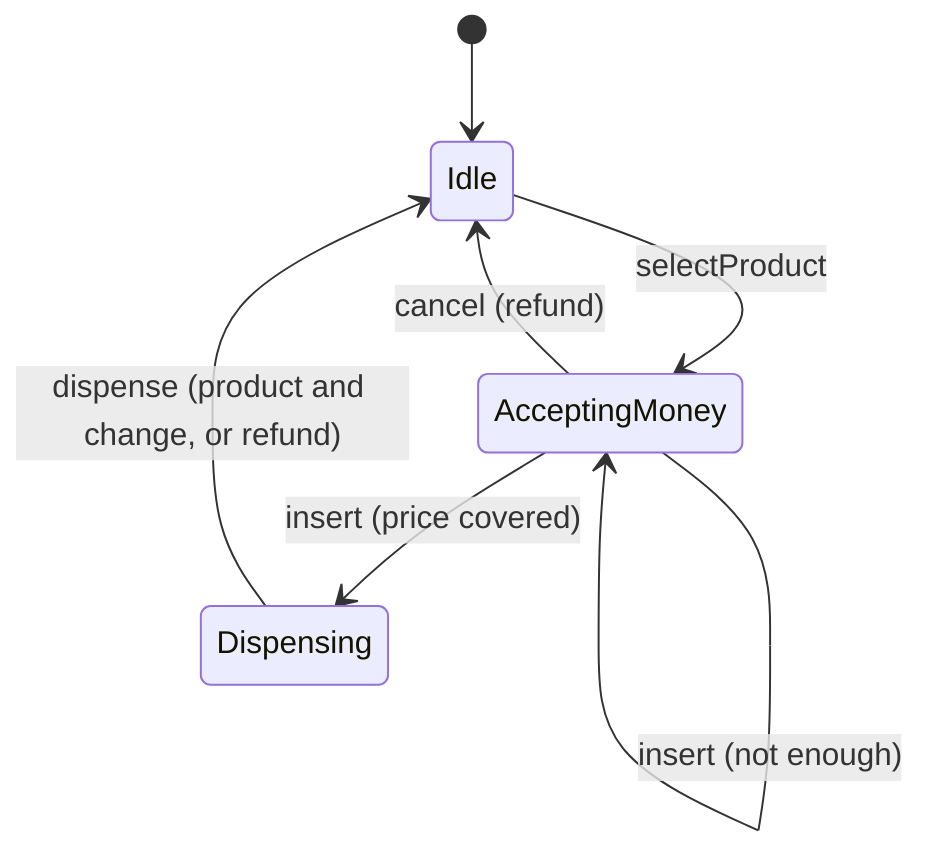
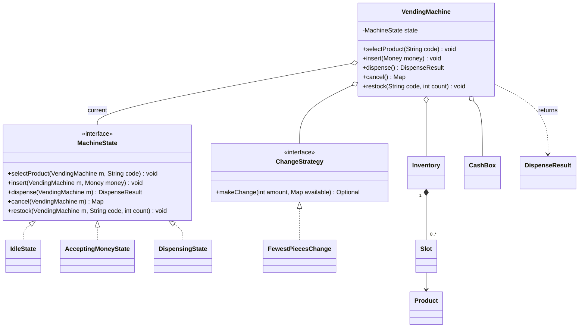

# 3. Vending Machine

**Difficulty:** Basic | **Time:** 30 minutes

## 1. Problem statement

Design a vending machine that sells products from coded slots and accepts cash.

- Each slot has a code, a product, a price in whole rupees and a quantity.
- The customer selects a product, then inserts coins or notes one at a time.
- Accepted values are 1, 2, 5, 10, 20, 50 and 100 rupees.
- Once the inserted amount covers the price, the machine dispenses the product and returns change.
- The customer can cancel before dispensing starts and gets a full refund.
- If exact change cannot be made, no product is sold and the money is returned.
- Sold-out products cannot be selected.
- An operator can restock a slot when the machine is idle.

**Out of scope:** card or UPI payments, hardware drivers, multiple items per purchase and sales reports.

## 2. What the interviewer wants to evaluate

| Area | What a strong answer shows |
|---|---|
| Requirement clarification | Asks about payment order, cancellation, change and sold-out slots |
| State modelling | Identifies the states and which actions are legal in each |
| Object modelling | Separates inventory, cash, change calculation and the machine |
| Invalid transitions | Rejects actions such as inserting money before selecting |
| Money handling | Uses integers and never loses or creates money |
| Algorithm choice | Knows that greedy change can fail when coin counts are limited |
| Extensibility | Adds a state or a change method without large `if` chains |
| Failure handling | Refunds safely when change is unavailable |

## 3. Design patterns and principles used

### Design patterns

| Pattern | Where | Why |
|---|---|---|
| State | `MachineState` and its three implementations | Each action behaves differently depending on the current state |
| Strategy | `ChangeStrategy` | The change algorithm can be replaced |

A Singleton is not needed. A building can have many vending machines. A Factory for products adds nothing because a product is only a name and a price.

### Design principles

| Principle | How it applies |
|---|---|
| Single Responsibility | `Inventory` tracks stock, `CashBox` tracks cash, states control the flow |
| Open/Closed | A new state or change method is a new class. Existing states change only if they lead to it |
| Liskov Substitution | The machine treats every state through the same interface |
| Dependency Inversion | The machine depends on the `ChangeStrategy` interface |
| Encapsulation | Stock and cash change only through their own methods |
| Fail fast | Illegal actions throw immediately with a clear message |

## 4. Solution

### 4.1 Core entities

| Entity | Responsibility |
|---|---|
| `Money` | Accepted coin and note values |
| `Product` | Name and price |
| `Inventory` | Slots and quantities |
| `CashBox` | Cash held by the machine |
| `ChangeStrategy` | Picks the coins and notes to return |
| `MachineState` | Allowed actions in one state |
| `VendingMachine` | Entry point that delegates to the current state |

### 4.2 State diagram



### 4.3 Class diagram



### 4.4 Java code (Java 17+)

#### Money, product and result

```java
public enum Money {
    ONE(1), TWO(2), FIVE(5), TEN(10), TWENTY(20), FIFTY(50), HUNDRED(100);

    private final int value;

    Money(int value) {
        this.value = value;
    }

    public int value() {
        return value;
    }

    public static int total(java.util.Map<Money, Integer> money) {
        return money.entrySet().stream()
                .mapToInt(e -> e.getKey().value() * e.getValue())
                .sum();
    }
}
```

```java
public record Product(String name, int price) {
    public Product {
        if (price <= 0) {
            throw new IllegalArgumentException("Price must be positive");
        }
    }
}
```

```java
import java.util.Map;
import java.util.Optional;

/** product is empty when the sale failed and the money was refunded. */
public record DispenseResult(Optional<Product> product, Map<Money, Integer> returned) { }
```

#### Inventory

```java
public class Slot {
    private final Product product;
    private int quantity;

    public Slot(Product product, int quantity) {
        this.product = product;
        add(quantity);
    }

    public Product product() {
        return product;
    }

    public int quantity() {
        return quantity;
    }

    void add(int count) {
        if (count < 0) {
            throw new IllegalArgumentException("Count cannot be negative");
        }
        quantity += count;
    }

    void removeOne() {
        if (quantity == 0) {
            throw new IllegalStateException("Sold out: " + product.name());
        }
        quantity--;
    }
}
```

```java
import java.util.HashMap;
import java.util.Map;

public class Inventory {
    private final Map<String, Slot> slots = new HashMap<>();

    public void addSlot(String code, Product product, int quantity) {
        if (slots.putIfAbsent(code, new Slot(product, quantity)) != null) {
            throw new IllegalArgumentException("Slot exists: " + code);
        }
    }

    public Slot slot(String code) {
        Slot slot = slots.get(code);
        if (slot == null) {
            throw new IllegalArgumentException("Unknown code: " + code);
        }
        return slot;
    }
}
```

#### Cash and change

```java
import java.util.EnumMap;
import java.util.Map;

public class CashBox {
    private final Map<Money, Integer> money = new EnumMap<>(Money.class);

    public void add(Map<Money, Integer> added) {
        added.forEach((m, count) -> money.merge(m, count, Integer::sum));
    }

    public void remove(Map<Money, Integer> removed) {
        removed.forEach((m, count) -> {
            if (money.getOrDefault(m, 0) < count) {
                throw new IllegalStateException("Not enough " + m);
            }
        });
        removed.forEach((m, count) -> money.merge(m, -count, Integer::sum));
    }

    public Map<Money, Integer> snapshot() {
        Map<Money, Integer> copy = new EnumMap<>(Money.class);
        copy.putAll(money);
        return copy;
    }
}
```

```java
import java.util.Map;
import java.util.Optional;

public interface ChangeStrategy {
    Optional<Map<Money, Integer>> makeChange(int amount, Map<Money, Integer> available);
}
```

Greedy fails here. To return 60 from one 50 and three 20s, greedy takes the 50 and gets stuck. Dynamic programming finds the three 20s.

```java
import java.util.ArrayList;
import java.util.Collections;
import java.util.EnumMap;
import java.util.List;
import java.util.Map;
import java.util.Optional;

public class FewestPiecesChange implements ChangeStrategy {
    @Override
    public Optional<Map<Money, Integer>> makeChange(int amount, Map<Money, Integer> available) {
        // best.get(a) = fewest pieces that add up to a, or null if impossible
        List<List<Money>> best = new ArrayList<>(Collections.nCopies(amount + 1, null));
        best.set(0, List.of());

        available.forEach((money, count) -> {
            for (int used = 0; used < count; used++) {
                // go downwards so each physical piece is used at most once
                for (int a = amount; a >= money.value(); a--) {
                    List<Money> previous = best.get(a - money.value());
                    if (previous != null
                            && (best.get(a) == null || best.get(a).size() > previous.size() + 1)) {
                        List<Money> next = new ArrayList<>(previous);
                        next.add(money);
                        best.set(a, next);
                    }
                }
            }
        });

        if (best.get(amount) == null) {
            return Optional.empty();
        }
        Map<Money, Integer> change = new EnumMap<>(Money.class);
        best.get(amount).forEach(m -> change.merge(m, 1, Integer::sum));
        return Optional.of(change);
    }
}
```

#### States

Every action is rejected by default. Each state overrides only what it allows.

```java
import java.util.Map;

public interface MachineState {
    default void selectProduct(VendingMachine machine, String code) {
        throw notAllowed("select");
    }

    default void insert(VendingMachine machine, Money money) {
        throw notAllowed("insert money");
    }

    default DispenseResult dispense(VendingMachine machine) {
        throw notAllowed("dispense");
    }

    default Map<Money, Integer> cancel(VendingMachine machine) {
        throw notAllowed("cancel");
    }

    default void restock(VendingMachine machine, String code, int count) {
        throw notAllowed("restock");
    }

    private IllegalStateException notAllowed(String action) {
        return new IllegalStateException(
                "Cannot " + action + " in " + getClass().getSimpleName());
    }
}
```

```java
public class IdleState implements MachineState {
    @Override
    public void selectProduct(VendingMachine machine, String code) {
        if (machine.inventory().slot(code).quantity() == 0) {
            throw new IllegalStateException("Sold out: " + code);
        }
        machine.startSale(code);
        machine.setState(new AcceptingMoneyState());
    }

    @Override
    public void restock(VendingMachine machine, String code, int count) {
        machine.inventory().slot(code).add(count);
    }
}
```

```java
import java.util.Map;

public class AcceptingMoneyState implements MachineState {
    @Override
    public void insert(VendingMachine machine, Money money) {
        machine.accept(money);
        if (machine.insertedTotal() >= machine.selectedSlot().product().price()) {
            machine.setState(new DispensingState());
        }
    }

    @Override
    public Map<Money, Integer> cancel(VendingMachine machine) {
        Map<Money, Integer> refund = machine.inserted();
        machine.reset();
        return refund;
    }
}
```

```java
public class DispensingState implements MachineState {
    @Override
    public DispenseResult dispense(VendingMachine machine) {
        DispenseResult result = machine.completeSale();
        machine.reset();
        return result;
    }
}
```

#### Vending machine

```java
import java.util.EnumMap;
import java.util.Map;
import java.util.Optional;

public class VendingMachine {
    private final Inventory inventory;
    private final CashBox cashBox;
    private final ChangeStrategy changeStrategy;
    private final Map<Money, Integer> inserted = new EnumMap<>(Money.class);
    private MachineState state = new IdleState();
    private String selectedCode;

    public VendingMachine(Inventory inventory, CashBox cashBox, ChangeStrategy changeStrategy) {
        this.inventory = inventory;
        this.cashBox = cashBox;
        this.changeStrategy = changeStrategy;
    }

    // Public actions: synchronized so button and cash events cannot interleave
    public synchronized void selectProduct(String code) {
        state.selectProduct(this, code);
    }

    public synchronized void insert(Money money) {
        state.insert(this, money);
    }

    public synchronized DispenseResult dispense() {
        return state.dispense(this);
    }

    public synchronized Map<Money, Integer> cancel() {
        return state.cancel(this);
    }

    public synchronized void restock(String code, int count) {
        state.restock(this, code, count);
    }

    // Package-private operations used by the states
    Inventory inventory() {
        return inventory;
    }

    void setState(MachineState next) {
        state = next;
    }

    void startSale(String code) {
        selectedCode = code;
    }

    Slot selectedSlot() {
        return inventory.slot(selectedCode);
    }

    void accept(Money money) {
        inserted.merge(money, 1, Integer::sum);
    }

    int insertedTotal() {
        return Money.total(inserted);
    }

    Map<Money, Integer> inserted() {
        Map<Money, Integer> copy = new EnumMap<>(Money.class);
        copy.putAll(inserted);
        return copy;
    }

    DispenseResult completeSale() {
        Slot slot = selectedSlot();
        int due = insertedTotal() - slot.product().price();

        Map<Money, Integer> available = cashBox.snapshot();
        inserted.forEach((m, count) -> available.merge(m, count, Integer::sum));

        Optional<Map<Money, Integer>> change = changeStrategy.makeChange(due, available);
        if (change.isEmpty()) {
            return new DispenseResult(Optional.empty(), inserted());
        }
        slot.removeOne();
        cashBox.add(inserted);
        cashBox.remove(change.get());
        return new DispenseResult(Optional.of(slot.product()), change.get());
    }

    void reset() {
        inserted.clear();
        selectedCode = null;
        state = new IdleState();
    }
}
```

#### Demo

```java
import java.util.Map;

public class VendingMachineDemo {
    public static void main(String[] args) {
        Inventory inventory = new Inventory();
        inventory.addSlot("A1", new Product("Chips", 40), 5);

        CashBox cashBox = new CashBox();
        cashBox.add(Map.of(Money.FIFTY, 1, Money.TWENTY, 3));

        VendingMachine machine = new VendingMachine(inventory, cashBox, new FewestPiecesChange());
        machine.selectProduct("A1");
        machine.insert(Money.HUNDRED);
        DispenseResult result = machine.dispense();

        System.out.println(result.product().map(Product::name).orElse("Refunded")
                + ", returned " + result.returned());
    }
}
```

### 4.5 Complexity

Let A be the change amount and C the number of coins and notes available.

| Operation | Time |
|---|---|
| Select, insert, cancel | O(1) for a fixed set of money values |
| Make change | O(C × A) updates, each copying a list of at most A items |

For real cash boxes, cap each count at `A / value` before running the algorithm.

## 5. Follow-up questions

| Question | Answer outline |
|---|---|
| What happens if the machine cannot return exact change? | The sale fails and the inserted money is returned. A better machine also checks early and shows "exact change only" |
| What if the product gets stuck while dispensing? | Wait for a sensor confirmation before committing cash and stock. Refund on failure |
| How would you add UPI or card payments? | Introduce a payment strategy so that states do not depend on cash |
| How would you add a maintenance mode? | Add a state that allows restock and cash collection only |
| What if power fails mid-sale? | Persist the sale state and inserted amount, then resume or refund on restart |
