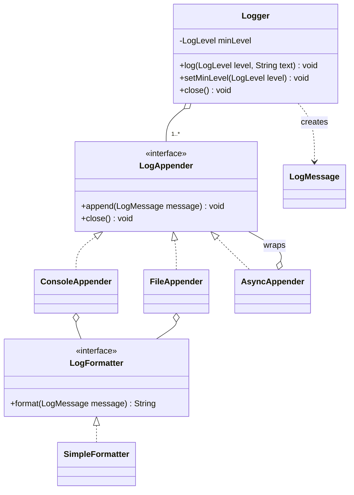
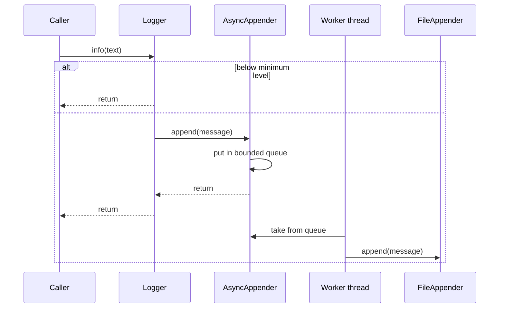

# 4. Logging Framework

**Difficulty:** Basic | **Time:** 30 minutes

## 1. Problem statement

Design a logging library that applications use to record messages.

- Levels in increasing severity: `DEBUG`, `INFO`, `WARN`, `ERROR`, `FATAL`.
- A logger has a minimum level and ignores messages below it.
- The minimum level can change at runtime.
- One message can go to several destinations, such as the console and a file.
- Each destination can use its own message format.
- Many threads can log at the same time without mixing up lines.
- Slow destinations can be written to asynchronously.
- A failing destination must not crash the application or block the others permanently.
- Closing the logger writes all queued messages.

**Out of scope:** configuration files, log rotation, network destinations and logger hierarchies.

## 2. What the interviewer wants to evaluate

| Area | What a strong answer shows |
|---|---|
| Requirement clarification | Asks about levels, destinations, format, threading and message loss |
| API design | A small and easy interface for callers |
| Separation of concerns | Filtering, formatting and writing are separate |
| Extensibility | Adds a destination or format without editing `Logger` |
| Thread safety | Prevents interleaved output |
| Asynchronous design | Uses a bounded queue and explains what happens when it is full |
| Resource handling | Flushes and closes files and threads |
| Pattern judgement | Explains the trade-offs of Singleton and Chain of Responsibility |

## 3. Design patterns and principles used

### Design patterns

| Pattern | Where | Why |
|---|---|---|
| Strategy | `LogFormatter` | The output format is interchangeable |
| Strategy | `LogAppender` | The destination is interchangeable |
| Decorator | `AsyncAppender` | Adds asynchronous writing to any appender |
| Producer-consumer | `AsyncAppender` queue and worker | Callers are separated from slow writes |

Producer-consumer is a concurrency pattern.

**Chain of Responsibility** is often suggested, with one handler per level. It is not needed here, because a level comparison does the filtering and every appender receives the message.

**Singleton** gives easy global access, but hides dependencies and makes tests share state. This design creates the logger once at startup and passes it to the classes that need it.

### Design principles

| Principle | How it applies |
|---|---|
| Single Responsibility | `Logger` filters, formatters format, appenders write |
| Open/Closed | New destinations and formats are new classes |
| Liskov Substitution | An `AsyncAppender` can be used wherever a `LogAppender` is expected |
| Dependency Inversion | `Logger` depends only on the `LogAppender` interface |
| Composition over inheritance | Async behaviour wraps an appender instead of subclassing each one |

## 4. Solution

### 4.1 Core entities

| Entity | Responsibility |
|---|---|
| `LogLevel` | Severity order |
| `LogMessage` | Immutable record of one event |
| `LogFormatter` | Turns a message into text |
| `LogAppender` | Writes a message to one destination |
| `Logger` | Filters by level and sends to all appenders |

### 4.2 Class diagram



### 4.3 Flow of an asynchronous log call



### 4.4 Java code (Java 17+)

#### Level and message

```java
public enum LogLevel { DEBUG, INFO, WARN, ERROR, FATAL }
```

```java
import java.time.Instant;

public record LogMessage(Instant timestamp, LogLevel level, String thread, String text) { }
```

#### Formatters

```java
public interface LogFormatter {
    String format(LogMessage message);
}
```

```java
public class SimpleFormatter implements LogFormatter {
    @Override
    public String format(LogMessage m) {
        return m.timestamp() + " " + m.level() + " [" + m.thread() + "] " + m.text();
    }
}
```

#### Appenders

```java
public interface LogAppender extends AutoCloseable {
    void append(LogMessage message);

    @Override
    default void close() { }
}
```

```java
public class ConsoleAppender implements LogAppender {
    private final LogFormatter formatter;

    public ConsoleAppender(LogFormatter formatter) {
        this.formatter = formatter;
    }

    @Override
    public synchronized void append(LogMessage message) {
        System.out.println(formatter.format(message));
    }
}
```

```java
import java.io.BufferedWriter;
import java.io.IOException;
import java.io.UncheckedIOException;
import java.nio.file.Files;
import java.nio.file.Path;
import java.nio.file.StandardOpenOption;

public class FileAppender implements LogAppender {
    private final LogFormatter formatter;
    private final BufferedWriter writer;

    public FileAppender(Path path, LogFormatter formatter) {
        this.formatter = formatter;
        try {
            writer = Files.newBufferedWriter(path,
                    StandardOpenOption.CREATE, StandardOpenOption.APPEND);
        } catch (IOException e) {
            throw new UncheckedIOException(e);
        }
    }

    @Override
    public synchronized void append(LogMessage message) {
        try {
            writer.write(formatter.format(message));
            writer.newLine();
            writer.flush(); // safer, but slower than batching
        } catch (IOException e) {
            throw new UncheckedIOException(e);
        }
    }

    @Override
    public synchronized void close() {
        try {
            writer.close();
        } catch (IOException e) {
            throw new UncheckedIOException(e);
        }
    }
}
```

#### Asynchronous decorator

The queue is bounded, so memory cannot grow without limit. When it is full, callers wait and no message is dropped. An empty `Optional` tells the worker to stop.

```java
import java.util.Optional;
import java.util.concurrent.ArrayBlockingQueue;
import java.util.concurrent.BlockingQueue;

public class AsyncAppender implements LogAppender {
    private final LogAppender delegate;
    private final BlockingQueue<Optional<LogMessage>> queue;
    private final Thread worker;
    private boolean closed;

    public AsyncAppender(LogAppender delegate, int capacity) {
        this.delegate = delegate;
        this.queue = new ArrayBlockingQueue<>(capacity);
        this.worker = new Thread(this::drain, "log-writer");
        worker.start();
    }

    @Override
    public synchronized void append(LogMessage message) {
        if (closed) {
            throw new IllegalStateException("Appender is closed");
        }
        enqueue(Optional.of(message));
    }

    @Override
    public synchronized void close() {
        if (closed) {
            return;
        }
        closed = true;
        enqueue(Optional.empty()); // queued after all accepted messages
        try {
            worker.join();
        } catch (InterruptedException e) {
            Thread.currentThread().interrupt();
            return;
        }
        delegate.close();
    }

    private void enqueue(Optional<LogMessage> item) {
        boolean interrupted = false;
        while (true) {
            try {
                queue.put(item);
                break;
            } catch (InterruptedException e) {
                interrupted = true; // retry, then restore the flag
            }
        }
        if (interrupted) {
            Thread.currentThread().interrupt();
        }
    }

    private void drain() {
        try {
            for (Optional<LogMessage> next = queue.take(); next.isPresent(); next = queue.take()) {
                try {
                    delegate.append(next.get());
                } catch (RuntimeException e) {
                    System.err.println("Log write failed: " + e.getMessage());
                }
            }
        } catch (InterruptedException e) {
            Thread.currentThread().interrupt();
        }
    }
}
```

#### Logger

```java
import java.time.Instant;
import java.util.List;

public class Logger implements AutoCloseable {
    private final List<LogAppender> appenders;
    private volatile LogLevel minLevel;

    public Logger(LogLevel minLevel, List<LogAppender> appenders) {
        this.minLevel = minLevel;
        this.appenders = List.copyOf(appenders);
    }

    public void setMinLevel(LogLevel level) {
        minLevel = level;
    }

    public void log(LogLevel level, String text) {
        if (level.compareTo(minLevel) < 0) {
            return;
        }
        // capture time and thread on the caller's side
        LogMessage message = new LogMessage(
                Instant.now(), level, Thread.currentThread().getName(), text);
        for (LogAppender appender : appenders) {
            try {
                appender.append(message);
            } catch (RuntimeException e) {
                System.err.println("Appender failed: " + e.getMessage());
            }
        }
    }

    public void debug(String text) { log(LogLevel.DEBUG, text); }
    public void info(String text)  { log(LogLevel.INFO, text); }
    public void warn(String text)  { log(LogLevel.WARN, text); }
    public void error(String text) { log(LogLevel.ERROR, text); }
    public void fatal(String text) { log(LogLevel.FATAL, text); }

    @Override
    public void close() {
        for (LogAppender appender : appenders) {
            try {
                appender.close();
            } catch (RuntimeException e) {
                System.err.println("Close failed: " + e.getMessage());
            }
        }
    }
}
```

#### Demo

```java
import java.nio.file.Path;
import java.util.List;

public class LoggingDemo {
    public static void main(String[] args) {
        LogFormatter formatter = new SimpleFormatter();
        try (Logger logger = new Logger(LogLevel.INFO, List.of(
                new ConsoleAppender(formatter),
                new AsyncAppender(new FileAppender(Path.of("app.log"), formatter), 1000)))) {
            logger.debug("Not shown");
            logger.info("Application started");
            logger.error("Something failed");
        }
    }
}
```

### 4.5 Complexity

Let K be the number of appenders.

| Operation | Time |
|---|---|
| Filtered-out message | O(1) |
| Logged message | O(K), plus the cost of each write |
| Async append | O(1) while the queue has space |

## 5. Follow-up questions

| Question | Answer outline |
|---|---|
| How would you log asynchronously from many threads? | Use `AsyncAppender`: threads produce into a bounded queue and one worker writes |
| What if the queue fills up? | Choose between blocking, dropping low levels or dropping with a counter. State the trade-off |
| Are messages lost in a crash? | Queued messages can be. Write `FATAL` synchronously if it must survive |
| How would you rotate log files? | A `RollingFileAppender` that opens a new file by size or date |
| How would you set a level per appender? | Add a filtering decorator around an appender |
| What about expensive messages that get filtered out? | Accept a `Supplier<String>` and call it only when the level is enabled |
