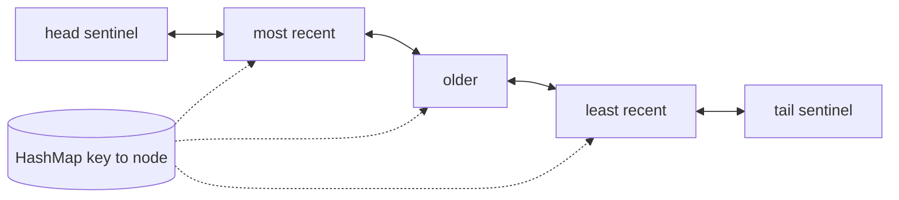
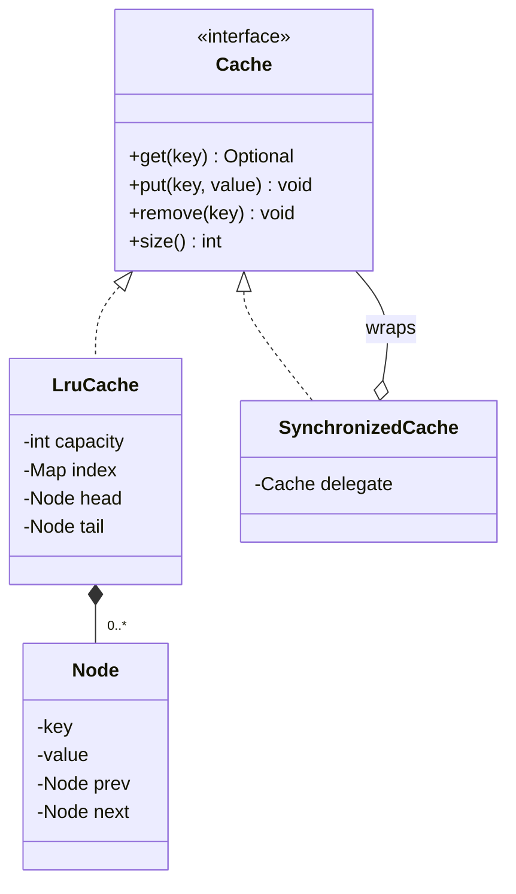
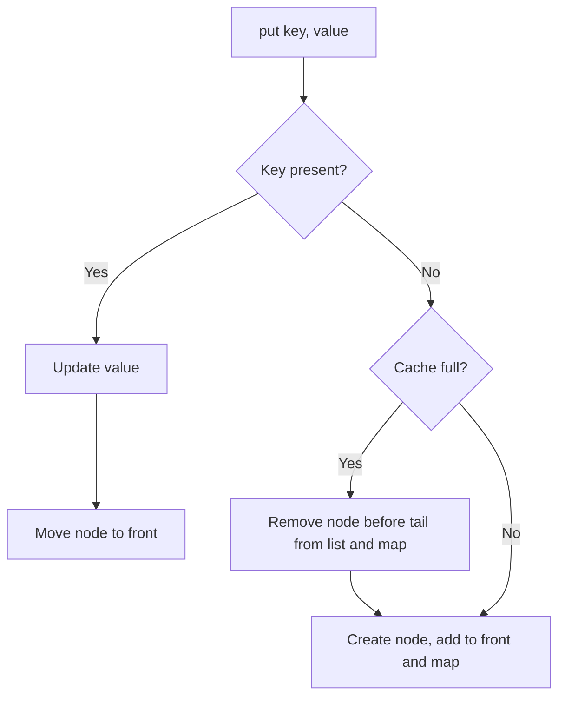

# 5. LRU Cache

**Difficulty:** Basic | **Time:** 30 minutes

## 1. Problem statement

Design an in-memory cache with a fixed capacity that evicts the least recently used (LRU) entry.

- `get(key)` returns the value if the key is present.
- `put(key, value)` inserts a new entry or updates an existing one.
- `remove(key)` deletes an entry.
- Both a successful `get` and any `put` make that key the most recently used.
- Inserting a new key into a full cache first evicts the least recently used key.
- `get`, `put` and `remove` run in O(1) average time.
- Keys and values can be of any type. `null` is not allowed.
- A thread-safe version must be available.

**Out of scope:** expiry times, persistence and distribution across servers.

## 2. What the interviewer wants to evaluate

| Area | What a strong answer shows |
|---|---|
| Requirement clarification | Asks whether `get` and updates count as use, and about thread safety |
| Data structure choice | Combines a hash map with a doubly linked list, and explains why |
| Implementation accuracy | Updates pointers correctly for the head, tail and single-entry cases |
| Complexity analysis | Justifies O(1) for every operation |
| API design | Uses generics and a clear interface |
| Edge cases | Handles capacity 1, updates in a full cache and missing keys |
| Concurrency | Sees that `get` also modifies the list |
| Extensibility | Explains how to support other eviction policies |

## 3. Design patterns and principles used

### Design patterns

| Pattern | Where | Why |
|---|---|---|
| Decorator | `SynchronizedCache` | Adds thread safety without changing `LruCache` |

The core of this problem is the data structure. A **sentinel node** at each end of the list removes the special cases for an empty list, the head and the tail.

**Strategy** for eviction is a good follow-up. Adding it before a second policy exists makes the code longer for no benefit.

### Design principles

| Principle | How it applies |
|---|---|
| Single Responsibility | `LruCache` handles eviction, `SynchronizedCache` handles locking |
| Open/Closed | Thread safety is added by wrapping, not editing |
| Liskov Substitution | Both classes can be used as a `Cache` |
| Dependency Inversion | The wrapper depends on the `Cache` interface |
| Encapsulation | Nodes and pointers are private |
| YAGNI | No eviction framework until it is needed |

## 4. Solution

### 4.1 Why two data structures

| Structure | Gives | Lacks |
|---|---|---|
| Hash map | O(1) lookup by key | Usage order |
| Doubly linked list | O(1) removal and insertion for a known node | Fast lookup |

The map stores each key's list node. The most recently used node sits next to `head`, and the least recently used sits next to `tail`.



### 4.2 Class diagram



### 4.3 Flow of a put



### 4.4 Java code (Java 17+)

#### Interface

```java
import java.util.Optional;

public interface Cache<K, V> {
    Optional<V> get(K key);
    void put(K key, V value);
    void remove(K key);
    int size();
}
```

#### LRU cache

```java
import java.util.HashMap;
import java.util.Map;
import java.util.Objects;
import java.util.Optional;

public class LruCache<K, V> implements Cache<K, V> {
    private static final class Node<K, V> {
        private final K key;
        private V value;
        private Node<K, V> prev;
        private Node<K, V> next;

        private Node(K key, V value) {
            this.key = key;
            this.value = value;
        }
    }

    private final int capacity;
    private final Map<K, Node<K, V>> index = new HashMap<>();
    private final Node<K, V> head = new Node<>(null, null);
    private final Node<K, V> tail = new Node<>(null, null);

    public LruCache(int capacity) {
        if (capacity < 1) {
            throw new IllegalArgumentException("Capacity must be at least 1");
        }
        this.capacity = capacity;
        head.next = tail;
        tail.prev = head;
    }

    @Override
    public Optional<V> get(K key) {
        Node<K, V> node = index.get(Objects.requireNonNull(key));
        if (node == null) {
            return Optional.empty();
        }
        moveToFront(node);
        return Optional.of(node.value);
    }

    @Override
    public void put(K key, V value) {
        Objects.requireNonNull(key);
        Objects.requireNonNull(value);
        Node<K, V> node = index.get(key);
        if (node != null) {
            node.value = value;
            moveToFront(node);
            return;
        }
        if (index.size() == capacity) {
            Node<K, V> oldest = tail.prev;
            unlink(oldest);
            index.remove(oldest.key); // this is why a node stores its key
        }
        node = new Node<>(key, value);
        addToFront(node);
        index.put(key, node);
    }

    @Override
    public void remove(K key) {
        Node<K, V> node = index.remove(Objects.requireNonNull(key));
        if (node != null) {
            unlink(node);
        }
    }

    @Override
    public int size() {
        return index.size();
    }

    private void moveToFront(Node<K, V> node) {
        unlink(node);
        addToFront(node);
    }

    private void unlink(Node<K, V> node) {
        node.prev.next = node.next;
        node.next.prev = node.prev;
    }

    private void addToFront(Node<K, V> node) {
        node.prev = head;
        node.next = head.next;
        head.next.prev = node;
        head.next = node;
    }
}
```

#### Thread-safe wrapper

A read-write lock does not help with this design, because `get` reorders the list and is therefore a write.

```java
import java.util.Optional;

public class SynchronizedCache<K, V> implements Cache<K, V> {
    private final Cache<K, V> delegate;

    public SynchronizedCache(Cache<K, V> delegate) {
        this.delegate = delegate;
    }

    @Override
    public synchronized Optional<V> get(K key) {
        return delegate.get(key);
    }

    @Override
    public synchronized void put(K key, V value) {
        delegate.put(key, value);
    }

    @Override
    public synchronized void remove(K key) {
        delegate.remove(key);
    }

    @Override
    public synchronized int size() {
        return delegate.size();
    }
}
```

#### Demo

```java
public class LruCacheDemo {
    public static void main(String[] args) {
        Cache<Integer, String> cache = new SynchronizedCache<>(new LruCache<>(2));
        cache.put(1, "one");
        cache.put(2, "two");
        cache.get(1);          // 1 is now the most recent
        cache.put(3, "three"); // evicts 2
        System.out.println(cache.get(2)); // Optional.empty
        System.out.println(cache.get(1)); // Optional[one]
    }
}
```

> Java's `LinkedHashMap` in access order, with `removeEldestEntry` overridden, gives an LRU cache in a few lines. Mention it, then build your own, since that is usually what is being tested.

### 4.5 Complexity

| Operation | Time |
|---|---|
| `get` | O(1) average |
| `put` | O(1) average |
| `remove` | O(1) average |

Space is O(capacity).

## 5. Follow-up questions

| Question | Answer outline |
|---|---|
| How would you make it thread-safe with less contention? | Split keys into segments, each with its own lock and LRU list. Ordering becomes per segment |
| How would you support other eviction policies? | Extract an `EvictionPolicy` strategy with methods for access, removal and choosing a victim |
| How would you design an LFU cache? | Map each frequency to a linked list and track the minimum frequency |
| How would you add expiry times? | Store an expiry time per node, check it on `get` and clean up periodically |
| How would you distribute the cache? | Partition keys with consistent hashing. Each server runs its own LRU |
