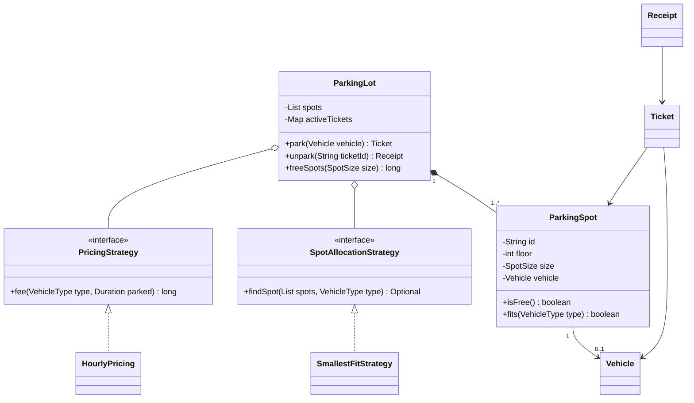
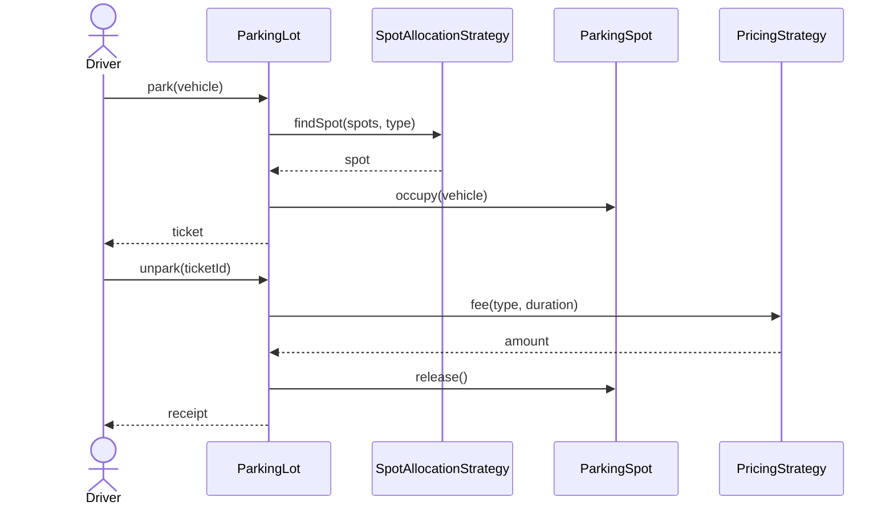

# 6. Parking Lot

**Difficulty:** Easy | **Time:** 45 minutes

## 1. Problem statement

Design a parking lot system for a building with several floors.

- Vehicles are motorcycles, cars and trucks.
- Spots are small, medium and large.
- A motorcycle fits any spot, a car fits medium or large, and a truck fits large only.
- On entry, the system assigns the smallest free spot that fits, preferring lower floors, and issues a ticket.
- On exit, the system calculates the fee, frees the spot and returns a receipt.
- The fee is charged per started hour, with a minimum of one hour. Rates differ by vehicle type.
- The lot has several entry and exit gates working at the same time.
- A vehicle cannot be parked twice, and a ticket cannot be used twice.
- The system reports the number of free spots of each size.

**Out of scope:** payment processing, reservations, lost tickets and gate hardware.

## 2. What the interviewer wants to evaluate

| Area | What a strong answer shows |
|---|---|
| Requirement clarification | Asks about vehicle types, spot rules, pricing and gates |
| Object modelling | Separates vehicle, spot, ticket, pricing and the lot |
| Class relationships | Explains what the lot owns and what it only references |
| Extensibility | Changes allocation or pricing without editing `ParkingLot` |
| Concurrency | Prevents two gates from taking the same spot |
| Time handling | Rounds hours correctly and makes time testable |
| Edge cases | Handles a full lot, duplicate vehicles and unknown tickets |
| Prioritisation | Builds park and unpark first, then discusses extras |

## 3. Design patterns and principles used

### Design patterns

| Pattern | Where | Why |
|---|---|---|
| Strategy | `SpotAllocationStrategy` | Spot selection rules can change |
| Strategy | `PricingStrategy` | Pricing can differ by lot, time or season |

An enum describes vehicle types, so no `Car` or `Truck` subclasses and no Factory are needed while the types differ only in data. A Singleton `ParkingLot` is often suggested, but it blocks multiple lots and makes testing harder.

### Design principles

| Principle | How it applies |
|---|---|
| Single Responsibility | Allocation, pricing and parking records live in separate classes |
| Open/Closed | New rules are new strategy classes |
| Liskov Substitution | Any strategy works wherever its interface is expected |
| Dependency Inversion | `ParkingLot` depends on strategy interfaces and an injected `Clock` |
| Composition over inheritance | The lot is assembled from spots and strategies |
| Encapsulation | Only code in the same package can occupy or release a spot |

## 4. Solution

### 4.1 Core entities

| Entity | Responsibility |
|---|---|
| `Vehicle` | Number plate and type |
| `ParkingSpot` | Floor, size and current vehicle |
| `Ticket` | Entry record |
| `Receipt` | Exit record and fee |
| `ParkingLot` | Entry, exit and active tickets |

### 4.2 Class diagram



### 4.3 Flow of entry and exit



The diagram shows the successful path. A full lot or an unknown ticket throws an exception.

### 4.4 Java code (Java 17+)

#### Types and vehicle

```java
/** Declared from smallest to largest. */
public enum SpotSize { SMALL, MEDIUM, LARGE }
```

```java
public enum VehicleType {
    MOTORCYCLE(SpotSize.SMALL),
    CAR(SpotSize.MEDIUM),
    TRUCK(SpotSize.LARGE);

    private final SpotSize minimumSize;

    VehicleType(SpotSize minimumSize) {
        this.minimumSize = minimumSize;
    }

    public SpotSize minimumSize() {
        return minimumSize;
    }
}
```

```java
public record Vehicle(String plate, VehicleType type) { }
```

#### Parking spot

```java
public class ParkingSpot {
    private final String id;
    private final int floor;
    private final SpotSize size;
    private Vehicle vehicle;

    public ParkingSpot(String id, int floor, SpotSize size) {
        this.id = id;
        this.floor = floor;
        this.size = size;
    }

    public String id() { return id; }
    public int floor() { return floor; }
    public SpotSize size() { return size; }

    public boolean isFree() {
        return vehicle == null;
    }

    public boolean fits(VehicleType type) {
        return size.compareTo(type.minimumSize()) >= 0;
    }

    void occupy(Vehicle incoming) {
        if (!isFree() || !fits(incoming.type())) {
            throw new IllegalStateException("Cannot use spot " + id);
        }
        vehicle = incoming;
    }

    void release() {
        vehicle = null;
    }
}
```

#### Ticket and receipt

```java
import java.time.Instant;

public record Ticket(String id, Vehicle vehicle, ParkingSpot spot, Instant entryTime) { }
```

```java
import java.time.Instant;

public record Receipt(Ticket ticket, Instant exitTime, long feeInRupees) { }
```

#### Allocation strategy

```java
import java.util.List;
import java.util.Optional;

public interface SpotAllocationStrategy {
    Optional<ParkingSpot> findSpot(List<ParkingSpot> spots, VehicleType type);
}
```

```java
import java.util.Comparator;
import java.util.List;
import java.util.Optional;

public class SmallestFitStrategy implements SpotAllocationStrategy {
    @Override
    public Optional<ParkingSpot> findSpot(List<ParkingSpot> spots, VehicleType type) {
        return spots.stream()
                .filter(spot -> spot.isFree() && spot.fits(type))
                .min(Comparator.comparing(ParkingSpot::size)
                        .thenComparingInt(ParkingSpot::floor)
                        .thenComparing(ParkingSpot::id));
    }
}
```

#### Pricing strategy

```java
import java.time.Duration;

public interface PricingStrategy {
    long fee(VehicleType type, Duration parked);
}
```

```java
import java.time.Duration;
import java.util.EnumMap;
import java.util.Map;

public class HourlyPricing implements PricingStrategy {
    private static final long HOUR_MILLIS = Duration.ofHours(1).toMillis();
    private final Map<VehicleType, Long> rates;

    public HourlyPricing(Map<VehicleType, Long> ratesInRupees) {
        if (ratesInRupees.size() != VehicleType.values().length) {
            throw new IllegalArgumentException("Every vehicle type needs a rate");
        }
        this.rates = new EnumMap<>(ratesInRupees);
    }

    @Override
    public long fee(VehicleType type, Duration parked) {
        long startedHours = (parked.toMillis() + HOUR_MILLIS - 1) / HOUR_MILLIS;
        return Math.max(1, startedHours) * rates.get(type);
    }
}
```

#### Parking lot

`park` and `unpark` are synchronized, so finding and occupying a spot happen as one step.

```java
import java.time.Clock;
import java.time.Duration;
import java.time.Instant;
import java.util.HashMap;
import java.util.HashSet;
import java.util.List;
import java.util.Map;
import java.util.Set;
import java.util.UUID;

public class ParkingLot {
    private final List<ParkingSpot> spots;
    private final SpotAllocationStrategy allocation;
    private final PricingStrategy pricing;
    private final Clock clock;
    private final Map<String, Ticket> activeTickets = new HashMap<>();
    private final Set<String> parkedPlates = new HashSet<>();

    public ParkingLot(List<ParkingSpot> spots, SpotAllocationStrategy allocation,
                      PricingStrategy pricing, Clock clock) {
        this.spots = List.copyOf(spots);
        this.allocation = allocation;
        this.pricing = pricing;
        this.clock = clock;
    }

    public synchronized Ticket park(Vehicle vehicle) {
        if (parkedPlates.contains(vehicle.plate())) {
            throw new IllegalStateException("Already parked: " + vehicle.plate());
        }
        ParkingSpot spot = allocation.findSpot(spots, vehicle.type())
                .orElseThrow(() -> new IllegalStateException("No spot for " + vehicle.type()));
        spot.occupy(vehicle);
        Ticket ticket = new Ticket(
                UUID.randomUUID().toString(), vehicle, spot, clock.instant());
        activeTickets.put(ticket.id(), ticket);
        parkedPlates.add(vehicle.plate());
        return ticket;
    }

    public synchronized Receipt unpark(String ticketId) {
        Ticket ticket = activeTickets.get(ticketId);
        if (ticket == null) {
            throw new IllegalArgumentException("Unknown or used ticket");
        }
        Instant exit = clock.instant();
        long fee = pricing.fee(ticket.vehicle().type(),
                Duration.between(ticket.entryTime(), exit));

        activeTickets.remove(ticketId);
        parkedPlates.remove(ticket.vehicle().plate());
        ticket.spot().release();
        return new Receipt(ticket, exit, fee);
    }

    public synchronized long freeSpots(SpotSize size) {
        return spots.stream().filter(s -> s.size() == size && s.isFree()).count();
    }
}
```

#### Demo

```java
import java.time.Clock;
import java.util.List;
import java.util.Map;

public class ParkingLotDemo {
    public static void main(String[] args) {
        ParkingLot lot = new ParkingLot(
                List.of(new ParkingSpot("G-S1", 0, SpotSize.SMALL),
                        new ParkingSpot("G-M1", 0, SpotSize.MEDIUM),
                        new ParkingSpot("F1-L1", 1, SpotSize.LARGE)),
                new SmallestFitStrategy(),
                new HourlyPricing(Map.of(VehicleType.MOTORCYCLE, 10L,
                        VehicleType.CAR, 40L, VehicleType.TRUCK, 100L)),
                Clock.systemUTC());

        Ticket ticket = lot.park(new Vehicle("KA01AB1234", VehicleType.CAR));
        System.out.println("Spot: " + ticket.spot().id());
        System.out.println("Fee: " + lot.unpark(ticket.id()).feeInRupees());
    }
}
```

### 4.5 Complexity

Let S be the number of spots.

| Operation | Time |
|---|---|
| `park` | O(S) |
| `unpark` | O(1) average |
| `freeSpots` | O(S) |

Space is O(S).

## 5. Follow-up questions

| Question | Answer outline |
|---|---|
| How do you stop two entry gates from assigning the same spot? | Here one lock covers finding and occupying. With several servers, claim the spot with an atomic database update |
| How would you find a spot faster? | Keep an ordered set of free spots per size, giving O(log S) |
| How would you add electric vehicle spots? | Add a spot feature and let the allocation strategy filter on it |
| How would you support weekend or daily pricing? | Pass entry and exit times to the pricing strategy and add new implementations |
| What if payment fails at exit? | Quote the fee first, and release the spot only after payment succeeds |
| How would you show free spots on each floor? | Count by floor and size, or notify display boards with the Observer pattern |
