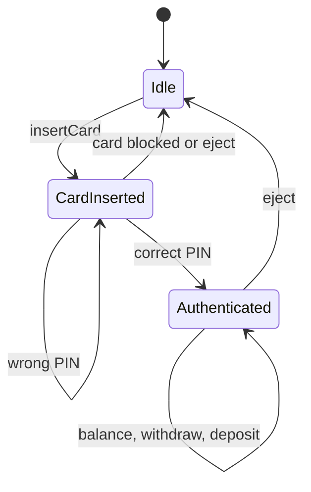
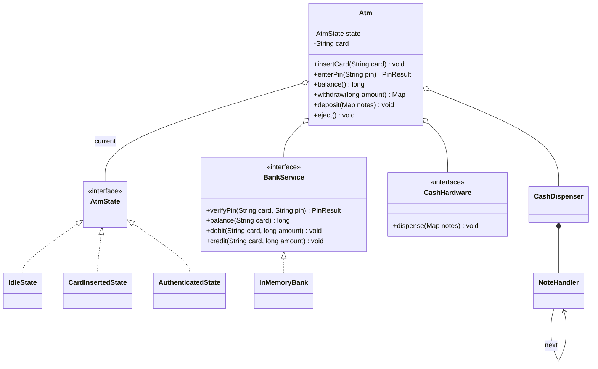

# 7. ATM

**Difficulty:** Easy | **Time:** 45 minutes

## 1. Problem statement

Design the software for an ATM.

- A customer inserts a card and enters a PIN.
- Three wrong PINs in a row block the card.
- After authentication, the customer can check the balance, withdraw, deposit and eject the card.
- The machine holds 500, 200 and 100 rupee notes in limited numbers.
- A withdrawal must be a positive multiple of 100, covered by both the balance and the notes available.
- If cash dispensing fails after the account is debited, the amount is credited back.
- The bank is an external service.

**Out of scope:** card hardware, transfers, receipts, bank network protocols and partial dispensing.

## 2. What the interviewer wants to evaluate

| Area | What a strong answer shows |
|---|---|
| Requirement clarification | Asks about notes, PIN attempts, limits and failure handling |
| State modelling | Allows each action only in the right state |
| Boundaries | Keeps balances and PINs in the bank, not in the ATM |
| Cash algorithm | Handles limited note counts, where a purely greedy choice fails |
| Consistency | Never debits money without dispensing it or reversing the debit |
| Security | Counts PIN failures where ejecting the card cannot reset them |
| Extensibility | Adds a note value or an operation with small changes |

## 3. Design patterns and principles used

### Design patterns

| Pattern | Where | Why |
|---|---|---|
| State | `AtmState` and its implementations | Actions depend on how far the session has progressed |
| Chain of Responsibility | `NoteHandler` | Each handler covers one note value and passes the rest on |
| Adapter point | `BankService`, `CashHardware` | Real systems can be plugged in behind these interfaces |

Each note handler tries fewer of its own notes if the rest of the chain cannot finish. To dispense 600 from one 500 and three 200s, it skips the 500 and uses the 200s.

### Design principles

| Principle | How it applies |
|---|---|
| Single Responsibility | The bank manages accounts, the dispenser manages notes, states manage the flow |
| Open/Closed | A new note value is one enum constant |
| Dependency Inversion | `Atm` depends on `BankService` and `CashHardware` interfaces |
| Interface Segregation | Hardware and bank operations are separate interfaces |
| Fail fast | Invalid actions throw before anything changes |

## 4. Solution

### 4.1 Core entities

| Entity | Responsibility |
|---|---|
| `Note` | Note values |
| `BankService` | PIN checks and balances |
| `CashDispenser` | Plans and tracks notes |
| `CashHardware` | Physically moves notes |
| `AtmState` | Allowed actions |
| `Atm` | Session entry point |

### 4.2 State diagram



### 4.3 Class diagram



### 4.4 Java code (Java 17+)

#### Notes and external services

```java
/** Declared from largest to smallest. */
public enum Note {
    FIVE_HUNDRED(500), TWO_HUNDRED(200), HUNDRED(100);

    private final int value;

    Note(int value) {
        this.value = value;
    }

    public int value() {
        return value;
    }
}
```

```java
public enum PinResult { OK, WRONG, BLOCKED }
```

```java
public interface BankService {
    PinResult verifyPin(String card, String pin);
    long balance(String card);
    void debit(String card, long amount);
    void credit(String card, long amount);
}
```

```java
import java.util.Map;

public interface CashHardware {
    /** Throws a RuntimeException if no notes could be dispensed. */
    void dispense(Map<Note, Integer> notes);
}
```

```java
import java.util.HashMap;
import java.util.Map;

public class InMemoryBank implements BankService {
    private static final class Account {
        private final String pin;
        private long balance;
        private int failures;

        private Account(String pin, long balance) {
            this.pin = pin;
            this.balance = balance;
        }
    }

    private final Map<String, Account> accounts = new HashMap<>();

    public synchronized void open(String card, String pin, long balance) {
        accounts.put(card, new Account(pin, balance)); // hash PINs in a real system
    }

    @Override
    public synchronized PinResult verifyPin(String card, String pin) {
        Account account = account(card);
        if (account.failures >= 3) {
            return PinResult.BLOCKED;
        }
        if (account.pin.equals(pin)) {
            account.failures = 0;
            return PinResult.OK;
        }
        account.failures++;
        return account.failures >= 3 ? PinResult.BLOCKED : PinResult.WRONG;
    }

    @Override
    public synchronized long balance(String card) {
        return account(card).balance;
    }

    @Override
    public synchronized void debit(String card, long amount) {
        Account account = account(card);
        if (amount <= 0 || amount > account.balance) {
            throw new IllegalStateException("Insufficient balance or invalid amount");
        }
        account.balance -= amount;
    }

    @Override
    public synchronized void credit(String card, long amount) {
        if (amount <= 0) {
            throw new IllegalArgumentException("Amount must be positive");
        }
        account(card).balance += amount;
    }

    private Account account(String card) {
        Account account = accounts.get(card);
        if (account == null) {
            throw new IllegalArgumentException("Unknown card");
        }
        return account;
    }
}
```

#### Chain of Responsibility for cash

```java
import java.util.EnumMap;
import java.util.Map;
import java.util.Optional;

public class NoteHandler {
    private final Note note;
    private final NoteHandler next;
    private int count;

    public NoteHandler(Note note, NoteHandler next) {
        this.note = note;
        this.next = next;
    }

    Optional<Map<Note, Integer>> plan(long amount) {
        long most = Math.min(count, amount / note.value());
        for (long used = most; used >= 0; used--) {
            long rest = amount - used * note.value();
            Optional<Map<Note, Integer>> result =
                    rest == 0 ? Optional.of(new EnumMap<>(Note.class))
                    : next == null ? Optional.empty()
                    : next.plan(rest);
            if (result.isPresent()) {
                if (used > 0) {
                    result.get().put(note, (int) used);
                }
                return result;
            }
        }
        return Optional.empty();
    }

    void change(Map<Note, Integer> notes, int sign) {
        count += sign * notes.getOrDefault(note, 0);
        if (next != null) {
            next.change(notes, sign);
        }
    }
}
```

```java
import java.util.Map;
import java.util.Optional;

import java.util.Map;
import java.util.Optional;

public class CashDispenser {
    private final NoteHandler chain;

    public CashDispenser() {
        NoteHandler head = null;
        Note[] notes = Note.values();
        for (int i = notes.length - 1; i >= 0; i--) {
            head = new NoteHandler(notes[i], head);
        }
        chain = head;
    }

    public Optional<Map<Note, Integer>> plan(long amount) {
        return chain.plan(amount);
    }

    public void add(Map<Note, Integer> notes) {
        if (notes.values().stream().anyMatch(c -> c < 0)) {
            throw new IllegalArgumentException("Note count cannot be negative");
        }
        chain.change(notes, 1);
    }

    /** Pass only a plan returned by this dispenser. */
    void remove(Map<Note, Integer> planned) {
        chain.change(planned, -1);
    }
}
```

#### States

```java
import java.util.Map;

public interface AtmState {
    default void insertCard(Atm atm, String card) { throw notAllowed("insert card"); }
    default PinResult enterPin(Atm atm, String pin) { throw notAllowed("enter PIN"); }
    default long balance(Atm atm) { throw notAllowed("check balance"); }
    default Map<Note, Integer> withdraw(Atm atm, long amount) { throw notAllowed("withdraw"); }
    default void deposit(Atm atm, Map<Note, Integer> notes) { throw notAllowed("deposit"); }
    default void eject(Atm atm) { atm.endSession(); }

    private IllegalStateException notAllowed(String action) {
        return new IllegalStateException(
                "Cannot " + action + " in " + getClass().getSimpleName());
    }
}
```

```java
public class IdleState implements AtmState {
    @Override
    public void insertCard(Atm atm, String card) {
        atm.startSession(card);
        atm.setState(new CardInsertedState());
    }

    @Override
    public void eject(Atm atm) {
        throw new IllegalStateException("No card to eject");
    }
}
```

```java
public class CardInsertedState implements AtmState {
    @Override
    public PinResult enterPin(Atm atm, String pin) {
        PinResult result = atm.bank().verifyPin(atm.card(), pin);
        if (result == PinResult.OK) {
            atm.setState(new AuthenticatedState());
        } else if (result == PinResult.BLOCKED) {
            atm.endSession();
        }
        return result;
    }
}
```

```java
import java.util.Map;

public class AuthenticatedState implements AtmState {
    @Override
    public long balance(Atm atm) {
        return atm.bank().balance(atm.card());
    }

    @Override
    public Map<Note, Integer> withdraw(Atm atm, long amount) {
        if (amount <= 0 || amount % 100 != 0) {
            throw new IllegalArgumentException("Enter a positive multiple of 100");
        }
        if (amount > atm.bank().balance(atm.card())) {
            throw new IllegalStateException("Insufficient balance");
        }
        Map<Note, Integer> notes = atm.dispenser().plan(amount)
                .orElseThrow(() -> new IllegalStateException("ATM cannot pay this amount"));

        atm.bank().debit(atm.card(), amount);
        try {
            atm.hardware().dispense(notes);
        } catch (RuntimeException failure) {
            atm.bank().credit(atm.card(), amount); // compensate
            throw failure;
        }
        atm.dispenser().remove(notes);
        return notes;
    }

    @Override
    public void deposit(Atm atm, Map<Note, Integer> notes) {
        long total = notes.entrySet().stream()
                .mapToLong(e -> (long) e.getKey().value() * e.getValue()).sum();
        if (total <= 0 || notes.values().stream().anyMatch(c -> c < 0)) {
            throw new IllegalArgumentException("Invalid deposit");
        }
        atm.bank().credit(atm.card(), total);
        atm.dispenser().add(notes);
    }
}
```

#### ATM

```java
import java.util.Map;

public class Atm {
    private final BankService bank;
    private final CashDispenser dispenser;
    private final CashHardware hardware;
    private AtmState state = new IdleState();
    private String card;

    public Atm(BankService bank, CashDispenser dispenser, CashHardware hardware) {
        this.bank = bank;
        this.dispenser = dispenser;
        this.hardware = hardware;
    }

    public synchronized void insertCard(String card) { state.insertCard(this, card); }
    public synchronized PinResult enterPin(String pin) { return state.enterPin(this, pin); }
    public synchronized long balance() { return state.balance(this); }
    public synchronized Map<Note, Integer> withdraw(long amount) { return state.withdraw(this, amount); }
    public synchronized void deposit(Map<Note, Integer> notes) { state.deposit(this, notes); }
    public synchronized void eject() { state.eject(this); }

    BankService bank() { return bank; }
    CashDispenser dispenser() { return dispenser; }
    CashHardware hardware() { return hardware; }
    String card() { return card; }
    void setState(AtmState next) { state = next; }
    void startSession(String inserted) { card = inserted; }

    void endSession() {
        card = null;
        state = new IdleState();
    }
}
```

#### Demo

```java
import java.util.Map;

public class AtmDemo {
    public static void main(String[] args) {
        InMemoryBank bank = new InMemoryBank();
        bank.open("CARD-1", "1234", 5000);

        CashDispenser dispenser = new CashDispenser();
        dispenser.add(Map.of(Note.FIVE_HUNDRED, 1, Note.TWO_HUNDRED, 3));

        Atm atm = new Atm(bank, dispenser, notes -> System.out.println("Dispensing " + notes));
        atm.insertCard("CARD-1");
        atm.enterPin("1234");
        atm.withdraw(600);
        System.out.println("Balance: " + atm.balance());
        atm.eject();
    }
}
```

### 4.5 Complexity

Let A be the amount.

| Operation | Time |
|---|---|
| Balance, deposit | O(1) |
| Plan notes (three values) | At most about (A/500 + 1) × (A/200 + 1) steps |

A per-transaction limit keeps planning fast.

## 5. Follow-up questions

| Question | Answer outline |
|---|---|
| What if cash dispensing fails after the account is debited? | Credit the amount back. If the reversal also fails, write it to a durable log and retry |
| What if only some notes come out? | The hardware must report what it dispensed. Reverse the difference and flag it for reconciliation |
| What if the network drops during a debit? | Send a transaction ID so retries are idempotent, then query the status |
| How would you add a 2000 rupee note? | Add an enum constant in value order |
| How would you add a mini statement? | Add a bank method and allow it in the authenticated state |
