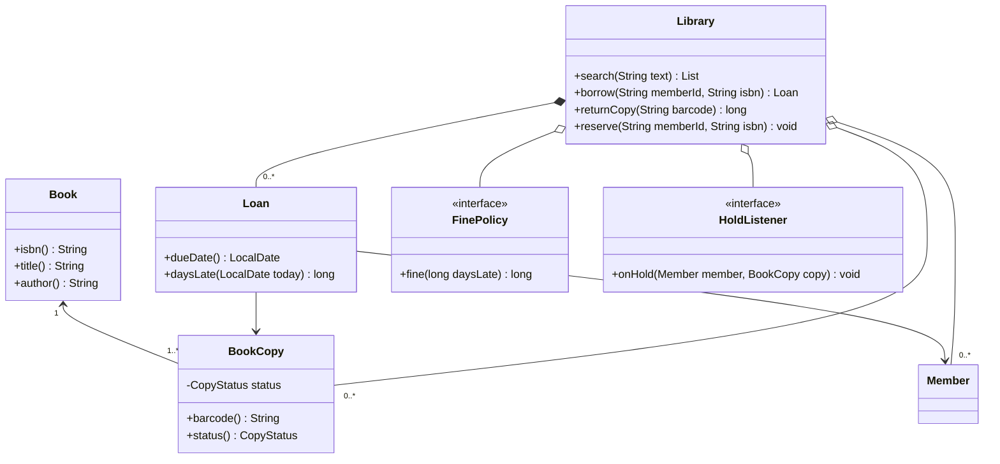
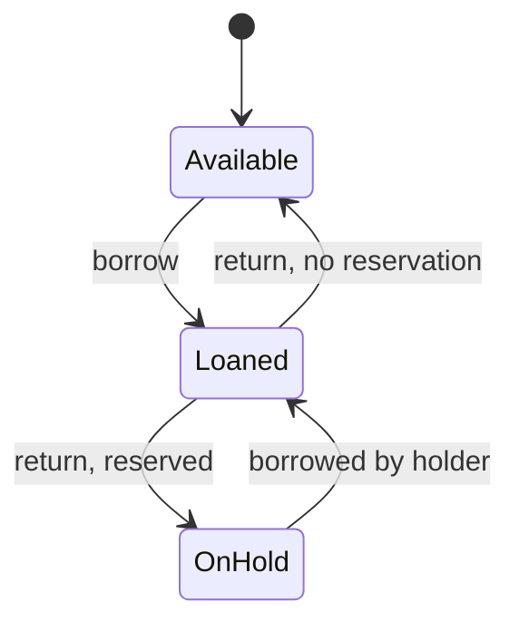

# 8. Library Management System

**Difficulty:** Easy | **Time:** 45 minutes

## 1. Problem statement

Design a system for a library to manage books and members.

- A book (title, author, ISBN) can have several physical copies, each with a barcode.
- Members search books by title or author.
- A member can borrow up to 5 copies at a time, for 14 days each.
- A member cannot hold two copies of the same book.
- If no copy is available, a member can reserve the book. Reservations are served first come, first served.
- When a reserved copy is returned, it is held for the next member, who is notified.
- Late returns are fined per day.

**Out of scope:** payments, renewals, hold expiry, staff accounts and persistence.

## 2. What the interviewer wants to evaluate

| Area | What a strong answer shows |
|---|---|
| Requirement clarification | Asks about limits, loan period, reservations and fines |
| Domain modelling | Distinguishes a `Book` from a `BookCopy` |
| Relationships | Models loans as their own entity linking a member and a copy |
| State handling | Moves copies correctly between available, loaned and on hold |
| Extensibility | Changes fine rules or notification channels easily |
| Edge cases | Handles limits, duplicate reservations and held copies |
| Testability | Controls the current date |

## 3. Design patterns and principles used

### Design patterns

| Pattern | Where | Why |
|---|---|---|
| Strategy | `FinePolicy` | Fine rules vary between libraries |
| Observer | `HoldListener` | Notification is separate from lending |
| Facade | `Library` | Callers use one simple entry point |

`Library` can grow too large. In a bigger system, split it into catalogue, lending and reservation services.

### Design principles

| Principle | How it applies |
|---|---|
| Single Responsibility | `Book` describes, `BookCopy` tracks status, `Loan` records borrowing |
| Open/Closed | New fine rules and listeners need no change to `Library` |
| Dependency Inversion | `Library` depends on interfaces and an injected `Clock` |
| Information Expert | `Loan` knows whether it is late |
| Encapsulation | Only the library package changes copy status |

## 4. Solution

### 4.1 Core entities

| Entity | Responsibility |
|---|---|
| `Book` | Details shared by all copies |
| `BookCopy` | One physical item and its status |
| `Member` | A borrower |
| `Loan` | Who borrowed which copy, and until when |
| `Library` | Search, borrow, return and reserve |

### 4.2 Class diagram



### 4.3 Copy lifecycle



### 4.4 Java code (Java 17+)

#### Domain

```java
public record Book(String isbn, String title, String author) { }
```

```java
public record Member(String id, String name) { }
```

```java
public enum CopyStatus { AVAILABLE, LOANED, ON_HOLD }
```

```java
public class BookCopy {
    private final String barcode;
    private final Book book;
    private CopyStatus status = CopyStatus.AVAILABLE;
    private String heldFor;

    public BookCopy(String barcode, Book book) {
        this.barcode = barcode;
        this.book = book;
    }

    public String barcode() { return barcode; }
    public Book book() { return book; }
    public CopyStatus status() { return status; }

    boolean isHeldFor(String memberId) {
        return status == CopyStatus.ON_HOLD && memberId.equals(heldFor);
    }

    void markLoaned() { status = CopyStatus.LOANED; heldFor = null; }
    void markAvailable() { status = CopyStatus.AVAILABLE; heldFor = null; }
    void holdFor(String memberId) { status = CopyStatus.ON_HOLD; heldFor = memberId; }
}
```

```java
import java.time.LocalDate;
import java.time.temporal.ChronoUnit;

public record Loan(BookCopy copy, Member member, LocalDate dueDate) {
    public long daysLate(LocalDate today) {
        return Math.max(0, ChronoUnit.DAYS.between(dueDate, today));
    }
}
```

#### Policies

```java
public interface FinePolicy {
    long fine(long daysLate);
}
```

```java
public class PerDayFine implements FinePolicy {
    private final long rupeesPerDay;

    public PerDayFine(long rupeesPerDay) {
        this.rupeesPerDay = rupeesPerDay;
    }

    @Override
    public long fine(long daysLate) {
        return daysLate * rupeesPerDay;
    }
}
```

```java
public interface HoldListener {
    void onHold(Member member, BookCopy copy);
}
```

#### Library

```java
import java.time.Clock;
import java.time.LocalDate;
import java.util.ArrayDeque;
import java.util.ArrayList;
import java.util.Deque;
import java.util.HashMap;
import java.util.LinkedHashMap;
import java.util.List;
import java.util.Locale;
import java.util.Map;

public class Library {
    private static final int MAX_LOANS = 5;
    private static final int LOAN_DAYS = 14;

    private final Map<String, Member> members = new HashMap<>();
    private final Map<String, BookCopy> copies = new LinkedHashMap<>();
    private final Map<String, Loan> activeLoans = new HashMap<>();       // by barcode
    private final Map<String, Deque<String>> reservations = new HashMap<>(); // by ISBN
    private final FinePolicy finePolicy;
    private final HoldListener listener;
    private final Clock clock;

    public Library(FinePolicy finePolicy, HoldListener listener, Clock clock) {
        this.finePolicy = finePolicy;
        this.listener = listener;
        this.clock = clock;
    }

    public synchronized void addMember(Member member) {
        members.put(member.id(), member);
    }

    public synchronized void addCopy(BookCopy copy) {
        if (copies.putIfAbsent(copy.barcode(), copy) != null) {
            throw new IllegalArgumentException("Duplicate barcode");
        }
        makeAvailable(copy);
    }

    public synchronized List<Book> search(String text) {
        String query = text.toLowerCase(Locale.ROOT);
        return copies.values().stream()
                .map(BookCopy::book)
                .distinct()
                .filter(b -> b.title().toLowerCase(Locale.ROOT).contains(query)
                        || b.author().toLowerCase(Locale.ROOT).contains(query))
                .toList();
    }

    public synchronized Loan borrow(String memberId, String isbn) {
        Member member = member(memberId);
        List<Loan> current = loansOf(memberId);
        if (current.size() >= MAX_LOANS) {
            throw new IllegalStateException("Loan limit reached");
        }
        if (current.stream().anyMatch(l -> l.copy().book().isbn().equals(isbn))) {
            throw new IllegalStateException("Already borrowed this book");
        }
        BookCopy copy = copiesOf(isbn).stream()
                .filter(c -> c.isHeldFor(memberId))
                .findFirst()
                .or(() -> copiesOf(isbn).stream()
                        .filter(c -> c.status() == CopyStatus.AVAILABLE)
                        .findFirst())
                .orElseThrow(() -> new IllegalStateException("No copy available"));

        copy.markLoaned();
        reservations.getOrDefault(isbn, new ArrayDeque<>()).remove(memberId);
        Loan loan = new Loan(copy, member, LocalDate.now(clock).plusDays(LOAN_DAYS));
        activeLoans.put(copy.barcode(), loan);
        return loan;
    }

    /** Returns the fine in rupees. */
    public synchronized long returnCopy(String barcode) {
        Loan loan = activeLoans.remove(barcode);
        if (loan == null) {
            throw new IllegalArgumentException("Copy is not on loan");
        }
        long fine = finePolicy.fine(loan.daysLate(LocalDate.now(clock)));

        makeAvailable(loan.copy());
        return fine;
    }

    public synchronized void reserve(String memberId, String isbn) {
        member(memberId);
        List<BookCopy> all = copiesOf(isbn);
        if (all.isEmpty()) {
            throw new IllegalArgumentException("Unknown book");
        }
        if (all.stream().anyMatch(c -> c.status() == CopyStatus.AVAILABLE)) {
            throw new IllegalStateException("A copy is available, borrow it");
        }
        boolean alreadyHas = loansOf(memberId).stream()
                .anyMatch(l -> l.copy().book().isbn().equals(isbn))
                || all.stream().anyMatch(c -> c.isHeldFor(memberId));
        Deque<String> queue = reservations.computeIfAbsent(isbn, k -> new ArrayDeque<>());
        if (alreadyHas || queue.contains(memberId)) {
            throw new IllegalStateException("Already borrowed or reserved");
        }
        queue.add(memberId);
    }

    /** Holds the copy for the next member in the queue, if there is one. */
    private void makeAvailable(BookCopy copy) {
        Deque<String> queue = reservations.get(copy.book().isbn());
        String next = queue == null ? null : queue.poll();
        if (next == null) {
            copy.markAvailable();
        } else {
            copy.holdFor(next);
            listener.onHold(member(next), copy); // send asynchronously in production
        }
    }

    private Member member(String id) {
        Member member = members.get(id);
        if (member == null) {
            throw new IllegalArgumentException("Unknown member");
        }
        return member;
    }

    private List<BookCopy> copiesOf(String isbn) {
        List<BookCopy> result = new ArrayList<>();
        for (BookCopy copy : copies.values()) {
            if (copy.book().isbn().equals(isbn)) {
                result.add(copy);
            }
        }
        return result;
    }

    private List<Loan> loansOf(String memberId) {
        return activeLoans.values().stream()
                .filter(l -> l.member().id().equals(memberId))
                .toList();
    }
}
```

#### Demo

```java
import java.time.Clock;

public class LibraryDemo {
    public static void main(String[] args) {
        Library library = new Library(
                new PerDayFine(5),
                (member, copy) -> System.out.println("Notify " + member.name()),
                Clock.systemDefaultZone());

        Book book = new Book("978-1", "Clean Design", "A. Writer");
        library.addCopy(new BookCopy("B1", book));
        library.addMember(new Member("m1", "Asha"));
        library.addMember(new Member("m2", "Ravi"));

        library.borrow("m1", "978-1");
        library.reserve("m2", "978-1");
        System.out.println("Fine: " + library.returnCopy("B1"));
        library.borrow("m2", "978-1");
    }
}
```

### 4.5 Complexity

Let C be the number of copies and L the number of active loans.

| Operation | Time |
|---|---|
| Search, borrow, reserve | O(C + L) |
| Return | O(1) average |

## 5. Follow-up questions

| Question | Answer outline |
|---|---|
| How would you handle reservations and late fines? | A queue per ISBN for reservations, and a `FinePolicy` applied on return |
| How would you speed up borrowing and search? | Index copies by ISBN, loans by member, and use a search index for text |
| What if the holder never collects the book? | Store a hold expiry and pass the copy to the next member |
| How would you add renewals? | Extend the due date only if nobody has reserved the book |
| How would you add other item types such as DVDs? | Introduce a `LibraryItem` abstraction with its own loan rules |
