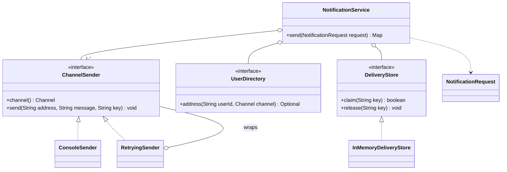
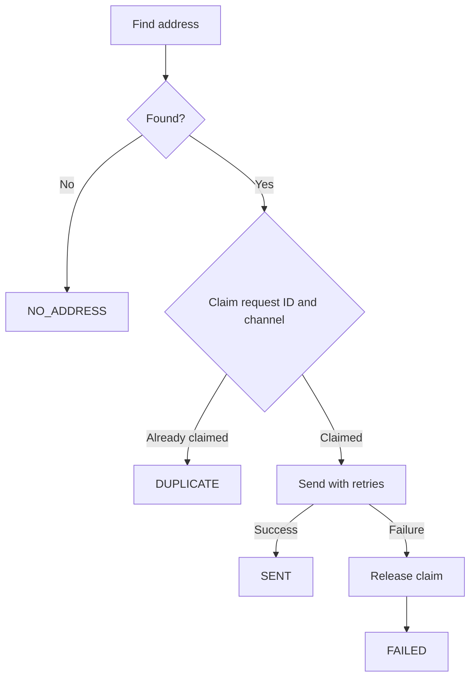

# 9. Notification System

**Difficulty:** Easy | **Time:** 45 minutes

## 1. Problem statement

Design a service that sends notifications to users.

- Supported channels are email, SMS and push.
- A request has a unique ID, a user, a message and one or more channels.
- The service finds the user's address for each channel.
- A temporary failure is retried a limited number of times with increasing delays.
- Submitting the same request ID again must not resend a channel that already succeeded.
- A failure on one channel does not stop the others.
- The result of every channel is reported.
- New channels can be added without changing the service.

**Out of scope:** templates, scheduling, user preferences, priority queues and persistence.

## 2. What the interviewer wants to evaluate

| Area | What a strong answer shows |
|---|---|
| Requirement clarification | Asks about channels, delivery guarantees, retries and duplicates |
| Abstraction | Hides providers behind one interface |
| Open/Closed design | Adds a channel with a new class and registration |
| Reliability | Retries only temporary failures, with backoff |
| Idempotency | Prevents duplicates, including concurrent submissions |
| Failure isolation | One channel failing does not affect another |
| Honest trade-offs | Explains why exactly-once delivery cannot be fully guaranteed |

## 3. Design patterns and principles used

### Design patterns

| Pattern | Where | Why |
|---|---|---|
| Strategy | `ChannelSender` | Each channel sends in its own way |
| Decorator | `RetryingSender` | Adds retries to any sender |
| Registry | Sender map in `NotificationService` | Picks the sender for a channel without a `switch` |

A registry does the selecting job usually given to a **Factory**. Senders are created once at startup, so there is nothing to construct per request.

### Design principles

| Principle | How it applies |
|---|---|
| Single Responsibility | Sending, retrying, address lookup and deduplication are separate |
| Open/Closed | A new channel does not modify the service logic |
| Liskov Substitution | A `RetryingSender` behaves like any sender |
| Dependency Inversion | The service depends on interfaces only |
| Interface Segregation | `ChannelSender`, `UserDirectory` and `DeliveryStore` are small |

## 4. Solution

### 4.1 Core entities

| Entity | Responsibility |
|---|---|
| `NotificationRequest` | What to send, to whom and how |
| `ChannelSender` | Delivers through one channel |
| `UserDirectory` | Finds addresses |
| `DeliveryStore` | Remembers claimed deliveries |
| `NotificationService` | Coordinates a request |

A new channel needs a `Channel` constant and a sender class.

### 4.2 Class diagram



### 4.3 Flow for one channel



### 4.4 Java code (Java 17+)

#### Basic types

```java
public enum Channel { EMAIL, SMS, PUSH }
```

```java
public enum DeliveryStatus { SENT, FAILED, DUPLICATE, NO_ADDRESS }
```

```java
import java.util.Set;

public record NotificationRequest(String id, String userId, String message,
                                  Set<Channel> channels) {
    public NotificationRequest {
        if (channels.isEmpty()) {
            throw new IllegalArgumentException("Choose at least one channel");
        }
        channels = Set.copyOf(channels);
    }
}
```

```java
/** A temporary failure that is worth retrying. */
public class TransientSendException extends RuntimeException {
    public TransientSendException(String message) {
        super(message);
    }
}
```

#### Senders

```java
public interface ChannelSender {
    Channel channel();

    /** The key lets a provider discard repeated attempts. */
    void send(String address, String message, String key);
}
```

```java
public class ConsoleSender implements ChannelSender {
    private final Channel channel;

    public ConsoleSender(Channel channel) {
        this.channel = channel;
    }

    @Override
    public Channel channel() {
        return channel;
    }

    @Override
    public void send(String address, String message, String key) {
        System.out.println(channel + " to " + address + ": " + message);
    }
}
```

```java
import java.time.Duration;

public interface Sleeper {
    void sleep(Duration duration) throws InterruptedException;
}
```

```java
import java.time.Duration;

public class RetryingSender implements ChannelSender {
    private final ChannelSender delegate;
    private final int maxAttempts;
    private final Duration firstDelay;
    private final Sleeper sleeper;

    public RetryingSender(ChannelSender delegate, int maxAttempts,
                          Duration firstDelay, Sleeper sleeper) {
        if (maxAttempts < 1) {
            throw new IllegalArgumentException("Need at least one attempt");
        }
        this.delegate = delegate;
        this.maxAttempts = maxAttempts;
        this.firstDelay = firstDelay;
        this.sleeper = sleeper;
    }

    @Override
    public Channel channel() {
        return delegate.channel();
    }

    @Override
    public void send(String address, String message, String key) {
        Duration delay = firstDelay;
        for (int attempt = 1; ; attempt++) {
            try {
                delegate.send(address, message, key);
                return;
            } catch (TransientSendException e) {
                if (attempt == maxAttempts) {
                    throw e;
                }
                try {
                    sleeper.sleep(delay);
                } catch (InterruptedException interrupted) {
                    Thread.currentThread().interrupt();
                    throw e;
                }
                delay = delay.multipliedBy(2); // exponential backoff
            }
        }
    }
}
```

#### Directory and delivery store

```java
import java.util.Optional;

public interface UserDirectory {
    Optional<String> address(String userId, Channel channel);
}
```

```java
public interface DeliveryStore {
    /** Atomically claims a key. Returns false if it is already claimed. */
    boolean claim(String key);

    void release(String key);
}
```

```java
import java.util.Set;
import java.util.concurrent.ConcurrentHashMap;

public class InMemoryDeliveryStore implements DeliveryStore {
    private final Set<String> claimed = ConcurrentHashMap.newKeySet();

    @Override
    public boolean claim(String key) {
        return claimed.add(key);
    }

    @Override
    public void release(String key) {
        claimed.remove(key);
    }
}
```

#### Service

```java
import java.util.EnumMap;
import java.util.List;
import java.util.Map;
import java.util.Optional;

public class NotificationService {
    private final Map<Channel, ChannelSender> senders = new EnumMap<>(Channel.class);
    private final UserDirectory directory;
    private final DeliveryStore store;

    public NotificationService(List<ChannelSender> senderList,
                               UserDirectory directory, DeliveryStore store) {
        for (ChannelSender sender : senderList) {
            if (senders.put(sender.channel(), sender) != null) {
                throw new IllegalArgumentException("Two senders for " + sender.channel());
            }
        }
        this.directory = directory;
        this.store = store;
    }

    public Map<Channel, DeliveryStatus> send(NotificationRequest request) {
        // reject unsupported channels before sending anything
        if (!senders.keySet().containsAll(request.channels())) {
            throw new IllegalArgumentException("Unsupported channel");
        }
        Map<Channel, DeliveryStatus> results = new EnumMap<>(Channel.class);
        for (Channel channel : request.channels()) {
            results.put(channel, deliver(request, channel));
        }
        return results;
    }

    private DeliveryStatus deliver(NotificationRequest request, Channel channel) {
        String key = request.id() + ":" + channel;
        boolean claimed = false;
        try {
            Optional<String> address = directory.address(request.userId(), channel);
            if (address.isEmpty()) {
                return DeliveryStatus.NO_ADDRESS;
            }
            if (!store.claim(key)) {
                return DeliveryStatus.DUPLICATE; // sent, or being sent now
            }
            claimed = true;
            senders.get(channel).send(address.get(), request.message(), key);
            return DeliveryStatus.SENT;
        } catch (RuntimeException e) {
            if (claimed) {
                store.release(key); // allow a later resubmission
            }
            return DeliveryStatus.FAILED;
        }
    }
}
```

#### Demo

```java
import java.time.Duration;
import java.util.List;
import java.util.Optional;
import java.util.Set;

public class NotificationDemo {
    public static void main(String[] args) {
        Sleeper sleeper = d -> Thread.sleep(d.toMillis());
        List<ChannelSender> senders = List.of(
                new RetryingSender(new ConsoleSender(Channel.EMAIL), 3,
                        Duration.ofMillis(100), sleeper),
                new ConsoleSender(Channel.SMS));

        NotificationService service = new NotificationService(senders,
                (user, channel) -> Optional.of(user + "@" + channel),
                new InMemoryDeliveryStore());

        NotificationRequest request = new NotificationRequest(
                "order-42", "asha", "Order shipped", Set.of(Channel.EMAIL, Channel.SMS));
        System.out.println(service.send(request));
        System.out.println(service.send(request)); // duplicates
    }
}
```

### 4.5 Complexity

Let C be the channels in a request and R the maximum attempts.

| Operation | Time |
|---|---|
| Send a request | O(C × R) provider calls in the worst case |
| Duplicate check | O(1) average |

## 5. Follow-up questions

| Question | Answer outline |
|---|---|
| How would you retry failures without sending duplicates? | Claim a key per request and channel, and pass it to the provider |
| Is delivery exactly once? | No. A provider may accept a message while the reply is lost. Provider-side idempotency is needed |
| How would you handle high volume? | Put requests on a queue per channel and scale workers. Do not sleep in the request thread |
| What if the process dies after claiming a key? | Store a status with an expiry in a database, so stale claims can be retried |
| How would you handle permanent failures? | Do not retry them. Record them in a dead-letter queue |
| How would you add user preferences? | Filter the requested channels before delivery |
