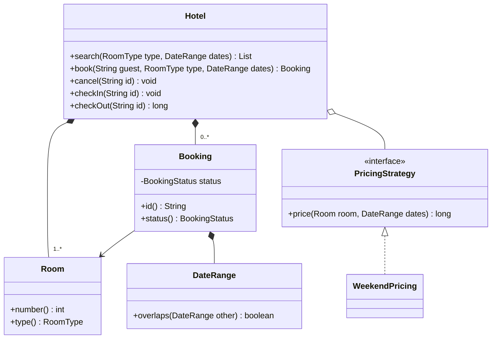
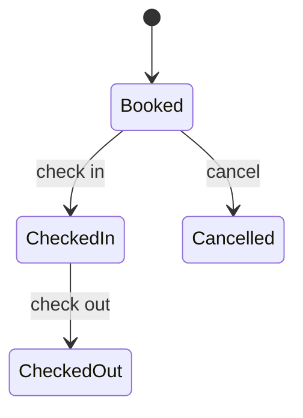

# 10. Hotel Management System

**Difficulty:** Easy | **Time:** 45 minutes

## 1. Problem statement

Design a booking system for a single hotel.

- Rooms are single, double or suite.
- Guests search for rooms of a type that are free for a date range.
- A booking covers the nights from the check-in date up to, but not including, the check-out date.
- A room cannot have two active bookings for the same night, even with concurrent requests.
- A booking can be cancelled before check-in.
- A guest can check in only during the booked dates, and only if the room is empty.
- At check-out, the guest is charged for all booked nights.

**Out of scope:** payments, multiple hotels, room service, early check-out refunds and persistence.

## 2. What the interviewer wants to evaluate

| Area | What a strong answer shows |
|---|---|
| Requirement clarification | Asks about date boundaries, cancellation, pricing and concurrency |
| Domain modelling | Separates `Room` from `Booking` |
| Date logic | Detects overlaps correctly and allows same-day turnover |
| Lifecycle | Allows only valid booking status changes |
| Concurrency | Makes check-and-book atomic |
| Extensibility | Supports new pricing rules |
| Edge cases | Handles invalid dates, overstays and repeated actions |

## 3. Design patterns and principles used

### Design patterns

| Pattern | Where | Why |
|---|---|---|
| Strategy | `PricingStrategy` | Rates vary by day, season or offer |
| Facade | `Hotel` | One entry point for booking operations |

A full **State** pattern is not needed. The lifecycle has few rules, so an enum with allowed transitions is enough.

### Design principles

| Principle | How it applies |
|---|---|
| Single Responsibility | `DateRange` compares dates, `Booking` guards its status, pricing calculates |
| Open/Closed | New pricing is a new class |
| Dependency Inversion | `Hotel` depends on `PricingStrategy` and `Clock` |
| Information Expert | `DateRange` decides whether ranges overlap |
| Immutability | `Room` and `DateRange` are records |

## 4. Solution

### 4.1 Core entities

| Entity | Responsibility |
|---|---|
| `Room` | Number and type |
| `DateRange` | Stay period |
| `Booking` | Guest, room, dates and status |
| `PricingStrategy` | Price of a stay |
| `Hotel` | Search, book, cancel, check in and out |

Availability is derived from bookings, so a room has no `isBooked` flag.

### 4.2 Class diagram



### 4.3 Booking lifecycle



### 4.4 Java code (Java 17+)

#### Types

```java
public enum RoomType { SINGLE, DOUBLE, SUITE }
```

```java
public record Room(int number, RoomType type) { }
```

```java
import java.time.LocalDate;

/** The start date is included and the end date is not. */
public record DateRange(LocalDate start, LocalDate end) {
    public DateRange {
        if (!start.isBefore(end)) {
            throw new IllegalArgumentException("End must be after start");
        }
    }

    public boolean overlaps(DateRange other) {
        return start.isBefore(other.end) && other.start.isBefore(end);
    }

    public boolean contains(LocalDate date) {
        return !date.isBefore(start) && date.isBefore(end);
    }
}
```

```java
public enum BookingStatus {
    BOOKED, CHECKED_IN, CHECKED_OUT, CANCELLED;

    public boolean canMoveTo(BookingStatus next) {
        return switch (this) {
            case BOOKED -> next == CHECKED_IN || next == CANCELLED;
            case CHECKED_IN -> next == CHECKED_OUT;
            case CHECKED_OUT, CANCELLED -> false;
        };
    }

    public boolean isActive() {
        return this == BOOKED || this == CHECKED_IN;
    }
}
```

```java
public class Booking {
    private final String id;
    private final String guest;
    private final Room room;
    private final DateRange dates;
    private BookingStatus status = BookingStatus.BOOKED;

    Booking(String id, String guest, Room room, DateRange dates) {
        this.id = id;
        this.guest = guest;
        this.room = room;
        this.dates = dates;
    }

    public String id() { return id; }
    public String guest() { return guest; }
    public Room room() { return room; }
    public DateRange dates() { return dates; }
    public BookingStatus status() { return status; }

    void moveTo(BookingStatus next) {
        if (!status.canMoveTo(next)) {
            throw new IllegalStateException("Cannot move from " + status + " to " + next);
        }
        status = next;
    }
}
```

#### Pricing

```java
public interface PricingStrategy {
    long price(Room room, DateRange dates);
}
```

```java
import java.time.DayOfWeek;
import java.time.LocalDate;
import java.util.Map;

public class WeekendPricing implements PricingStrategy {
    private final Map<RoomType, Long> nightlyRates;

    public WeekendPricing(Map<RoomType, Long> nightlyRates) {
        this.nightlyRates = Map.copyOf(nightlyRates);
    }

    /** Friday and Saturday nights cost 20% more. */
    @Override
    public long price(Room room, DateRange dates) {
        long rate = nightlyRates.get(room.type());
        long total = 0;
        for (LocalDate d = dates.start(); d.isBefore(dates.end()); d = d.plusDays(1)) {
            boolean weekend = d.getDayOfWeek() == DayOfWeek.FRIDAY
                    || d.getDayOfWeek() == DayOfWeek.SATURDAY;
            total += weekend ? rate * 120 / 100 : rate;
        }
        return total;
    }
}
```

#### Hotel

```java
import java.time.Clock;
import java.time.LocalDate;
import java.util.HashMap;
import java.util.List;
import java.util.Map;
import java.util.UUID;

public class Hotel {
    private final List<Room> rooms;
    private final Map<String, Booking> bookings = new HashMap<>();
    private final PricingStrategy pricing;
    private final Clock clock;

    public Hotel(List<Room> rooms, PricingStrategy pricing, Clock clock) {
        this.rooms = List.copyOf(rooms);
        this.pricing = pricing;
        this.clock = clock;
    }

    public synchronized List<Room> search(RoomType type, DateRange dates) {
        return rooms.stream()
                .filter(room -> room.type() == type && isFree(room, dates))
                .toList();
    }

    public synchronized Booking book(String guest, RoomType type, DateRange dates) {
        if (dates.start().isBefore(LocalDate.now(clock))) {
            throw new IllegalArgumentException("Cannot book in the past");
        }
        Room room = search(type, dates).stream().findFirst()
                .orElseThrow(() -> new IllegalStateException("No room available"));
        Booking booking = new Booking(UUID.randomUUID().toString(), guest, room, dates);
        bookings.put(booking.id(), booking);
        return booking;
    }

    public synchronized void cancel(String id) {
        booking(id).moveTo(BookingStatus.CANCELLED);
    }

    public synchronized void checkIn(String id) {
        Booking booking = booking(id);
        if (!booking.dates().contains(LocalDate.now(clock))) {
            throw new IllegalStateException("Outside the booked dates");
        }
        boolean occupied = bookings.values().stream().anyMatch(other ->
                other.room().equals(booking.room())
                        && other.status() == BookingStatus.CHECKED_IN);
        if (occupied) {
            throw new IllegalStateException("Room is still occupied");
        }
        booking.moveTo(BookingStatus.CHECKED_IN);
    }

    /** Returns the amount to pay. */
    public synchronized long checkOut(String id) {
        Booking booking = booking(id);
        booking.moveTo(BookingStatus.CHECKED_OUT);
        return pricing.price(booking.room(), booking.dates());
    }

    private boolean isFree(Room room, DateRange dates) {
        return bookings.values().stream().noneMatch(b ->
                b.status().isActive()
                        && b.room().equals(room)
                        && b.dates().overlaps(dates));
    }

    private Booking booking(String id) {
        Booking booking = bookings.get(id);
        if (booking == null) {
            throw new IllegalArgumentException("Unknown booking");
        }
        return booking;
    }
}
```

#### Demo

```java
import java.time.Clock;
import java.time.LocalDate;
import java.util.List;
import java.util.Map;

public class HotelDemo {
    public static void main(String[] args) {
        Hotel hotel = new Hotel(
                List.of(new Room(101, RoomType.DOUBLE)),
                new WeekendPricing(Map.of(RoomType.DOUBLE, 3000L)),
                Clock.systemDefaultZone());

        LocalDate today = LocalDate.now();
        Booking booking = hotel.book("Asha", RoomType.DOUBLE,
                new DateRange(today, today.plusDays(2)));
        hotel.checkIn(booking.id());
        System.out.println("Bill: " + hotel.checkOut(booking.id()));
    }
}
```

### 4.5 Complexity

Let R be rooms, B bookings and N nights.

| Operation | Time |
|---|---|
| Search or book | O(R × B) |
| Cancel | O(1) average |
| Check in | O(B) |
| Check out | O(N) |

## 5. Follow-up questions

| Question | Answer outline |
|---|---|
| How do you prevent double booking of a room? | Check and insert under one lock. With a database, use a unique key on room and night, or a transaction with row locks |
| How would you speed up search? | Keep a sorted map of bookings per room and check only neighbouring ranges |
| What if a guest overstays? | Block the next check-in and move that booking to another free room |
| How would you hold a room during payment? | Add a pending status with an expiry time |
| How would you support many hotels? | Partition data by hotel ID, so bookings in different hotels do not contend |
