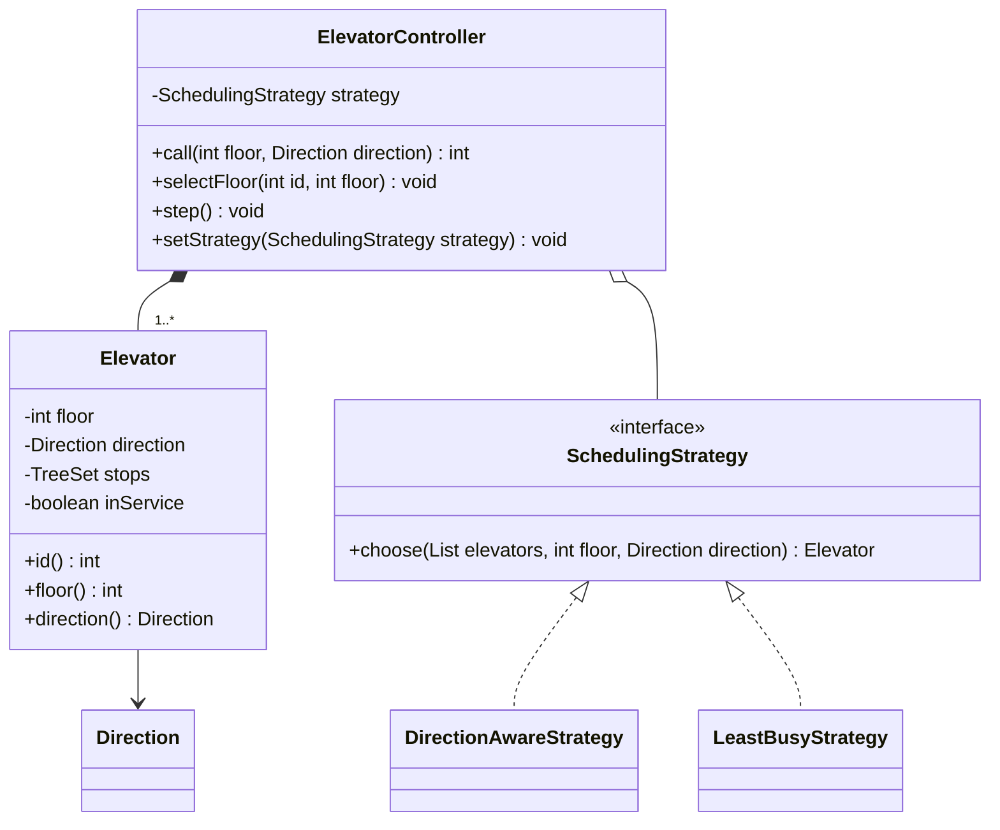
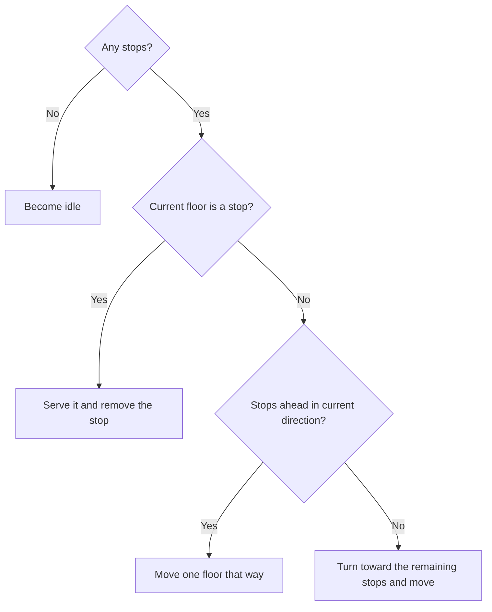

# 11. Elevator System

**Difficulty:** Medium | **Time:** 60 minutes

## 1. Problem statement

Design the control system for several elevators in one building.

- Floors are numbered from 0 to the top floor.
- A person on a floor presses up or down (hall call). The system assigns one elevator.
- A person inside an elevator presses a destination floor (car call).
- An elevator serves all stops in its current direction before it reverses.
- The rule for choosing an elevator can be changed while the system runs.
- An elevator can be taken out of service when it has no pending stops.
- Movement is simulated in steps. Each step moves a car by at most one floor or serves one stop.

**Out of scope:** door timing, weight limits, motor control, emergency handling and reassigning calls.

## 2. What the interviewer wants to evaluate

| Area | What a strong answer shows |
|---|---|
| Requirement clarification | Asks about hall and car calls, scheduling goals and capacity |
| Object modelling | Separates the car, the controller and the scheduling rule |
| State handling | Tracks direction, stops and service status consistently |
| Scheduling algorithm | Avoids starvation, for example with the LOOK algorithm |
| Data structure choice | Uses a sorted set to find the next stop quickly |
| Extensibility | Swaps scheduling rules without changing elevators |
| Concurrency | Handles button presses while cars move |
| Testability | Drives movement with explicit steps instead of real time |

## 3. Design patterns and principles used

### Design patterns

| Pattern | Where | Why |
|---|---|---|
| Strategy | `SchedulingStrategy` | Peak and off-peak hours need different assignment rules |
| Facade | `ElevatorController` | One entry point for all buttons and the clock |

The **State** pattern is often suggested. Here a car has three directions and a service flag, so an enum and a boolean are clearer. Add State classes if doors, overload and emergency modes bring different behaviour.

### Design principles

| Principle | How it applies |
|---|---|
| Single Responsibility | `Elevator` moves, the strategy assigns, the controller coordinates |
| Open/Closed | A new scheduling rule is a new class |
| Dependency Inversion | The controller depends on `SchedulingStrategy` |
| Encapsulation | Only the controller changes a car's stops |
| Information Expert | The elevator decides its own next move |

## 4. Solution

### 4.1 Core entities

| Entity | Responsibility |
|---|---|
| `Direction` | Up, down or idle |
| `Elevator` | Position, direction and stops |
| `SchedulingStrategy` | Chooses a car for a hall call |
| `ElevatorController` | Accepts requests and advances time |

The chosen scheduling rule uses the hall call direction. A car stores only floors, so it may stop for a call going the opposite way. Mention this simplification.

### 4.2 Class diagram



### 4.3 Movement logic for one step



### 4.4 Java code (Java 17+)

#### Direction and elevator

```java
public enum Direction { UP, DOWN, IDLE }
```

```java
import java.util.TreeSet;

public class Elevator {
    private final int id;
    private final TreeSet<Integer> stops = new TreeSet<>();
    private int floor;
    private Direction direction = Direction.IDLE;
    private boolean inService = true;

    public Elevator(int id, int startFloor) {
        this.id = id;
        this.floor = startFloor;
    }

    public int id() { return id; }
    public int floor() { return floor; }
    public Direction direction() { return direction; }
    public boolean inService() { return inService; }
    public int pendingStops() { return stops.size(); }

    void addStop(int target) {
        stops.add(target);
    }

    void setInService(boolean value) {
        if (!value && !stops.isEmpty()) {
            throw new IllegalStateException("Elevator still has stops");
        }
        inService = value;
    }

    /** Returns true if the car served a stop during this step. */
    boolean step() {
        if (stops.remove(floor)) {
            if (stops.isEmpty()) {
                direction = Direction.IDLE;
            }
            return true;
        }
        if (stops.isEmpty()) {
            direction = Direction.IDLE;
            return false;
        }
        boolean above = stops.higher(floor) != null;
        boolean below = stops.lower(floor) != null;
        if (direction == Direction.UP && !above) {
            direction = Direction.DOWN;
        } else if (direction == Direction.DOWN && !below) {
            direction = Direction.UP;
        } else if (direction == Direction.IDLE) {
            direction = above ? Direction.UP : Direction.DOWN;
        }
        floor += direction == Direction.UP ? 1 : -1;
        return false;
    }
}
```

#### Scheduling strategies

```java
import java.util.List;

public interface SchedulingStrategy {
    /** The list contains only cars that are in service. */
    Elevator choose(List<Elevator> elevators, int floor, Direction direction);
}
```

Cars that are idle, or already heading toward the caller in the same direction, are scored by distance. Others get a penalty.

```java
import java.util.Comparator;
import java.util.List;

public class DirectionAwareStrategy implements SchedulingStrategy {
    private final int penalty;

    public DirectionAwareStrategy(int floorCount) {
        this.penalty = 2 * floorCount;
    }

    @Override
    public Elevator choose(List<Elevator> elevators, int floor, Direction direction) {
        return elevators.stream()
                .min(Comparator.<Elevator>comparingInt(e -> cost(e, floor, direction))
                        .thenComparingInt(Elevator::id))
                .orElseThrow();
    }

    private int cost(Elevator e, int floor, Direction wanted) {
        int distance = Math.abs(e.floor() - floor);
        if (e.direction() == Direction.IDLE) {
            return distance;
        }
        boolean ahead = e.direction() == Direction.UP
                ? floor >= e.floor()
                : floor <= e.floor();
        return ahead && e.direction() == wanted ? distance : distance + penalty;
    }
}
```

```java
import java.util.Comparator;
import java.util.List;

public class LeastBusyStrategy implements SchedulingStrategy {
    @Override
    public Elevator choose(List<Elevator> elevators, int floor, Direction direction) {
        return elevators.stream()
                .min(Comparator.comparingInt(Elevator::pendingStops)
                        .thenComparingInt(e -> Math.abs(e.floor() - floor)))
                .orElseThrow();
    }
}
```

#### Controller

```java
import java.util.ArrayList;
import java.util.List;

public class ElevatorController {
    private final int topFloor;
    private final List<Elevator> elevators = new ArrayList<>();
    private SchedulingStrategy strategy;

    public ElevatorController(int topFloor, int count, SchedulingStrategy strategy) {
        if (topFloor < 1 || count < 1) {
            throw new IllegalArgumentException("Invalid building");
        }
        this.topFloor = topFloor;
        this.strategy = strategy;
        for (int id = 0; id < count; id++) {
            elevators.add(new Elevator(id, 0));
        }
    }

    /** Hall call. Returns the assigned elevator ID. */
    public synchronized int call(int floor, Direction direction) {
        check(floor);
        if (direction == Direction.IDLE
                || (floor == 0 && direction == Direction.DOWN)
                || (floor == topFloor && direction == Direction.UP)) {
            throw new IllegalArgumentException("Invalid direction");
        }
        List<Elevator> available = elevators.stream().filter(Elevator::inService).toList();
        if (available.isEmpty()) {
            throw new IllegalStateException("No elevator in service");
        }
        Elevator chosen = strategy.choose(available, floor, direction);
        chosen.addStop(floor);
        return chosen.id();
    }

    /** Car call. */
    public synchronized void selectFloor(int id, int floor) {
        check(floor);
        Elevator elevator = elevator(id);
        if (!elevator.inService()) {
            throw new IllegalStateException("Out of service");
        }
        elevator.addStop(floor);
    }

    public synchronized void step() {
        elevators.forEach(Elevator::step);
    }

    public synchronized void setStrategy(SchedulingStrategy next) {
        strategy = next;
    }

    public synchronized void setInService(int id, boolean value) {
        elevator(id).setInService(value);
    }

    public synchronized int floorOf(int id) {
        return elevator(id).floor();
    }

    private Elevator elevator(int id) {
        if (id < 0 || id >= elevators.size()) {
            throw new IllegalArgumentException("Unknown elevator");
        }
        return elevators.get(id);
    }

    private void check(int floor) {
        if (floor < 0 || floor > topFloor) {
            throw new IllegalArgumentException("Invalid floor");
        }
    }
}
```

#### Demo

```java
public class ElevatorDemo {
    public static void main(String[] args) {
        ElevatorController controller =
                new ElevatorController(10, 2, new DirectionAwareStrategy(11));

        int id = controller.call(3, Direction.UP);
        for (int i = 0; i < 4; i++) {
            controller.step(); // three moves and one stop
        }
        controller.selectFloor(id, 8);
        for (int i = 0; i < 6; i++) {
            controller.step();
        }
        System.out.println("Elevator " + id + " at floor " + controller.floorOf(id));
    }
}
```

### 4.5 Complexity

Let E be the elevators and S the stops of one car.

| Operation | Time |
|---|---|
| Hall call | O(E) |
| Car call | O(log S) |
| One step | O(E log S) |

## 5. Follow-up questions

| Question | Answer outline |
|---|---|
| How would you swap the scheduling algorithm at peak hours? | Call `setStrategy` from a time-based policy. Existing stops stay assigned |
| How would you respect the hall call direction? | Keep separate up and down stop sets and serve each only when moving that way |
| How would you handle capacity? | Track load, and skip hall calls when the car is full |
| What if an elevator breaks down? | Add a fault mode that moves its hall calls to other cars |
| How would you add priority or fire service? | A separate mode that clears normal stops and goes to a set floor |
