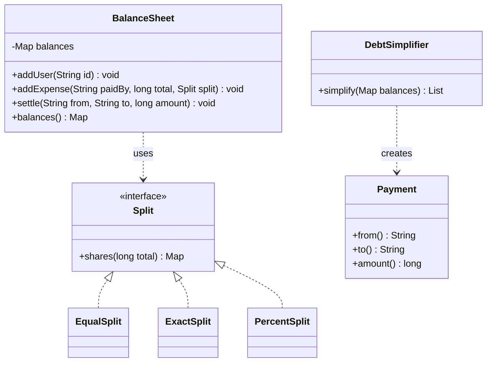
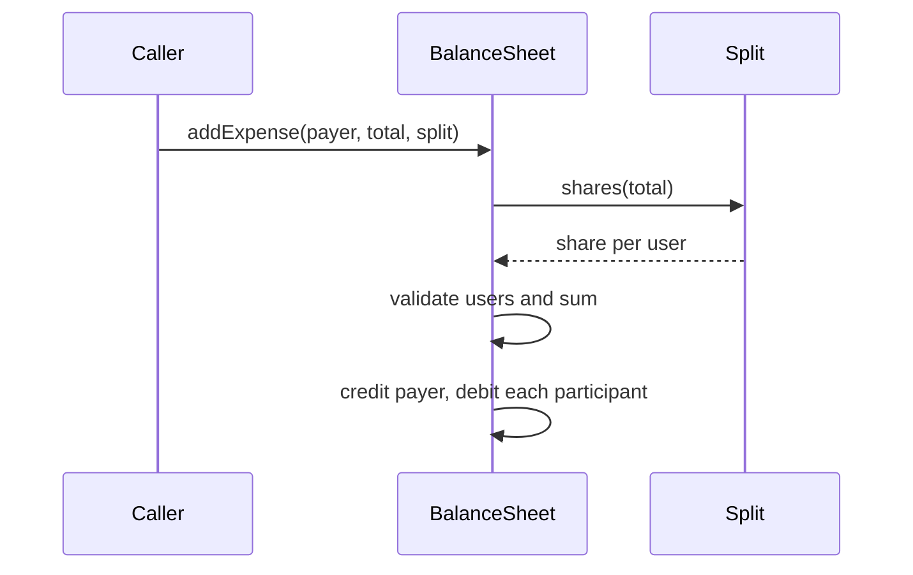

# 12. Splitwise

**Difficulty:** Medium | **Time:** 60 minutes

## 1. Problem statement

Design an application that tracks shared expenses.

- Users add expenses paid by one person and shared among several people.
- An expense can be split equally, by exact amounts or by percentage.
- The shares must add up to the full amount, with no money lost to rounding.
- Each user can see a net balance: positive if others owe them, negative if they owe.
- Users record settlement payments.
- The system suggests a short list of payments that clears all balances.

**Out of scope:** groups, multiple currencies, editing expenses, authentication and persistence.

## 2. What the interviewer wants to evaluate

| Area | What a strong answer shows |
|---|---|
| Requirement clarification | Asks about split types, rounding, currency and debt simplification |
| Polymorphism | Models split types without `if` or `switch` chains |
| Money handling | Uses the smallest currency unit and distributes remainders |
| Invariants | Keeps the sum of all balances at zero |
| Data modelling | Chooses between net and pairwise balances, with reasons |
| Algorithm | Simplifies debts and states the limits of the method |
| Concurrency | Updates balances atomically |
| Validation | Rejects wrong totals and unknown users |

## 3. Design patterns and principles used

### Design patterns

| Pattern | Where | Why |
|---|---|---|
| Strategy | `Split` and its implementations | Each split type calculates shares differently |

A **Factory** helps only if split types are created from raw input such as API requests. Callers here construct them directly.

### Design principles

| Principle | How it applies |
|---|---|
| Single Responsibility | Splits calculate shares, `BalanceSheet` keeps balances, `DebtSimplifier` suggests payments |
| Open/Closed | A new split type needs no change to `BalanceSheet` |
| Liskov Substitution | Every split returns shares that add up to the total |
| Dependency Inversion | `BalanceSheet` depends on the `Split` interface |
| Fail fast | An invalid split changes nothing |

## 4. Solution

### 4.1 Core entities

| Entity | Responsibility |
|---|---|
| `Split` | Turns a total into a share per user |
| `BalanceSheet` | Users and net balances |
| `Payment` | One suggested transfer |
| `DebtSimplifier` | Builds the suggestions |

All amounts are in paise (`long`). Only net balances are stored, which is enough for settlement but does not show who owes whom per expense.

### 4.2 Class diagram



### 4.3 Flow of adding an expense



### 4.4 Java code (Java 17+)

#### Split types

```java
import java.util.Map;

public interface Split {
    /** Returns each participant's share. Shares add up to total. */
    Map<String, Long> shares(long total);
}
```

```java
import java.util.LinkedHashMap;
import java.util.List;
import java.util.Map;

public class EqualSplit implements Split {
    private final List<String> users;

    public EqualSplit(List<String> users) {
        if (users.isEmpty() || users.stream().distinct().count() != users.size()) {
            throw new IllegalArgumentException("Need distinct participants");
        }
        this.users = List.copyOf(users);
    }

    @Override
    public Map<String, Long> shares(long total) {
        long base = total / users.size();
        long remainder = total % users.size();
        Map<String, Long> result = new LinkedHashMap<>();
        for (int i = 0; i < users.size(); i++) {
            // the first few participants pay one extra paisa
            result.put(users.get(i), base + (i < remainder ? 1 : 0));
        }
        return result;
    }
}
```

```java
import java.util.Map;

public class ExactSplit implements Split {
    private final Map<String, Long> amounts;

    public ExactSplit(Map<String, Long> amounts) {
        if (amounts.values().stream().anyMatch(a -> a < 0)) {
            throw new IllegalArgumentException("Shares cannot be negative");
        }
        this.amounts = Map.copyOf(amounts);
    }

    @Override
    public Map<String, Long> shares(long total) {
        long sum = amounts.values().stream().mapToLong(Long::longValue).sum();
        if (sum != total) {
            throw new IllegalArgumentException("Shares must add up to the total");
        }
        return amounts;
    }
}
```

Percentages are given in basis points, where 10000 means 100%.

```java
import java.util.LinkedHashMap;
import java.util.Map;
import java.util.TreeMap;

public class PercentSplit implements Split {
    private final TreeMap<String, Integer> basisPoints;

    public PercentSplit(Map<String, Integer> basisPoints) {
        if (basisPoints.values().stream().anyMatch(p -> p < 0)
                || basisPoints.values().stream().mapToInt(Integer::intValue).sum() != 10_000) {
            throw new IllegalArgumentException("Percentages must total 100");
        }
        this.basisPoints = new TreeMap<>(basisPoints);
    }

    @Override
    public Map<String, Long> shares(long total) {
        Map<String, Long> result = new LinkedHashMap<>();
        long assigned = 0;
        for (var entry : basisPoints.entrySet()) {
            long share = Math.multiplyExact(total, (long) entry.getValue()) / 10_000;
            result.put(entry.getKey(), share);
            assigned += share;
        }
        long remainder = total - assigned;
        for (var entry : result.entrySet()) {
            // rounding leftovers go to people with a non-zero share
            if (remainder > 0 && basisPoints.get(entry.getKey()) > 0) {
                entry.setValue(entry.getValue() + 1);
                remainder--;
            }
        }
        return result;
    }
}
```

#### Balance sheet

```java
import java.util.Map;
import java.util.TreeMap;

public class BalanceSheet {
    private final Map<String, Long> balances = new TreeMap<>();

    public synchronized void addUser(String id) {
        balances.putIfAbsent(id, 0L);
    }

    public synchronized void addExpense(String paidBy, long total, Split split) {
        if (total <= 0) {
            throw new IllegalArgumentException("Amount must be positive");
        }
        Map<String, Long> shares = split.shares(total);
        // validate everything before changing anything
        requireUser(paidBy);
        shares.keySet().forEach(this::requireUser);

        balances.merge(paidBy, total, Long::sum);
        shares.forEach((user, share) -> balances.merge(user, -share, Long::sum));
    }

    public synchronized void settle(String from, String to, long amount) {
        requireUser(from);
        requireUser(to);
        if (amount <= 0 || from.equals(to)) {
            throw new IllegalArgumentException("Invalid payment");
        }
        balances.merge(from, amount, Long::sum);
        balances.merge(to, -amount, Long::sum);
    }

    public synchronized Map<String, Long> balances() {
        return new TreeMap<>(balances);
    }

    private void requireUser(String id) {
        if (!balances.containsKey(id)) {
            throw new IllegalArgumentException("Unknown user: " + id);
        }
    }
}
```

#### Debt simplification

Repeatedly match the largest debtor with the largest creditor. For N people with non-zero balances this needs at most N − 1 payments. It is **not** guaranteed to find the minimum number, which is NP-hard in general.

```java
public record Payment(String from, String to, long amount) { }
```

```java
import java.util.ArrayList;
import java.util.Comparator;
import java.util.List;
import java.util.Map;
import java.util.PriorityQueue;

public class DebtSimplifier {
    private record Entry(String user, long amount) { }

    /** Balances must add up to zero. */
    public List<Payment> simplify(Map<String, Long> balances) {
        Comparator<Entry> largestFirst = Comparator.comparingLong(Entry::amount)
                .reversed().thenComparing(Entry::user);
        PriorityQueue<Entry> creditors = new PriorityQueue<>(largestFirst);
        PriorityQueue<Entry> debtors = new PriorityQueue<>(largestFirst);

        balances.forEach((user, value) -> {
            if (value > 0) {
                creditors.add(new Entry(user, value));
            } else if (value < 0) {
                debtors.add(new Entry(user, -value));
            }
        });

        List<Payment> payments = new ArrayList<>();
        while (!creditors.isEmpty() && !debtors.isEmpty()) {
            Entry creditor = creditors.remove();
            Entry debtor = debtors.remove();
            long paid = Math.min(creditor.amount(), debtor.amount());
            payments.add(new Payment(debtor.user(), creditor.user(), paid));

            if (creditor.amount() > paid) {
                creditors.add(new Entry(creditor.user(), creditor.amount() - paid));
            }
            if (debtor.amount() > paid) {
                debtors.add(new Entry(debtor.user(), debtor.amount() - paid));
            }
        }
        return payments;
    }
}
```

#### Demo

```java
import java.util.List;

public class SplitwiseDemo {
    public static void main(String[] args) {
        BalanceSheet sheet = new BalanceSheet();
        List<String> users = List.of("asha", "ravi", "meena");
        users.forEach(sheet::addUser);

        sheet.addExpense("asha", 10_000, new EqualSplit(users));
        System.out.println(sheet.balances());
        System.out.println(new DebtSimplifier().simplify(sheet.balances()));
    }
}
```

### 4.5 Complexity

Let P be participants in an expense and N users.

| Operation | Time |
|---|---|
| Add expense | O(P log N), plus O(P log P) for a percentage split |
| Settle | O(log N) |
| Simplify | O(N log N) |

## 5. Follow-up questions

| Question | Answer outline |
|---|---|
| How would you minimise the number of settlement payments? | Greedy matching gives a short list. An exact minimum needs a search over subsets that sum to zero, practical only for small groups |
| How would you show an expense history? | Store immutable `Expense` records and derive balances from them |
| How would you edit or delete an expense? | Add a reversing entry, then the corrected one |
| How would you support groups? | Give each group its own balance sheet |
| How would you handle multiple currencies? | Keep balances per currency, and convert only at a recorded rate |
| How do you stop a repeated request adding an expense twice? | Require a unique expense ID |
