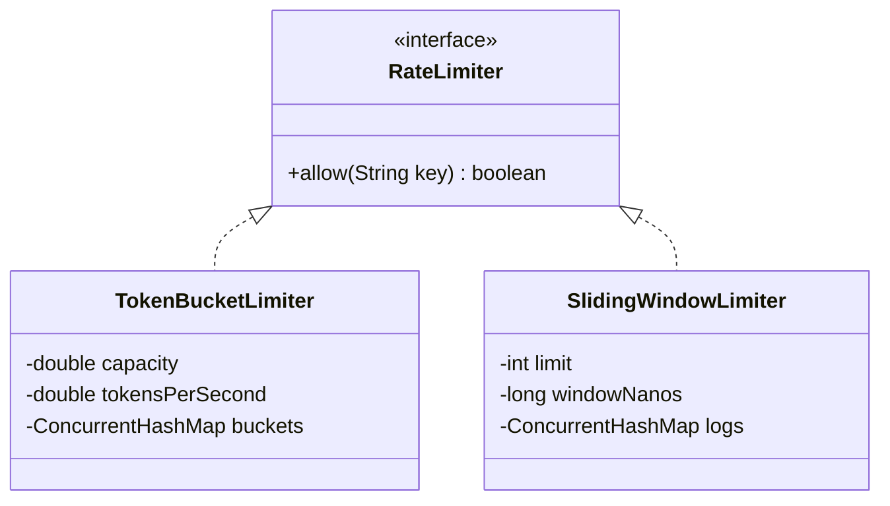
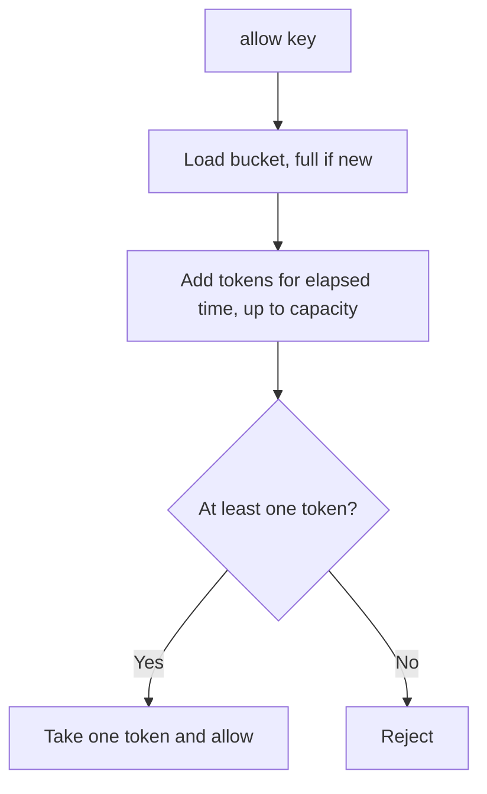

# 13. Rate Limiter

**Difficulty:** Medium | **Time:** 60 minutes

## 1. Problem statement

Design a library that limits how many requests each user can make.

- `allow(key)` returns `true` if the request is within the limit, and `false` otherwise.
- Each key, such as a user ID, has its own limit.
- Support two algorithms: **token bucket** and **sliding window log**.
- Token bucket allows bursts up to a capacity and refills at a steady rate.
- Sliding window log allows at most N requests in any window of a given length.
- Many threads can call the limiter at the same time.
- Rejected requests do not use up any allowance.
- The limiter runs inside one process.

**Out of scope:** distributed limits, different limits per key and removal of idle keys.

## 2. What the interviewer wants to evaluate

| Area | What a strong answer shows |
|---|---|
| Requirement clarification | Asks about scope, bursts, accuracy and what happens on rejection |
| Algorithm knowledge | Compares fixed window, sliding window and token bucket |
| Trade-offs | Weighs memory against accuracy |
| Thread safety | Makes read, update and decision atomic per key |
| Contention | Avoids one global lock |
| Time handling | Uses a monotonic clock and injects it for tests |
| Extensibility | Adds an algorithm behind one interface |
| Distributed thinking | Explains what breaks across several servers |

## 3. Design patterns and principles used

### Design patterns

| Pattern | Where | Why |
|---|---|---|
| Strategy | `RateLimiter` implementations | The algorithm can be chosen per use case |

Both algorithms rely on `ConcurrentHashMap.compute`, which runs the update atomically for one key.

### Design principles

| Principle | How it applies |
|---|---|
| Single Responsibility | Each class implements one algorithm |
| Open/Closed | A new algorithm is a new class |
| Liskov Substitution | Callers can use either limiter unchanged |
| Dependency Inversion | Time comes from an injected `LongSupplier` |
| Interface Segregation | The interface has a single method |

## 4. Solution

### 4.1 Algorithm comparison

| Algorithm | Memory per key | Accuracy | Bursts |
|---|---|---|---|
| Fixed window counter | O(1) | Can allow twice the limit around a boundary | Uncontrolled at boundaries |
| Sliding window log | O(N) | Exact | Up to N |
| Sliding window counter | O(1) | Approximate | Smoothed |
| Token bucket | O(1) | Enforces average rate and burst size | Up to capacity |

### 4.2 Class diagram



### 4.3 Token bucket decision



### 4.4 Java code (Java 17+)

#### Interface

```java
public interface RateLimiter {
    boolean allow(String key);
}
```

#### Token bucket

Tokens are refilled when a request arrives, so no background thread is needed.

```java
import java.util.concurrent.ConcurrentHashMap;
import java.util.function.LongSupplier;

public class TokenBucketLimiter implements RateLimiter {
    private record Bucket(double tokens, long updatedAt) { }

    private final double capacity;
    private final double tokensPerSecond;
    private final LongSupplier nanoTime;
    private final ConcurrentHashMap<String, Bucket> buckets = new ConcurrentHashMap<>();

    public TokenBucketLimiter(int capacity, double tokensPerSecond, LongSupplier nanoTime) {
        if (capacity < 1 || !(tokensPerSecond > 0)) {
            throw new IllegalArgumentException("Invalid limit");
        }
        this.capacity = capacity;
        this.tokensPerSecond = tokensPerSecond;
        this.nanoTime = nanoTime;
    }

    @Override
    public boolean allow(String key) {
        boolean[] allowed = new boolean[1];
        buckets.compute(key, (k, old) -> {
            long now = nanoTime.getAsLong(); // read inside the atomic update
            double tokens = old == null
                    ? capacity
                    : Math.min(capacity,
                            old.tokens() + (now - old.updatedAt()) / 1e9 * tokensPerSecond);
            allowed[0] = tokens >= 1;
            return new Bucket(allowed[0] ? tokens - 1 : tokens, now);
        });
        return allowed[0];
    }
}
```

#### Sliding window log

```java
import java.time.Duration;
import java.util.ArrayDeque;
import java.util.Deque;
import java.util.concurrent.ConcurrentHashMap;
import java.util.function.LongSupplier;

public class SlidingWindowLimiter implements RateLimiter {
    private final int limit;
    private final long windowNanos;
    private final LongSupplier nanoTime;
    private final ConcurrentHashMap<String, Deque<Long>> logs = new ConcurrentHashMap<>();

    public SlidingWindowLimiter(int limit, Duration window, LongSupplier nanoTime) {
        if (limit < 1 || window.isZero() || window.isNegative()) {
            throw new IllegalArgumentException("Invalid limit");
        }
        this.limit = limit;
        this.windowNanos = window.toNanos();
        this.nanoTime = nanoTime;
    }

    @Override
    public boolean allow(String key) {
        boolean[] allowed = new boolean[1];
        logs.compute(key, (k, existing) -> {
            Deque<Long> log = existing == null ? new ArrayDeque<>() : existing;
            long now = nanoTime.getAsLong();
            while (!log.isEmpty() && now - log.peekFirst() >= windowNanos) {
                log.removeFirst(); // outside the window
            }
            allowed[0] = log.size() < limit;
            if (allowed[0]) {
                log.addLast(now);
            }
            return log;
        });
        return allowed[0];
    }
}
```

#### Demo

```java
public class RateLimiterDemo {
    public static void main(String[] args) {
        RateLimiter limiter = new TokenBucketLimiter(3, 1.0, System::nanoTime);
        for (int i = 1; i <= 5; i++) {
            System.out.println("Request " + i + ": " + limiter.allow("asha"));
        }
    }
}
```

`System.nanoTime` is used because it does not jump when the wall clock is changed.

### 4.5 Complexity

| Limiter | Time per request | Space |
|---|---|---|
| Token bucket | O(1) average | O(K) for K keys |
| Sliding window log | Amortised O(1) average | O(K × N) |

## 5. Follow-up questions

| Question | Answer outline |
|---|---|
| What changes if the limit must hold across many servers? | Move state to a shared store such as Redis and update it with one atomic script. Decide whether to allow or reject when the store is down |
| How would you remove idle keys? | Use an expiring cache, removing only entries whose allowance has fully recovered |
| How would you set different limits per user? | Look up a rule for each key from a configuration provider |
| How would you tell the client when to retry? | Return a result object with the wait time |
| How would you apply several limits at once? | Check all of them atomically, so a rejection by one does not consume another |
