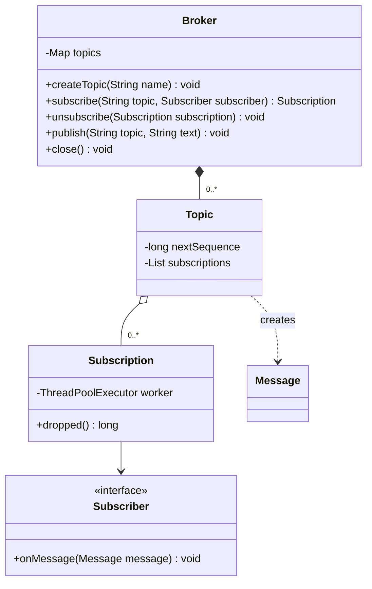
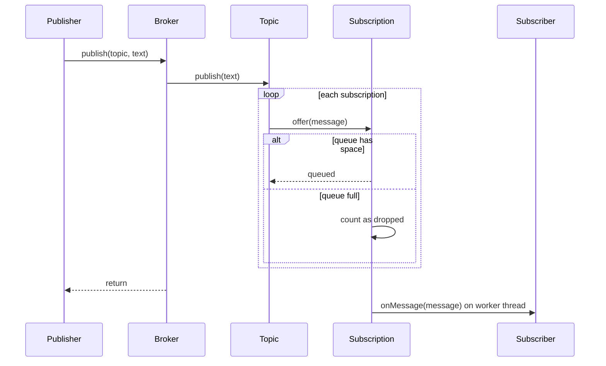

# 14. Pub-Sub System

**Difficulty:** Medium | **Time:** 60 minutes

## 1. Problem statement

Design an in-memory publish-subscribe system.

- Publishers send messages to named topics.
- Subscribers subscribe to a topic and receive every message published after they subscribe.
- Each subscriber receives a topic's messages in publish order.
- Publishers do not wait for subscribers to process messages.
- A slow or failing subscriber must not delay the others.
- Each subscription has a bounded queue. When it is full, new messages for that subscriber are dropped and counted.
- After unsubscribing, no new messages are accepted, but queued ones are still delivered.
- Closing the broker delivers queued messages and stops all threads.

**Out of scope:** persistence, replay, acknowledgements, redelivery and network communication.

## 2. What the interviewer wants to evaluate

| Area | What a strong answer shows |
|---|---|
| Requirement clarification | Asks about ordering, delivery guarantees, slow consumers and history |
| Decoupling | Publishers and subscribers do not know each other |
| Concurrency | Delivers in parallel while keeping order per subscriber |
| Backpressure | Uses bounded queues and states the overflow policy |
| Failure isolation | Contains subscriber exceptions |
| Lifecycle | Handles unsubscribe and shutdown without leaking threads |
| Trade-offs | Compares blocking, dropping and buffering |

## 3. Design patterns and principles used

### Design patterns

| Pattern | Where | Why |
|---|---|---|
| Observer | `Subscriber` registered on a topic | Subscribers are told about new messages |
| Producer-consumer | Queue per `Subscription` | Separates publishing speed from processing speed |
| Mediator | `Broker` | Publishers and subscribers communicate only through it |

A single-threaded `ThreadPoolExecutor` with a bounded queue gives the queue, the worker and ordering together.

### Design principles

| Principle | How it applies |
|---|---|
| Single Responsibility | `Broker` manages topics, `Topic` fans out, `Subscription` delivers |
| Open/Closed | New consumers implement `Subscriber` |
| Dependency Inversion | Delivery depends on the `Subscriber` interface |
| Loose coupling | Neither side holds a reference to the other |
| Immutability | `Message` is a record |

## 4. Solution

### 4.1 Core entities

| Entity | Responsibility |
|---|---|
| `Message` | Topic, sequence number and text |
| `Subscriber` | Processes messages |
| `Subscription` | Queue and worker for one subscriber |
| `Topic` | Orders messages and fans them out |
| `Broker` | Public entry point |

### 4.2 Class diagram



### 4.3 Flow of a publish



### 4.4 Java code (Java 17+)

#### Message and subscriber

```java
public record Message(String topic, long sequence, String text) { }
```

```java
public interface Subscriber {
    void onMessage(Message message);
}
```

#### Subscription

```java
import java.util.concurrent.ArrayBlockingQueue;
import java.util.concurrent.RejectedExecutionException;
import java.util.concurrent.ThreadPoolExecutor;
import java.util.concurrent.TimeUnit;
import java.util.concurrent.atomic.AtomicLong;

public class Subscription {
    private final String topic;
    private final Subscriber subscriber;
    private final ThreadPoolExecutor worker;
    private final AtomicLong dropped = new AtomicLong();

    Subscription(String topic, Subscriber subscriber, int capacity) {
        this.topic = topic;
        this.subscriber = subscriber;
        // one thread keeps order, and the default policy rejects when full
        this.worker = new ThreadPoolExecutor(1, 1, 0, TimeUnit.MILLISECONDS,
                new ArrayBlockingQueue<>(capacity));
    }

    public String topic() {
        return topic;
    }

    public long dropped() {
        return dropped.get();
    }

    void offer(Message message) {
        try {
            worker.execute(() -> deliver(message));
        } catch (RejectedExecutionException full) {
            dropped.incrementAndGet();
        }
    }

    private void deliver(Message message) {
        try {
            subscriber.onMessage(message);
        } catch (RuntimeException e) {
            System.err.println("Subscriber failed: " + e.getMessage());
        }
    }

    /** Accepts nothing new but finishes queued messages. */
    void stop() {
        worker.shutdown();
    }

    boolean awaitStop(long seconds) throws InterruptedException {
        return worker.awaitTermination(seconds, TimeUnit.SECONDS);
    }
}
```

#### Topic

`publish` is synchronized, so all subscribers see concurrent publishes in the same order.

```java
import java.util.ArrayList;
import java.util.List;

public class Topic {
    private final String name;
    private final List<Subscription> subscriptions = new ArrayList<>();
    private long nextSequence = 1;

    Topic(String name) {
        this.name = name;
    }

    synchronized void add(Subscription subscription) {
        subscriptions.add(subscription);
    }

    synchronized void remove(Subscription subscription) {
        if (subscriptions.remove(subscription)) {
            subscription.stop();
        }
    }

    synchronized void publish(String text) {
        Message message = new Message(name, nextSequence++, text);
        subscriptions.forEach(s -> s.offer(message)); // never blocks
    }

    synchronized List<Subscription> removeAll() {
        List<Subscription> removed = List.copyOf(subscriptions);
        removed.forEach(this::remove);
        return removed;
    }
}
```

#### Broker

```java
import java.util.ArrayList;
import java.util.HashMap;
import java.util.List;
import java.util.Map;

public class Broker implements AutoCloseable {
    private final Map<String, Topic> topics = new HashMap<>();
    private final int queueCapacity;
    private boolean closed;

    public Broker(int queueCapacity) {
        this.queueCapacity = queueCapacity;
    }

    public synchronized void createTopic(String name) {
        requireOpen();
        topics.computeIfAbsent(name, Topic::new);
    }

    public synchronized Subscription subscribe(String topic, Subscriber subscriber) {
        Topic target = topic(topic);
        Subscription subscription = new Subscription(topic, subscriber, queueCapacity);
        target.add(subscription);
        return subscription;
    }

    public synchronized void unsubscribe(Subscription subscription) {
        topic(subscription.topic()).remove(subscription);
    }

    public void publish(String topic, String text) {
        Topic target;
        synchronized (this) {
            target = topic(topic);
        }
        target.publish(text); // other topics are not blocked
    }

    /** Do not call this from inside a subscriber. */
    @Override
    public void close() {
        List<Subscription> stopping = new ArrayList<>();
        synchronized (this) {
            if (closed) {
                return;
            }
            closed = true;
            topics.values().forEach(t -> stopping.addAll(t.removeAll()));
        }
        try {
            for (Subscription subscription : stopping) {
                if (!subscription.awaitStop(10)) {
                    System.err.println("A subscriber is still running");
                }
            }
        } catch (InterruptedException e) {
            Thread.currentThread().interrupt();
        }
    }

    private Topic topic(String name) {
        requireOpen();
        Topic topic = topics.get(name);
        if (topic == null) {
            throw new IllegalArgumentException("Unknown topic: " + name);
        }
        return topic;
    }

    private void requireOpen() {
        if (closed) {
            throw new IllegalStateException("Broker is closed");
        }
    }
}
```

A publish that overlaps `close` may be dropped.

#### Demo

```java
public class PubSubDemo {
    public static void main(String[] args) {
        try (Broker broker = new Broker(100)) {
            broker.createTopic("orders");
            broker.subscribe("orders", m -> System.out.println("Email: " + m.text()));
            broker.subscribe("orders", m -> System.out.println("Audit: " + m.sequence()));
            broker.publish("orders", "Order 42 placed");
        }
    }
}
```

### 4.5 Complexity

Let S be the subscribers of a topic.

| Operation | Time |
|---|---|
| Publish | O(S) |
| Subscribe | O(1) |
| Unsubscribe | O(S) |

Queue memory is bounded by the number of subscriptions times the capacity. Threads grow with subscriptions.

## 5. Follow-up questions

| Question | Answer outline |
|---|---|
| How do you handle a slow subscriber and keep message order? | A bounded queue and one worker per subscriber. State the overflow policy |
| How would you support thousands of subscribers? | Share a thread pool, and allow only one active task per subscription |
| How would you guarantee at-least-once delivery? | Persist messages, require acknowledgements and redeliver. Consumers must tolerate duplicates |
| How would a new subscriber read old messages? | Keep a log per topic and an offset per subscriber |
| How would you scale one topic? | Split it into partitions and keep order within each key |
