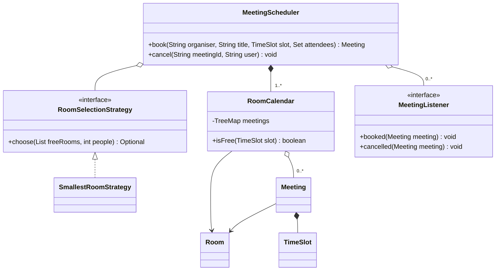
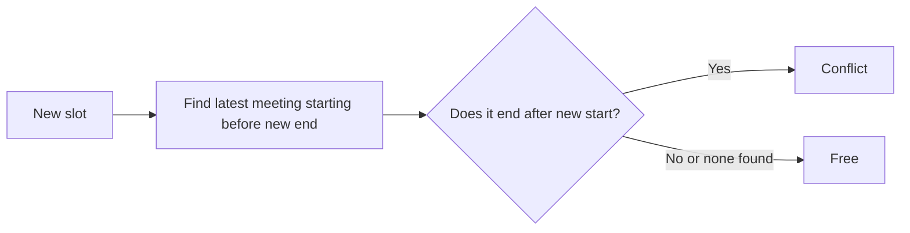

# 15. Meeting Scheduler

**Difficulty:** Medium | **Time:** 60 minutes

## 1. Problem statement

Design a system that books meeting rooms.

- Each room has an ID and a capacity.
- A user books a meeting with a title, a start time, an end time and attendees.
- The system picks a free room that is large enough. By default it picks the smallest.
- A room cannot hold two overlapping meetings, even with concurrent requests.
- A meeting that starts exactly when another ends does not overlap it.
- The organiser can cancel a meeting.
- Attendees are notified when a meeting is booked or cancelled.

**Out of scope:** attendee availability, recurring meetings, time zone display, invitations and persistence.

## 2. What the interviewer wants to evaluate

| Area | What a strong answer shows |
|---|---|
| Requirement clarification | Asks about capacity, overlaps, recurrence and attendee conflicts |
| Object modelling | Separates room, time slot, meeting, calendar and scheduler |
| Interval logic | Writes a correct overlap check |
| Data structure choice | Uses a sorted map to find conflicts quickly |
| Concurrency | Checks and books atomically |
| Extensibility | Changes room selection and notification independently |
| Failure isolation | A failed notification does not undo a booking |

## 3. Design patterns and principles used

### Design patterns

| Pattern | Where | Why |
|---|---|---|
| Strategy | `RoomSelectionStrategy` | Selection can favour size, floor or equipment |
| Observer | `MeetingListener` | Notifications and other reactions are added without changing booking logic |
| Facade | `MeetingScheduler` | One entry point for callers |

### Design principles

| Principle | How it applies |
|---|---|
| Single Responsibility | `RoomCalendar` finds conflicts, the scheduler coordinates, listeners notify |
| Open/Closed | New strategies and listeners are new classes |
| Dependency Inversion | The scheduler depends on interfaces |
| Information Expert | `TimeSlot` validates itself and the calendar owns conflicts |
| Immutability | `Room`, `TimeSlot` and `Meeting` are records |

## 4. Solution

### 4.1 Core entities

| Entity | Responsibility |
|---|---|
| `Room` | ID and capacity |
| `TimeSlot` | Start and end |
| `Meeting` | A confirmed booking |
| `RoomCalendar` | Meetings of one room |
| `MeetingScheduler` | Books and cancels |

### 4.2 Class diagram



### 4.3 Conflict check

Meetings in a room never overlap, so only the latest meeting that starts before the new end can conflict.



### 4.4 Java code (Java 17+)

#### Domain

```java
public record Room(String id, int capacity) { }
```

```java
import java.time.Instant;

/** The start is included and the end is not. */
public record TimeSlot(Instant start, Instant end) {
    public TimeSlot {
        if (!start.isBefore(end)) {
            throw new IllegalArgumentException("End must be after start");
        }
    }
}
```

```java
import java.util.Set;

public record Meeting(String id, String organiser, String title,
                      TimeSlot slot, Room room, Set<String> attendees) { }
```

#### Room calendar

```java
import java.time.Instant;
import java.util.TreeMap;

public class RoomCalendar {
    private final Room room;
    private final TreeMap<Instant, Meeting> meetings = new TreeMap<>(); // by start

    RoomCalendar(Room room) {
        this.room = room;
    }

    Room room() {
        return room;
    }

    boolean isFree(TimeSlot slot) {
        var previous = meetings.lowerEntry(slot.end());
        return previous == null
                || !previous.getValue().slot().end().isAfter(slot.start());
    }

    void add(Meeting meeting) {
        meetings.put(meeting.slot().start(), meeting);
    }

    void remove(Meeting meeting) {
        meetings.remove(meeting.slot().start());
    }
}
```

#### Strategy and listener

```java
import java.util.List;
import java.util.Optional;

public interface RoomSelectionStrategy {
    Optional<Room> choose(List<Room> freeRooms, int people);
}
```

```java
import java.util.Comparator;
import java.util.List;
import java.util.Optional;

public class SmallestRoomStrategy implements RoomSelectionStrategy {
    @Override
    public Optional<Room> choose(List<Room> freeRooms, int people) {
        return freeRooms.stream()
                .filter(room -> room.capacity() >= people)
                .min(Comparator.comparingInt(Room::capacity).thenComparing(Room::id));
    }
}
```

```java
public interface MeetingListener {
    void booked(Meeting meeting);
    void cancelled(Meeting meeting);
}
```

#### Scheduler

Listeners run outside the lock, so a slow notification does not block other bookings.

```java
import java.util.HashMap;
import java.util.HashSet;
import java.util.LinkedHashMap;
import java.util.List;
import java.util.Map;
import java.util.Set;
import java.util.UUID;
import java.util.function.Consumer;

public class MeetingScheduler {
    private final Map<String, RoomCalendar> calendars = new LinkedHashMap<>(); // by room ID
    private final Map<String, Meeting> meetings = new HashMap<>();
    private final RoomSelectionStrategy selection;
    private final List<MeetingListener> listeners;

    public MeetingScheduler(List<Room> rooms, RoomSelectionStrategy selection,
                            List<MeetingListener> listeners) {
        for (Room room : rooms) {
            if (calendars.put(room.id(), new RoomCalendar(room)) != null) {
                throw new IllegalArgumentException("Duplicate room");
            }
        }
        this.selection = selection;
        this.listeners = List.copyOf(listeners);
    }

    public Meeting book(String organiser, String title, TimeSlot slot,
                        Set<String> attendees) {
        Set<String> everyone = new HashSet<>(attendees);
        everyone.add(organiser);
        Meeting meeting;
        synchronized (this) {
            List<Room> free = calendars.values().stream()
                    .filter(c -> c.isFree(slot))
                    .map(RoomCalendar::room)
                    .toList();
            Room room = selection.choose(free, everyone.size())
                    .orElseThrow(() -> new IllegalStateException("No suitable room"));
            meeting = new Meeting(UUID.randomUUID().toString(), organiser, title,
                    slot, room, Set.copyOf(everyone));
            calendars.get(room.id()).add(meeting);
            meetings.put(meeting.id(), meeting);
        }
        publish(l -> l.booked(meeting));
        return meeting;
    }

    public void cancel(String meetingId, String user) {
        Meeting meeting;
        synchronized (this) {
            meeting = meetings.get(meetingId);
            if (meeting == null) {
                throw new IllegalArgumentException("Unknown meeting");
            }
            if (!meeting.organiser().equals(user)) {
                throw new IllegalStateException("Only the organiser can cancel");
            }
            meetings.remove(meetingId);
            calendars.get(meeting.room().id()).remove(meeting);
        }
        publish(l -> l.cancelled(meeting));
    }

    private void publish(Consumer<MeetingListener> event) {
        for (MeetingListener listener : listeners) {
            try {
                event.accept(listener);
            } catch (RuntimeException e) {
                System.err.println("Listener failed: " + e.getMessage());
            }
        }
    }
}
```

#### Demo

```java
import java.time.Duration;
import java.time.Instant;
import java.util.List;
import java.util.Set;

public class MeetingSchedulerDemo {
    public static void main(String[] args) {
        MeetingListener printer = new MeetingListener() {
            @Override
            public void booked(Meeting m) {
                System.out.println("Booked " + m.title() + " in " + m.room().id());
            }

            @Override
            public void cancelled(Meeting m) {
                System.out.println("Cancelled " + m.title());
            }
        };

        MeetingScheduler scheduler = new MeetingScheduler(
                List.of(new Room("Small", 4), new Room("Large", 12)),
                new SmallestRoomStrategy(),
                List.of(printer));

        Instant start = Instant.now().plus(Duration.ofHours(1));
        TimeSlot slot = new TimeSlot(start, start.plus(Duration.ofMinutes(30)));
        Meeting meeting = scheduler.book("asha", "Design review", slot, Set.of("ravi"));
        scheduler.cancel(meeting.id(), "asha");
    }
}
```

### 4.5 Complexity

Let R be rooms, M meetings per room, A attendees and L listeners.

| Operation | Time |
|---|---|
| Book | O(R log M + A), plus notifications to L listeners |
| Cancel | O(log M), plus notifications to L listeners |

## 5. Follow-up questions

| Question | Answer outline |
|---|---|
| How would you support recurring meetings? | Store a recurrence rule, expand it up to a horizon, and check every occurrence before booking all of them |
| How would you check attendee availability? | Keep a calendar per user and include it in the same atomic check |
| How would you suggest a free time? | Merge the busy intervals and return gaps that are long enough |
| How do you prevent double booking across servers? | Use a database transaction or an exclusion constraint on room and time range |
| How would you reschedule a meeting? | Reserve the new slot first, then release the old one in one atomic operation |
