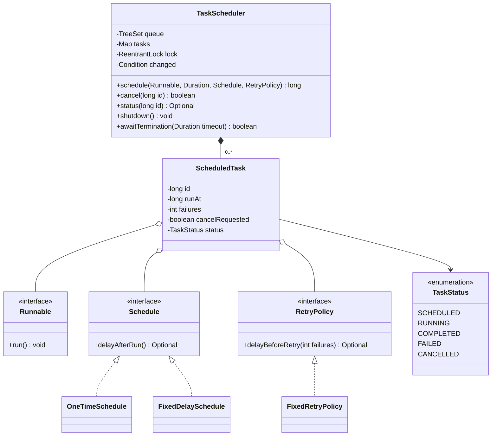
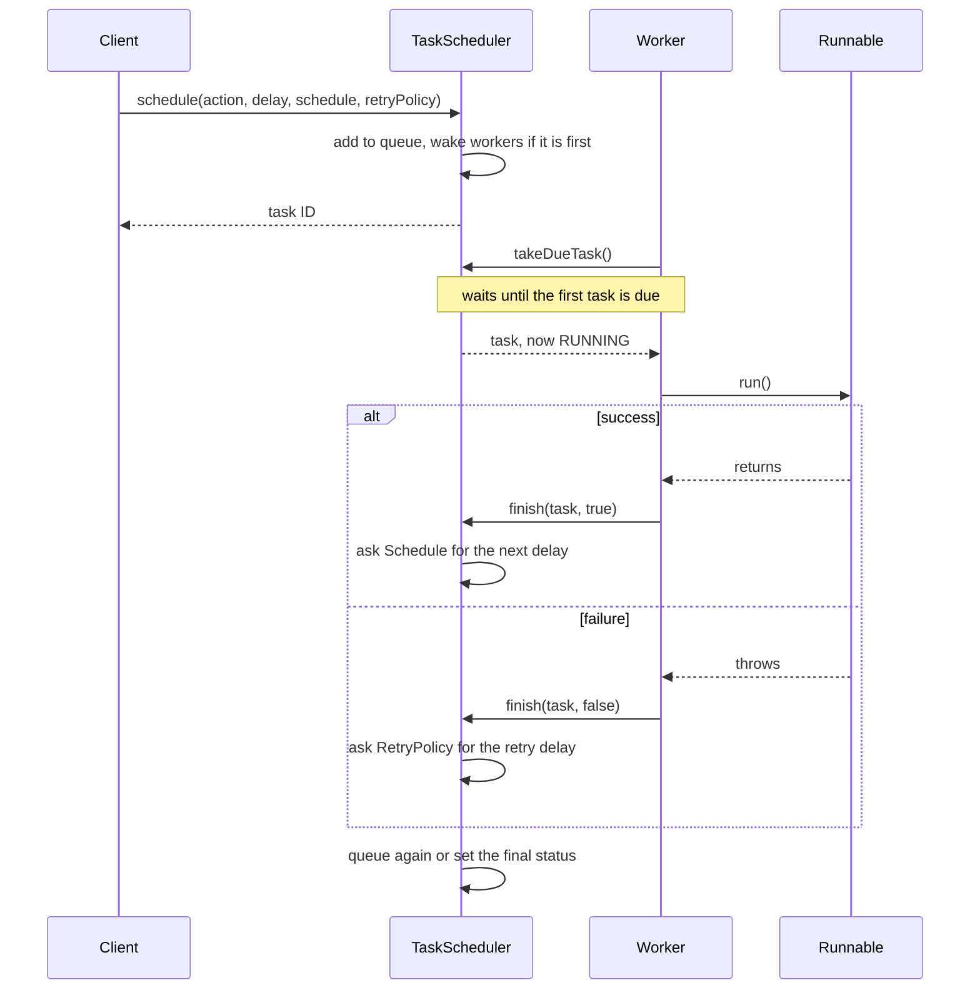

# 16. Task Scheduler

**Difficulty:** Medium | **Time:** 60 minutes

## 1. Problem statement

Design an in-process library that runs tasks at a later time.

- A client schedules a task to run after a delay. A zero delay means as soon as a worker is free.
- A task runs once, or repeats with a fixed delay between the end of one run and the start of the next.
- A fixed number of worker threads run the tasks.
- Tasks that are due run in order of their due time. Ties run in submission order.
- A task never runs twice at the same time.
- A failed run is retried according to the task's retry policy. When retries are used up, the task fails and does not repeat.
- A client can cancel a task. A run already in progress finishes, but no later run or retry starts.
- A client can check the status of a task.
- On shutdown, running tasks finish and waiting tasks are cancelled.
- Many threads can schedule and cancel at the same time.

**Out of scope:** persistence, distributed scheduling, cron expressions, priorities, dependencies between tasks, task timeouts and removal of finished tasks.

## 2. What the interviewer wants to evaluate

| Area | What a strong answer shows |
|---|---|
| Requirement clarification | Asks about repeat types, failures, cancellation, ordering and shutdown |
| Object modelling | Separates the task, its schedule, its retry policy and the scheduler |
| Data structure choice | Keeps tasks ordered by due time |
| Thread coordination | Workers sleep until the next due time without busy waiting |
| Thread safety | Changes the queue and task status under one lock |
| Lock scope | Never runs a task while holding the lock |
| Failure isolation | A failing task does not stop a worker |
| Lifecycle | Handles cancel during a run and shuts down cleanly |

## 3. Design patterns and principles used

### Design patterns

| Pattern | Where | Why |
|---|---|---|
| Producer-consumer | `TaskScheduler` queue | Clients add tasks and workers take them when due |
| Strategy | `Schedule` | One-time and repeating tasks decide the next run differently |
| Strategy | `RetryPolicy` | Retry rules can differ per task |
| Command | `Runnable` | The scheduler runs work without knowing what it does |

Singleton, State and Observer are deliberately left out. A program may want more than one scheduler, the status transitions are few enough for an enum, and nothing has asked to be notified of results.

### Design principles

| Principle | How it applies |
|---|---|
| Single Responsibility | `Schedule` handles repeats, `RetryPolicy` handles failures, `TaskScheduler` handles timing and threads |
| Open/Closed | A new repeat rule or retry rule is a new class |
| Liskov Substitution | The scheduler treats every schedule and retry policy the same way |
| Interface Segregation | Each strategy interface has a single method |
| Dependency Inversion | `TaskScheduler` depends on `Schedule`, `RetryPolicy` and `Runnable` |
| Encapsulation | `ScheduledTask` is hidden, and callers use only its ID |

## 4. Solution

### 4.1 Core entities

| Entity | Responsibility |
|---|---|
| `TaskStatus` | `SCHEDULED`, `RUNNING`, `COMPLETED`, `FAILED` or `CANCELLED` |
| `Schedule` | Says whether and when a task runs again after success |
| `RetryPolicy` | Says whether and when a failed run is retried |
| `ScheduledTask` | The work, its rules and its current state |
| `TaskScheduler` | Queue, workers, cancellation and shutdown |

Status changes:

| From | Event | To |
|---|---|---|
| `SCHEDULED` | A worker takes the due task | `RUNNING` |
| `SCHEDULED` | Cancel or shutdown | `CANCELLED` |
| `RUNNING` | Another run or retry is needed | `SCHEDULED` |
| `RUNNING` | Success with no further run | `COMPLETED` |
| `RUNNING` | Failure with no retry left | `FAILED` |
| `RUNNING` | Another run is needed, but cancel or shutdown was requested | `CANCELLED` |

### 4.2 Class diagram



### 4.3 Flow of one task



`takeDueTask` and `finish` are private methods of `TaskScheduler`. The worker is a thread running inside it.

### 4.4 Java code (Java 17+)

#### Status

```java
public enum TaskStatus { SCHEDULED, RUNNING, COMPLETED, FAILED, CANCELLED }
```

#### Schedules

```java
import java.time.Duration;
import java.util.Optional;

public interface Schedule {
    /**
     * Delay from the end of a successful run to the next one. Empty means no more runs.
     * Called under the scheduler's lock, so it must be quick and must not throw.
     */
    Optional<Duration> delayAfterRun();
}
```

```java
import java.time.Duration;
import java.util.Optional;

public record OneTimeSchedule() implements Schedule {
    @Override
    public Optional<Duration> delayAfterRun() {
        return Optional.empty();
    }
}
```

```java
import java.time.Duration;
import java.util.Optional;

public record FixedDelaySchedule(Duration interval) implements Schedule {
    public FixedDelaySchedule {
        if (interval.isZero() || interval.isNegative()) {
            throw new IllegalArgumentException("Interval must be positive");
        }
    }

    @Override
    public Optional<Duration> delayAfterRun() {
        return Optional.of(interval);
    }
}
```

#### Retry policy

```java
import java.time.Duration;
import java.util.Optional;

public interface RetryPolicy {
    /**
     * failures is the number of failed attempts in a row. Empty means give up.
     * Called under the scheduler's lock, so it must be quick and must not throw.
     */
    Optional<Duration> delayBeforeRetry(int failures);
}
```

```java
import java.time.Duration;
import java.util.Optional;

/** Use zero retries for a task that must not be retried. */
public record FixedRetryPolicy(int maxRetries, Duration delay) implements RetryPolicy {
    public FixedRetryPolicy {
        if (maxRetries < 0 || delay.isNegative()) {
            throw new IllegalArgumentException("Invalid retry policy");
        }
    }

    @Override
    public Optional<Duration> delayBeforeRetry(int failures) {
        return failures <= maxRetries ? Optional.of(delay) : Optional.empty();
    }
}
```

#### Scheduled task

All mutable fields are read and written only under the scheduler's lock.

```java
final class ScheduledTask {
    final long id;
    final Runnable action;
    final Schedule schedule;
    final RetryPolicy retryPolicy;

    long runAt; // never changed while the task is in the queue
    int failures;
    boolean cancelRequested;
    TaskStatus status;

    ScheduledTask(long id, Runnable action, Schedule schedule, RetryPolicy retryPolicy) {
        this.id = id;
        this.action = action;
        this.schedule = schedule;
        this.retryPolicy = retryPolicy;
    }
}
```

#### Scheduler

A `TreeSet` ordered by due time gives the next task quickly and also removes a cancelled task in O(log n). Each idle worker sleeps until the first task is due. Workers are woken early only when a new task goes to the front of the queue, or on shutdown.

```java
import java.time.Duration;
import java.util.ArrayList;
import java.util.Comparator;
import java.util.HashMap;
import java.util.List;
import java.util.Map;
import java.util.Objects;
import java.util.Optional;
import java.util.TreeSet;
import java.util.concurrent.TimeUnit;
import java.util.concurrent.locks.Condition;
import java.util.concurrent.locks.ReentrantLock;

public class TaskScheduler {
    private final ReentrantLock lock = new ReentrantLock();
    private final Condition changed = lock.newCondition();
    private final TreeSet<ScheduledTask> queue = new TreeSet<>(
            Comparator.<ScheduledTask>comparingLong(t -> t.runAt)
                    .thenComparingLong(t -> t.id));
    private final Map<Long, ScheduledTask> tasks = new HashMap<>();
    private final List<Thread> workers = new ArrayList<>();
    private final long origin = System.nanoTime();
    private long nextId = 1;
    private boolean stopped;

    public TaskScheduler(int workerCount) {
        if (workerCount < 1) {
            throw new IllegalArgumentException("Need at least one worker");
        }
        for (int i = 1; i <= workerCount; i++) {
            Thread worker = new Thread(this::workerLoop, "scheduler-worker-" + i);
            workers.add(worker);
            worker.start();
        }
    }

    public long schedule(Runnable action, Duration delay, Schedule schedule,
                         RetryPolicy retryPolicy) {
        Objects.requireNonNull(action);
        Objects.requireNonNull(schedule);
        Objects.requireNonNull(retryPolicy);
        if (delay.isNegative()) {
            throw new IllegalArgumentException("Delay cannot be negative");
        }
        lock.lock();
        try {
            if (stopped) {
                throw new IllegalStateException("Scheduler is shut down");
            }
            ScheduledTask task = new ScheduledTask(nextId++, action, schedule, retryPolicy);
            enqueue(task, delay);
            tasks.put(task.id, task);
            return task.id;
        } finally {
            lock.unlock();
        }
    }

    /** Returns true if the task was still active. It will not start again. */
    public boolean cancel(long id) {
        lock.lock();
        try {
            ScheduledTask task = tasks.get(id);
            if (task == null) {
                return false;
            }
            if (task.status == TaskStatus.SCHEDULED) {
                queue.remove(task);
                task.status = TaskStatus.CANCELLED;
                return true;
            }
            if (task.status == TaskStatus.RUNNING) {
                task.cancelRequested = true;
                return true;
            }
            return false;
        } finally {
            lock.unlock();
        }
    }

    public Optional<TaskStatus> status(long id) {
        lock.lock();
        try {
            return Optional.ofNullable(tasks.get(id)).map(t -> t.status);
        } finally {
            lock.unlock();
        }
    }

    public void shutdown() {
        lock.lock();
        try {
            stopped = true;
            queue.forEach(t -> t.status = TaskStatus.CANCELLED);
            queue.clear();
            changed.signalAll();
        } finally {
            lock.unlock();
        }
    }

    /** Returns true if every worker stopped within the timeout. */
    public boolean awaitTermination(Duration timeout) throws InterruptedException {
        long deadline = System.nanoTime() + timeout.toNanos();
        for (Thread worker : workers) {
            TimeUnit.NANOSECONDS.timedJoin(worker, deadline - System.nanoTime());
            if (worker.isAlive()) {
                return false;
            }
        }
        return true;
    }

    private long now() {
        return System.nanoTime() - origin;
    }

    /** The caller must hold the lock. */
    private void enqueue(ScheduledTask task, Duration delay) {
        task.runAt = Math.addExact(now(), delay.toNanos());
        task.status = TaskStatus.SCHEDULED;
        queue.add(task);
        if (queue.first() == task) {
            changed.signalAll();
        }
    }

    private void workerLoop() {
        try {
            ScheduledTask task;
            while ((task = takeDueTask()) != null) {
                boolean succeeded = runSafely(task.action);
                Thread.interrupted(); // a task must not leave the worker interrupted
                finish(task, succeeded);
            }
        } catch (InterruptedException e) {
            Thread.currentThread().interrupt();
        }
    }

    /** Blocks until a task is due. Returns null after shutdown. */
    private ScheduledTask takeDueTask() throws InterruptedException {
        lock.lockInterruptibly();
        try {
            while (!stopped) {
                if (queue.isEmpty()) {
                    changed.await();
                    continue;
                }
                long waitNanos = queue.first().runAt - now();
                if (waitNanos <= 0) {
                    ScheduledTask task = queue.pollFirst();
                    task.status = TaskStatus.RUNNING;
                    return task;
                }
                changed.awaitNanos(waitNanos); // the loop checks everything again
            }
            return null;
        } finally {
            lock.unlock();
        }
    }

    private boolean runSafely(Runnable action) {
        try {
            action.run();
            return true;
        } catch (Throwable e) { // one bad task must not kill the worker
            System.err.println("Task failed: " + e.getMessage());
            return false;
        }
    }

    private void finish(ScheduledTask task, boolean succeeded) {
        lock.lock();
        try {
            task.failures = succeeded ? 0 : task.failures + 1;
            Optional<Duration> next = succeeded
                    ? task.schedule.delayAfterRun()
                    : task.retryPolicy.delayBeforeRetry(task.failures);

            if (next.isEmpty()) {
                task.status = succeeded ? TaskStatus.COMPLETED : TaskStatus.FAILED;
            } else if (task.cancelRequested || stopped) {
                task.status = TaskStatus.CANCELLED;
            } else {
                enqueue(task, next.get());
            }
        } finally {
            lock.unlock();
        }
    }
}
```

#### Demo

```java
import java.time.Duration;
import java.util.concurrent.CountDownLatch;
import java.util.concurrent.TimeUnit;
import java.util.concurrent.atomic.AtomicInteger;

public class TaskSchedulerDemo {
    public static void main(String[] args) throws InterruptedException {
        TaskScheduler scheduler = new TaskScheduler(2);
        RetryPolicy noRetry = new FixedRetryPolicy(0, Duration.ZERO);
        CountDownLatch oneTimeRuns = new CountDownLatch(2);
        CountDownLatch heartbeats = new CountDownLatch(3);
        AtomicInteger attempts = new AtomicInteger();

        long report = scheduler.schedule(() -> {
            System.out.println("Report sent");
            oneTimeRuns.countDown();
        }, Duration.ofMillis(100), new OneTimeSchedule(), noRetry);

        long payment = scheduler.schedule(() -> {
            if (attempts.incrementAndGet() < 3) {
                throw new IllegalStateException("Payment service unavailable");
            }
            System.out.println("Payment synced on attempt " + attempts.get());
            oneTimeRuns.countDown();
        }, Duration.ZERO, new OneTimeSchedule(),
                new FixedRetryPolicy(3, Duration.ofMillis(50)));

        long heartbeat = scheduler.schedule(() -> {
            System.out.println("Heartbeat");
            heartbeats.countDown();
        }, Duration.ZERO, new FixedDelaySchedule(Duration.ofMillis(100)), noRetry);

        boolean allRan = oneTimeRuns.await(5, TimeUnit.SECONDS)
                && heartbeats.await(5, TimeUnit.SECONDS);
        scheduler.cancel(heartbeat);
        scheduler.shutdown();
        boolean stopped = scheduler.awaitTermination(Duration.ofSeconds(5));

        System.out.println("All ran: " + allRan + ", stopped: " + stopped);
        System.out.println("Report: " + scheduler.status(report).orElseThrow());
        System.out.println("Payment: " + scheduler.status(payment).orElseThrow());
        System.out.println("Heartbeat: " + scheduler.status(heartbeat).orElseThrow());
    }
}
```

The order of output lines from different tasks can change between runs.

### 4.5 Complexity

Let Q be the number of waiting tasks, T the number of tasks ever scheduled and W the number of workers.

| Operation | Time |
|---|---|
| Schedule | O(log Q), plus waking up to W workers |
| Take the next due task | O(log Q) |
| Cancel | O(log Q) |
| Check status | O(1) average |
| Shutdown | O(Q + W) |

Space is O(T + W), because finished tasks are kept so that their status can be read.

## 5. Follow-up questions

| Question | Answer outline |
|---|---|
| Why not sleep in a loop and poll the queue? | A short sleep wastes CPU and a long one runs tasks late. A timed wait on a condition wakes at the due time or when an earlier task arrives |
| What would you use in production? | `ScheduledThreadPoolExecutor` covers delays and repeats inside one process. Add retries on top |
| `signalAll` wakes every worker. How would you avoid that? | Let only one leader wait with a timeout while the others wait without one, as `DelayQueue` does |
| How would you support a fixed rate instead of a fixed delay? | Give `Schedule` the previous due time, and add the interval to it. Decide whether to catch up or skip missed runs |
| How would you add exponential backoff? | Write a new `RetryPolicy` that doubles the delay up to a limit, with some random jitter |
| What happens if a task hangs? | It holds a worker. Add a timeout that interrupts it, which works only if the task responds to interrupts |
| How would you add priorities? | Move due tasks into a second queue ordered by priority, and protect low priority tasks from starvation |
| How would tasks survive a restart? | Save each task as data with a type and payload, store the due time as wall clock time, and reload on startup |
| How would you run it on many servers? | Keep tasks in a shared database, claim them with a lease, and make tasks idempotent because a run can happen more than once |
| How would you stop finished tasks from using memory? | Remove them after a retention period, or write their results to storage |
