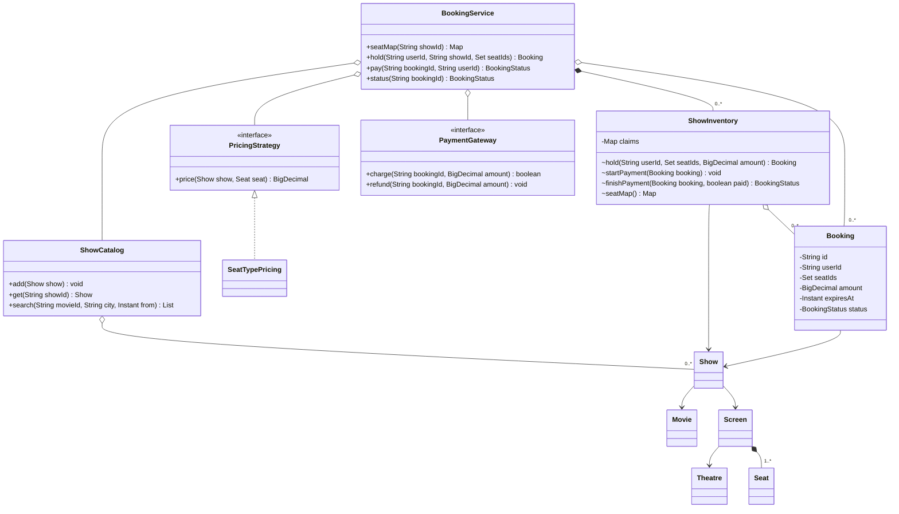
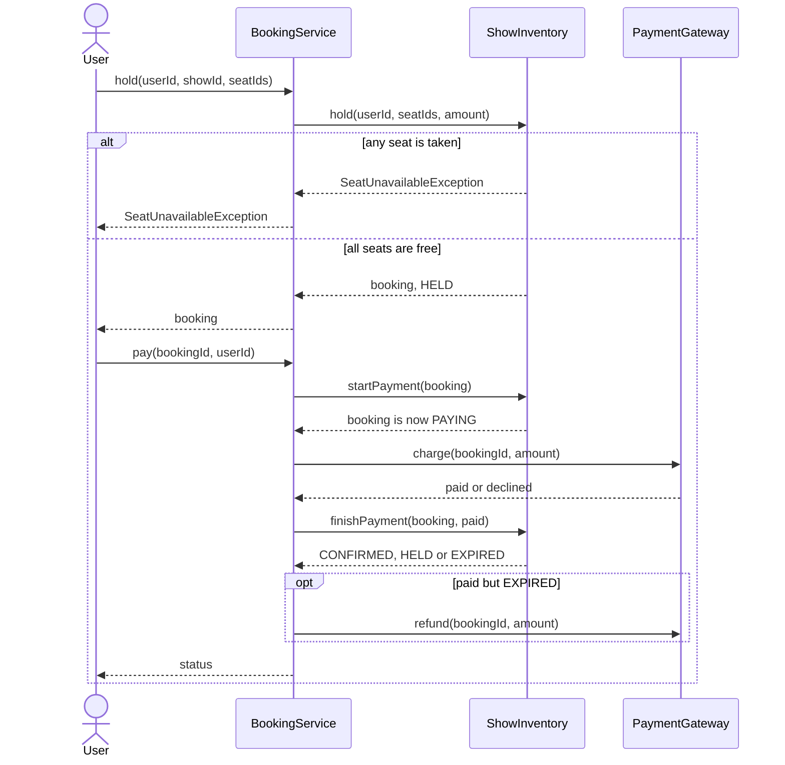

# 17. Movie Ticket Booking (BookMyShow)

**Difficulty:** Hard | **Time:** 75 minutes

## 1. Problem statement

Design the booking part of a movie ticket system.

- A city has theatres, a theatre has screens, and a screen has seats of different types.
- A show is one movie on one screen at a given start time.
- A user searches upcoming shows by movie and city.
- A user sees each seat of a show as available, held or booked.
- A user holds 1 to 10 seats of one show for a limited time, such as 5 minutes. Either all the seats are held or none.
- The price depends on the seat type and is fixed when the seats are held.
- Payment confirms the booking. After a declined payment the user can retry until the hold expires.
- An expired hold frees its seats. A payment that succeeds after expiry is refunded.
- A seat is never held or booked by two users at once, even with concurrent requests.
- Nothing can be held or paid for once the show has started.
- The system runs in one process.

**Out of scope:** cancellation of confirmed bookings, offers, notifications, theatre administration, login and persistence.

## 2. What the interviewer wants to evaluate

| Area | What a strong answer shows |
|---|---|
| Requirement clarification | Asks about holds, expiry, payment failure, seat limits and scale |
| Object modelling | Separates a physical seat from its availability in a show |
| Concurrency | Checks and holds all requested seats atomically |
| Lock scope | Locks one show at a time and never holds a lock during payment |
| State management | Defines every booking status and transition |
| Failure handling | Covers declines, gateway errors, double clicks and late payments |
| Extensibility | Changes pricing and payment provider without editing booking logic |
| Distributed thinking | Explains how to prevent double booking across servers |

## 3. Design patterns and principles used

### Design patterns

| Pattern | Where | Why |
|---|---|---|
| Strategy | `PricingStrategy` | Pricing rules change often |
| Adapter | `PaymentGateway` implementations | Each payment provider is wrapped behind one interface |
| Facade | `BookingService` | One entry point for seat maps, holds and payments |

Singleton, State and Observer are deliberately left out. The services can be created once and passed in, four booking statuses fit in an enum, and notifications are out of scope.

### Design principles

| Principle | How it applies |
|---|---|
| Single Responsibility | `ShowCatalog` searches, `ShowInventory` guards seats, `BookingService` coordinates |
| Open/Closed | A new pricing rule or payment provider is a new class |
| Liskov Substitution | Any gateway or pricing strategy can replace another |
| Dependency Inversion | `BookingService` depends on interfaces and an injected `Clock` |
| Information Expert | `ShowInventory` owns the claims, so it decides every status change |
| Immutability | `Movie`, `Theatre`, `Seat` and `Show` are records |

## 4. Solution

### 4.1 Core entities

| Entity | Responsibility |
|---|---|
| `Movie`, `Theatre` | Catalogue data |
| `Screen` | The physical seats of one hall |
| `Seat` | Seat ID and type |
| `Show` | A movie on a screen at a start time |
| `Booking` | A user's claim on seats of one show |
| `ShowInventory` | Seat claims and booking status for one show |
| `ShowCatalog` | Stores and searches shows |
| `BookingService` | Holds seats and takes payment |

Booking status changes:

| From | Event | To |
|---|---|---|
| New | All requested seats are free | `HELD` |
| `HELD` | Payment starts | `PAYING` |
| `PAYING` | Payment succeeds in time | `CONFIRMED` |
| `PAYING` | Payment is declined or the gateway throws | `HELD` |
| `HELD` or `PAYING` | Hold time passes | `EXPIRED` |

A seat has no stored status. It is derived from the booking that last claimed it, so the two cannot disagree. No background job is needed because expiry is checked when the data is read.

### 4.2 Class diagram



### 4.3 Flow of a booking



### 4.4 Java code (Java 17+)

#### Catalogue types

```java
public record Movie(String id, String title) { }
```

```java
public record Theatre(String id, String name, String city) { }
```

```java
public enum SeatType { REGULAR, PREMIUM }
```

```java
public record Seat(String id, SeatType type) { }
```

```java
import java.util.Collections;
import java.util.LinkedHashMap;
import java.util.List;
import java.util.Map;

public class Screen {
    private final String id;
    private final Theatre theatre;
    private final Map<String, Seat> seats; // by seat ID, in layout order

    public Screen(String id, Theatre theatre, List<Seat> layout) {
        Map<String, Seat> byId = new LinkedHashMap<>();
        for (Seat seat : layout) {
            if (byId.put(seat.id(), seat) != null) {
                throw new IllegalArgumentException("Duplicate seat " + seat.id());
            }
        }
        this.id = id;
        this.theatre = theatre;
        this.seats = Collections.unmodifiableMap(byId);
    }

    public String id() {
        return id;
    }

    public Theatre theatre() {
        return theatre;
    }

    public Map<String, Seat> seats() {
        return seats;
    }
}
```

```java
import java.time.Instant;

public record Show(String id, Movie movie, Screen screen, Instant startsAt) { }
```

#### Show catalogue

```java
import java.time.Instant;
import java.util.Comparator;
import java.util.List;
import java.util.Map;
import java.util.concurrent.ConcurrentHashMap;

public class ShowCatalog {
    private final Map<String, Show> shows = new ConcurrentHashMap<>();

    public void add(Show show) {
        if (shows.putIfAbsent(show.id(), show) != null) {
            throw new IllegalArgumentException("Duplicate show " + show.id());
        }
    }

    public Show get(String showId) {
        Show show = shows.get(showId);
        if (show == null) {
            throw new IllegalArgumentException("Unknown show " + showId);
        }
        return show;
    }

    public List<Show> search(String movieId, String city, Instant from) {
        return shows.values().stream()
                .filter(s -> s.movie().id().equals(movieId))
                .filter(s -> s.screen().theatre().city().equalsIgnoreCase(city))
                .filter(s -> s.startsAt().isAfter(from))
                .sorted(Comparator.comparing(Show::startsAt).thenComparing(Show::id))
                .toList();
    }
}
```

#### Booking

```java
public enum SeatStatus { AVAILABLE, HELD, BOOKED }
```

```java
public enum BookingStatus { HELD, PAYING, CONFIRMED, EXPIRED }
```

Only `ShowInventory` changes the status, and always under its lock.

```java
import java.math.BigDecimal;
import java.time.Instant;
import java.util.Set;
import java.util.UUID;

public class Booking {
    private final String id = UUID.randomUUID().toString();
    private final String userId;
    private final Show show;
    private final Set<String> seatIds;
    private final BigDecimal amount;
    private final Instant expiresAt;
    BookingStatus status = BookingStatus.HELD; // guarded by ShowInventory

    Booking(String userId, Show show, Set<String> seatIds,
            BigDecimal amount, Instant expiresAt) {
        this.userId = userId;
        this.show = show;
        this.seatIds = Set.copyOf(seatIds);
        this.amount = amount;
        this.expiresAt = expiresAt;
    }

    public String id() {
        return id;
    }

    public String userId() {
        return userId;
    }

    public Show show() {
        return show;
    }

    public Set<String> seatIds() {
        return seatIds;
    }

    public BigDecimal amount() {
        return amount;
    }

    public Instant expiresAt() {
        return expiresAt;
    }
}
```

```java
public class SeatUnavailableException extends RuntimeException {
    public SeatUnavailableException(String seatId) {
        super("Seat " + seatId + " is not available");
    }
}
```

#### Show inventory

This class is the heart of the design. Each show has its own instance, so bookings for different shows never block each other.

The clock is read **inside** the lock. A time read before waiting for the lock could be stale and let an expired booking be confirmed. Once a booking is marked `EXPIRED` it stays expired.

```java
import java.math.BigDecimal;
import java.time.Clock;
import java.time.Duration;
import java.time.Instant;
import java.util.HashMap;
import java.util.LinkedHashMap;
import java.util.Map;
import java.util.Set;

class ShowInventory {
    private final Show show;
    private final Clock clock;
    private final Duration holdTime;
    private final Map<String, Booking> claims = new HashMap<>(); // by seat ID

    ShowInventory(Show show, Clock clock, Duration holdTime) {
        this.show = show;
        this.clock = clock;
        this.holdTime = holdTime;
    }

    synchronized Booking hold(String userId, Set<String> seatIds, BigDecimal amount) {
        Instant now = clock.instant();
        if (!now.isBefore(show.startsAt())) {
            throw new IllegalStateException("Show has started");
        }
        for (String seatId : seatIds) { // check every seat before claiming any
            if (statusOfSeat(seatId) != SeatStatus.AVAILABLE) {
                throw new SeatUnavailableException(seatId);
            }
        }
        Instant expiresAt = now.plus(holdTime);
        if (expiresAt.isAfter(show.startsAt())) {
            expiresAt = show.startsAt();
        }
        Booking booking = new Booking(userId, show, seatIds, amount, expiresAt);
        seatIds.forEach(seatId -> claims.put(seatId, booking));
        return booking;
    }

    synchronized void startPayment(Booking booking) {
        BookingStatus current = statusOf(booking);
        if (current != BookingStatus.HELD) {
            throw new IllegalStateException("Cannot pay, booking is " + current);
        }
        booking.status = BookingStatus.PAYING; // blocks a second charge
    }

    synchronized BookingStatus finishPayment(Booking booking, boolean paid) {
        if (statusOf(booking) == BookingStatus.PAYING) {
            booking.status = paid ? BookingStatus.CONFIRMED : BookingStatus.HELD;
        }
        return booking.status;
    }

    synchronized BookingStatus statusOf(Booking booking) {
        if (booking.status != BookingStatus.CONFIRMED
                && !clock.instant().isBefore(booking.expiresAt())) {
            booking.status = BookingStatus.EXPIRED;
        }
        return booking.status;
    }

    synchronized Map<String, SeatStatus> seatMap() {
        Map<String, SeatStatus> result = new LinkedHashMap<>();
        for (String seatId : show.screen().seats().keySet()) {
            result.put(seatId, statusOfSeat(seatId));
        }
        return result;
    }

    private SeatStatus statusOfSeat(String seatId) {
        Booking booking = claims.get(seatId);
        if (booking == null) {
            return SeatStatus.AVAILABLE;
        }
        return switch (statusOf(booking)) {
            case HELD, PAYING -> SeatStatus.HELD;
            case CONFIRMED -> SeatStatus.BOOKED;
            case EXPIRED -> SeatStatus.AVAILABLE;
        };
    }
}
```

#### Pricing and payment

```java
import java.math.BigDecimal;

public interface PricingStrategy {
    BigDecimal price(Show show, Seat seat);
}
```

```java
import java.math.BigDecimal;
import java.util.Map;

public class SeatTypePricing implements PricingStrategy {
    private final Map<SeatType, BigDecimal> prices;

    public SeatTypePricing(Map<SeatType, BigDecimal> prices) {
        if (prices.size() != SeatType.values().length) {
            throw new IllegalArgumentException("Every seat type needs a price");
        }
        this.prices = Map.copyOf(prices);
    }

    @Override
    public BigDecimal price(Show show, Seat seat) {
        return prices.get(seat.type());
    }
}
```

```java
import java.math.BigDecimal;

public interface PaymentGateway {
    /** The booking ID identifies the payment, so it is never taken twice. */
    boolean charge(String bookingId, BigDecimal amount);

    void refund(String bookingId, BigDecimal amount);
}
```

#### Booking service

Payment runs between two short locked steps. If the hold expires in between, the seats may already belong to someone else, so the money is returned.

```java
import java.math.BigDecimal;
import java.time.Clock;
import java.time.Duration;
import java.util.Map;
import java.util.Set;
import java.util.concurrent.ConcurrentHashMap;

public class BookingService {
    private static final int MAX_SEATS = 10;

    private final ShowCatalog catalog;
    private final PricingStrategy pricing;
    private final PaymentGateway gateway;
    private final Clock clock;
    private final Duration holdTime;
    private final Map<String, ShowInventory> inventories = new ConcurrentHashMap<>();
    private final Map<String, Booking> bookings = new ConcurrentHashMap<>();

    public BookingService(ShowCatalog catalog, PricingStrategy pricing,
                          PaymentGateway gateway, Clock clock, Duration holdTime) {
        if (holdTime.isZero() || holdTime.isNegative()) {
            throw new IllegalArgumentException("Hold time must be positive");
        }
        this.catalog = catalog;
        this.pricing = pricing;
        this.gateway = gateway;
        this.clock = clock;
        this.holdTime = holdTime;
    }

    public Map<String, SeatStatus> seatMap(String showId) {
        return inventory(catalog.get(showId)).seatMap();
    }

    public Booking hold(String userId, String showId, Set<String> seatIds) {
        Set<String> requested = Set.copyOf(seatIds);
        if (requested.isEmpty() || requested.size() > MAX_SEATS) {
            throw new IllegalArgumentException("Choose 1 to " + MAX_SEATS + " seats");
        }
        Show show = catalog.get(showId);
        BigDecimal amount = BigDecimal.ZERO;
        for (String seatId : requested) {
            Seat seat = show.screen().seats().get(seatId);
            if (seat == null) {
                throw new IllegalArgumentException("Unknown seat " + seatId);
            }
            amount = amount.add(pricing.price(show, seat));
        }
        Booking booking = inventory(show).hold(userId, requested, amount);
        bookings.put(booking.id(), booking);
        return booking;
    }

    public BookingStatus pay(String bookingId, String userId) {
        Booking booking = find(bookingId);
        if (!booking.userId().equals(userId)) {
            throw new IllegalStateException("Booking belongs to another user");
        }
        ShowInventory inventory = inventory(booking.show());
        inventory.startPayment(booking);

        boolean paid = false;
        BookingStatus result;
        try {
            paid = gateway.charge(booking.id(), booking.amount()); // no lock held
        } finally {
            result = inventory.finishPayment(booking, paid);
        }
        if (paid && result != BookingStatus.CONFIRMED) {
            gateway.refund(booking.id(), booking.amount());
        }
        return result;
    }

    public BookingStatus status(String bookingId) {
        Booking booking = find(bookingId);
        return inventory(booking.show()).statusOf(booking);
    }

    private Booking find(String bookingId) {
        Booking booking = bookings.get(bookingId);
        if (booking == null) {
            throw new IllegalArgumentException("Unknown booking");
        }
        return booking;
    }

    private ShowInventory inventory(Show show) {
        return inventories.computeIfAbsent(show.id(),
                id -> new ShowInventory(show, clock, holdTime));
    }
}
```

#### Demo

The demo uses a clock that can be moved forward, so expiry can be shown without waiting.

```java
import java.math.BigDecimal;
import java.time.Clock;
import java.time.Duration;
import java.time.Instant;
import java.time.ZoneId;
import java.time.ZoneOffset;
import java.util.List;
import java.util.Map;
import java.util.Set;

public class MovieBookingDemo {
    static class ManualClock extends Clock {
        private Instant now = Instant.parse("2026-01-01T10:00:00Z");

        void advance(Duration duration) {
            now = now.plus(duration);
        }

        @Override
        public Instant instant() {
            return now;
        }

        @Override
        public ZoneId getZone() {
            return ZoneOffset.UTC;
        }

        @Override
        public Clock withZone(ZoneId zone) {
            throw new UnsupportedOperationException();
        }
    }

    public static void main(String[] args) {
        ManualClock clock = new ManualClock();
        Theatre theatre = new Theatre("T1", "City Cinema", "Pune");
        Screen screen = new Screen("S1", theatre, List.of(
                new Seat("A1", SeatType.REGULAR),
                new Seat("A2", SeatType.REGULAR),
                new Seat("P1", SeatType.PREMIUM)));
        Movie movie = new Movie("M1", "The Long Journey");

        ShowCatalog catalog = new ShowCatalog();
        catalog.add(new Show("SH1", movie, screen,
                clock.instant().plus(Duration.ofHours(3))));

        PaymentGateway gateway = new PaymentGateway() {
            @Override
            public boolean charge(String bookingId, BigDecimal amount) {
                System.out.println("Charged " + amount);
                return true;
            }

            @Override
            public void refund(String bookingId, BigDecimal amount) {
                System.out.println("Refunded " + amount);
            }
        };

        BookingService service = new BookingService(catalog,
                new SeatTypePricing(Map.of(
                        SeatType.REGULAR, new BigDecimal("200"),
                        SeatType.PREMIUM, new BigDecimal("350"))),
                gateway, clock, Duration.ofMinutes(5));

        Show show = catalog.search("M1", "Pune", clock.instant()).get(0);

        Booking asha = service.hold("asha", show.id(), Set.of("A1", "A2"));
        try {
            service.hold("ravi", show.id(), Set.of("A2", "P1"));
        } catch (SeatUnavailableException e) {
            System.out.println("Ravi: " + e.getMessage());
        }
        System.out.println("Asha: " + service.pay(asha.id(), "asha"));

        Booking ravi = service.hold("ravi", show.id(), Set.of("P1"));
        clock.advance(Duration.ofMinutes(6));
        service.hold("meera", show.id(), Set.of("P1"));
        System.out.println("Ravi's hold: " + service.status(ravi.id()));
        System.out.println(service.seatMap(show.id()));
    }
}
```

Output:

```text
Ravi: Seat A2 is not available
Charged 400
Asha: CONFIRMED
Ravi's hold: EXPIRED
{A1=BOOKED, A2=BOOKED, P1=HELD}
```

### 4.5 Complexity

Let S be the number of shows, N the seats in a screen and K the seats requested.

| Operation | Time |
|---|---|
| Search shows | O(S log S) in the worst case |
| Seat map | O(N) |
| Hold seats | O(K) average |
| Pay | O(1) average, plus the gateway call |
| Check booking status | O(1) average |

Space is O(S) for shows, plus the screen layouts, claimed seats and all bookings made.

## 5. Follow-up questions

| Question | Answer outline |
|---|---|
| How do you prevent double booking across many servers? | Keep one database row per show and seat. In one transaction, claim all rows only if each is free or expired, and roll back if the count is short |
| Could you lock each seat instead of the whole show? | It allows more parallel work, but locks must be taken in a fixed order to avoid deadlock. Measure contention first |
| What if the server crashes after charging? | Save the `PAYING` state before charging. On restart, ask the gateway for the result and then confirm or refund |
| What if the refund fails? | Record that a refund is due and retry it from a queue until it succeeds |
| What if the gateway replies later through a callback? | Make `pay` return after starting the payment and call `finishPayment` from the callback. Handle repeated callbacks safely |
| What if the gateway times out and the result is unknown? | Do not assume a decline. Query the gateway using the booking ID before allowing a new attempt |
| How would you add cancellation? | Add a `CANCELLED` status, free the seats under the show lock, then refund according to a policy |
| How would you stop one user from holding too many seats? | Limit active holds per user and show |
| How would you handle a very popular release? | Queue users before the seat map, cache seat maps for a few seconds and rate limit holds |
| How would you add weekend or demand pricing? | Write a new `PricingStrategy` |
| How would you make search faster? | Index shows by city and movie, sorted by start time |
