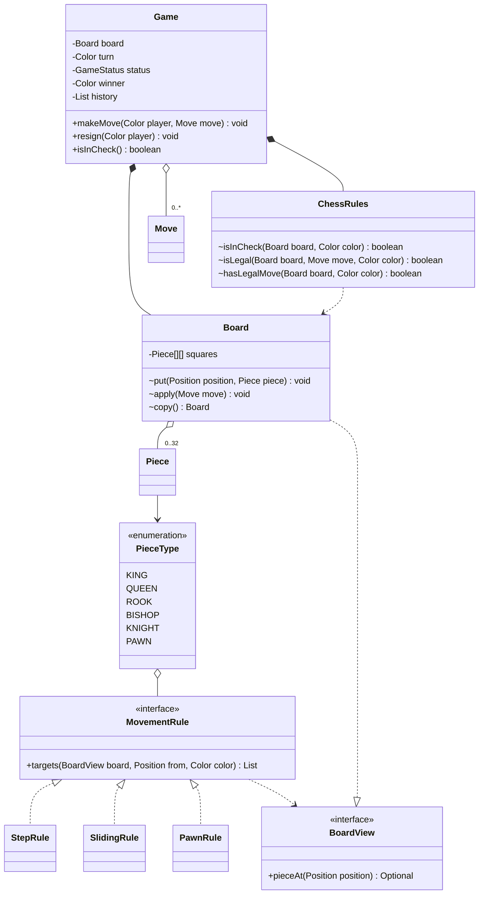
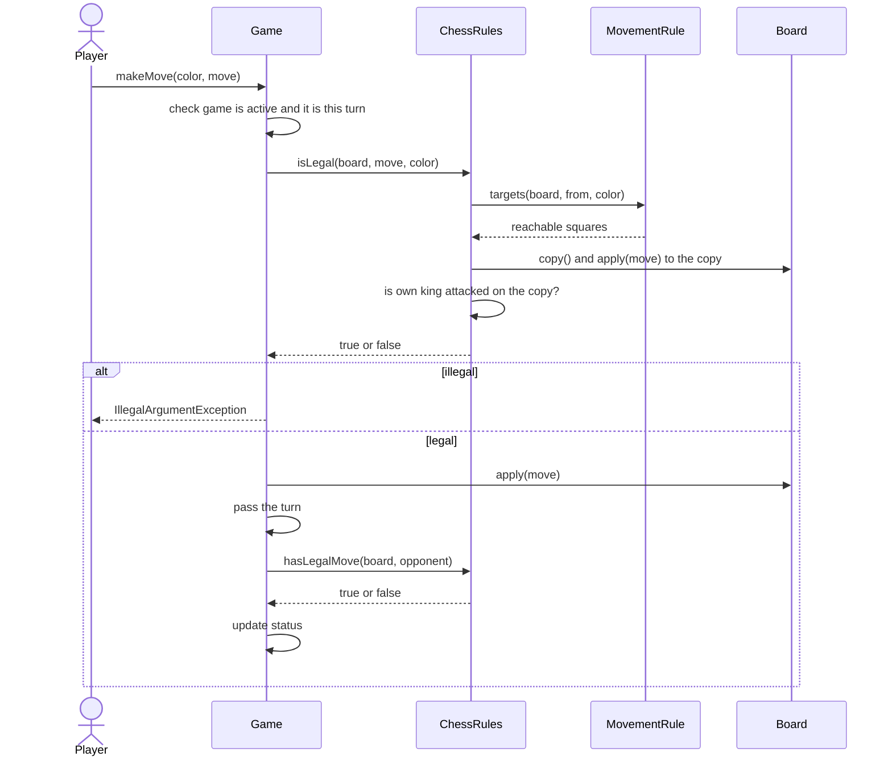

# 18. Chess

**Difficulty:** Hard | **Time:** 90 minutes

## 1. Problem statement

Design a chess game for two players.

- The game starts from the standard position on an 8 x 8 board. White moves first.
- Players take turns. A move names a start square and an end square.
- Each piece moves according to its own rules. Only the knight can jump over pieces.
- A pawn can move two squares from its starting row if both squares are empty. It captures diagonally.
- A pawn that reaches the last row is promoted to a queen, rook, bishop or knight, chosen by the player.
- A move that leaves the player's own king in check is rejected.
- The game ends in checkmate when the player to move is in check and has no legal move.
- The game ends in stalemate when that player is not in check and has no legal move.
- A player can resign.
- An illegal move is rejected, and the same player moves again.

**Out of scope:** castling, en passant, other draw rules, clocks, undo, computer players, online play, persistence and graphical UI.

## 2. What the interviewer wants to evaluate

| Area | What a strong answer shows |
|---|---|
| Requirement clarification | Asks which special moves and draw rules are needed before designing |
| Object modelling | Separates board, piece, movement, rules and game flow |
| Polymorphism | Piece movement has no long `if` or `switch` chain |
| Code reuse | Queen, rook and bishop share one sliding movement |
| Rule correctness | Distinguishes how a piece moves from whether the move is legal |
| Game state | Detects check, checkmate and stalemate |
| Encapsulation | Callers change the board only through the game |
| Prioritisation | Gets basic moves working before special moves |

## 3. Design patterns and principles used

### Design patterns

| Pattern | Where | Why |
|---|---|---|
| Strategy | `MovementRule` | Each way of moving is a separate class that pieces can share |

Factory, State, Command, Observer and Singleton are deliberately left out. The setup is a few lines, four statuses fit in an enum, undo is out of scope, nothing needs to be notified and one program can run many games.

### Design principles

| Principle | How it applies |
|---|---|
| Single Responsibility | `MovementRule` finds reachable squares, `ChessRules` judges legality, `Game` manages turns |
| Open/Closed | A new way of moving is a new `MovementRule` |
| Liskov Substitution | `ChessRules` treats all movement rules the same way |
| Interface Segregation | Movement rules see only the read-only `BoardView` |
| Dependency Inversion | Movement rules depend on `BoardView`, not on `Board` |
| Composition over inheritance | A piece type holds a movement rule instead of every piece being a subclass |
| Immutability | `Position`, `Move` and `Piece` are records |

## 4. Solution

### 4.1 Core entities

| Entity | Responsibility |
|---|---|
| `Color`, `PieceType`, `GameStatus` | Fixed sets of values |
| `Position` | A square on the board |
| `Move` | Start, end and optional promotion choice |
| `Piece` | Type and colour |
| `Board` | Which piece is on which square |
| `MovementRule` | Squares a piece can reach |
| `ChessRules` | Check, legality and whether any move exists |
| `Game` | Turns, history and result |

A move is validated in two stages:

1. **Reachable:** the piece's movement rule allows the end square.
2. **Safe:** after the move is tried on a copy of the board, the player's king is not attacked.

### 4.2 Class diagram



### 4.3 Flow of one move



### 4.4 Java code (Java 17+)

#### Basic types

Row 0 is White's back row and column 0 is the `a` file.

```java
public enum Color {
    WHITE, BLACK;

    public Color opposite() {
        return this == WHITE ? BLACK : WHITE;
    }
}
```

```java
public enum GameStatus { ACTIVE, CHECKMATE, STALEMATE, RESIGNED }
```

```java
import java.util.Optional;

public record Position(int row, int col) {
    public Position {
        if (!isOnBoard(row, col)) {
            throw new IllegalArgumentException("Off the board");
        }
    }

    /** Reads a square name such as "e2". */
    public static Position of(String square) {
        if (square.length() != 2) {
            throw new IllegalArgumentException("Invalid square " + square);
        }
        return new Position(square.charAt(1) - '1', square.charAt(0) - 'a');
    }

    /** Empty if the new square would be off the board. */
    public Optional<Position> shift(int rows, int cols) {
        return isOnBoard(row + rows, col + cols)
                ? Optional.of(new Position(row + rows, col + cols))
                : Optional.empty();
    }

    private static boolean isOnBoard(int row, int col) {
        return row >= 0 && row < 8 && col >= 0 && col < 8;
    }
}
```

```java
/** promotion is null unless a pawn reaches the last row. */
public record Move(Position from, Position to, PieceType promotion) {
    public Move(Position from, Position to) {
        this(from, to, null);
    }

    public static Move of(String from, String to) {
        return new Move(Position.of(from), Position.of(to));
    }
}
```

#### Pieces

```java
public enum PieceType {
    KING('K', new StepRule(Offsets.ALL)),
    QUEEN('Q', new SlidingRule(Offsets.ALL)),
    ROOK('R', new SlidingRule(Offsets.STRAIGHT)),
    BISHOP('B', new SlidingRule(Offsets.DIAGONAL)),
    KNIGHT('N', new StepRule(Offsets.KNIGHT)),
    PAWN('P', new PawnRule());

    private final char symbol;
    private final MovementRule rule;

    PieceType(char symbol, MovementRule rule) {
        this.symbol = symbol;
        this.rule = rule;
    }

    public char symbol() {
        return symbol;
    }

    public MovementRule rule() {
        return rule;
    }

    public boolean isPromotionChoice() {
        return this != KING && this != PAWN;
    }
}
```

```java
public record Piece(PieceType type, Color color) { }
```

#### Movement rules

```java
/** Each pair is a row change and a column change. */
final class Offsets {
    static final int[][] STRAIGHT = {{1, 0}, {-1, 0}, {0, 1}, {0, -1}};
    static final int[][] DIAGONAL = {{1, 1}, {1, -1}, {-1, 1}, {-1, -1}};
    static final int[][] ALL = {
        {1, 0}, {-1, 0}, {0, 1}, {0, -1}, {1, 1}, {1, -1}, {-1, 1}, {-1, -1}};
    static final int[][] KNIGHT = {
        {2, 1}, {2, -1}, {-2, 1}, {-2, -1}, {1, 2}, {1, -2}, {-1, 2}, {-1, -2}};

    private Offsets() { }
}
```

```java
import java.util.List;

public interface MovementRule {
    /** Squares the piece can reach, before checking whether its king stays safe. */
    List<Position> targets(BoardView board, Position from, Color color);
}
```

```java
import java.util.ArrayList;
import java.util.List;

/** One jump to a fixed offset, used by the king and knight. */
public class StepRule implements MovementRule {
    private final int[][] offsets;

    public StepRule(int[][] offsets) {
        this.offsets = offsets;
    }

    @Override
    public List<Position> targets(BoardView board, Position from, Color color) {
        List<Position> result = new ArrayList<>();
        for (int[] offset : offsets) {
            from.shift(offset[0], offset[1])
                    .filter(to -> board.pieceAt(to)
                            .map(p -> p.color() != color)
                            .orElse(true))
                    .ifPresent(result::add);
        }
        return result;
    }
}
```

```java
import java.util.ArrayList;
import java.util.List;
import java.util.Optional;

/** Moves in a line until blocked, used by the queen, rook and bishop. */
public class SlidingRule implements MovementRule {
    private final int[][] directions;

    public SlidingRule(int[][] directions) {
        this.directions = directions;
    }

    @Override
    public List<Position> targets(BoardView board, Position from, Color color) {
        List<Position> result = new ArrayList<>();
        for (int[] d : directions) {
            Optional<Position> next = from.shift(d[0], d[1]);
            while (next.isPresent()) {
                Position to = next.get();
                Optional<Piece> occupant = board.pieceAt(to);
                if (occupant.isPresent()) {
                    if (occupant.get().color() != color) {
                        result.add(to); // capture
                    }
                    break;
                }
                result.add(to);
                next = to.shift(d[0], d[1]);
            }
        }
        return result;
    }
}
```

```java
import java.util.ArrayList;
import java.util.List;

public class PawnRule implements MovementRule {
    @Override
    public List<Position> targets(BoardView board, Position from, Color color) {
        List<Position> result = new ArrayList<>();
        int forward = color == Color.WHITE ? 1 : -1;
        int startRow = color == Color.WHITE ? 1 : 6;

        from.shift(forward, 0)
                .filter(one -> board.pieceAt(one).isEmpty())
                .ifPresent(one -> {
                    result.add(one);
                    if (from.row() == startRow) {
                        from.shift(2 * forward, 0)
                                .filter(two -> board.pieceAt(two).isEmpty())
                                .ifPresent(result::add);
                    }
                });

        for (int side : new int[] {-1, 1}) {
            from.shift(forward, side)
                    .filter(to -> board.pieceAt(to)
                            .map(p -> p.color() != color)
                            .orElse(false))
                    .ifPresent(result::add);
        }
        return result;
    }
}
```

#### Board

```java
import java.util.Optional;

public interface BoardView {
    Optional<Piece> pieceAt(Position position);
}
```

```java
import java.util.Optional;

public class Board implements BoardView {
    private final Piece[][] squares = new Piece[8][8];

    static Board standard() {
        PieceType[] backRow = {
            PieceType.ROOK, PieceType.KNIGHT, PieceType.BISHOP, PieceType.QUEEN,
            PieceType.KING, PieceType.BISHOP, PieceType.KNIGHT, PieceType.ROOK};
        Board board = new Board();
        for (int col = 0; col < 8; col++) {
            board.put(new Position(0, col), new Piece(backRow[col], Color.WHITE));
            board.put(new Position(1, col), new Piece(PieceType.PAWN, Color.WHITE));
            board.put(new Position(6, col), new Piece(PieceType.PAWN, Color.BLACK));
            board.put(new Position(7, col), new Piece(backRow[col], Color.BLACK));
        }
        return board;
    }

    @Override
    public Optional<Piece> pieceAt(Position position) {
        return Optional.ofNullable(squares[position.row()][position.col()]);
    }

    void put(Position position, Piece piece) {
        squares[position.row()][position.col()] = piece;
    }

    /** Moves the piece without validating. ChessRules validates first. */
    void apply(Move move) {
        Piece piece = pieceAt(move.from()).orElseThrow();
        if (move.promotion() != null) {
            piece = new Piece(move.promotion(), piece.color());
        }
        put(move.to(), piece);
        put(move.from(), null);
    }

    Board copy() {
        Board copy = new Board();
        for (int row = 0; row < 8; row++) {
            copy.squares[row] = squares[row].clone();
        }
        return copy;
    }

    /** White pieces are upper case and Black pieces are lower case. */
    @Override
    public String toString() {
        StringBuilder out = new StringBuilder();
        for (int row = 7; row >= 0; row--) {
            out.append(row + 1).append(' ');
            for (Piece piece : squares[row]) {
                char symbol = '.';
                if (piece != null) {
                    symbol = piece.color() == Color.WHITE
                            ? piece.type().symbol()
                            : Character.toLowerCase(piece.type().symbol());
                }
                out.append(symbol).append(' ');
            }
            out.append('\n');
        }
        return out.append("  a b c d e f g h\n").toString();
    }
}
```

#### Rules

A king is in check if any opposing piece can reach its square. This works for pawns too, because their diagonal squares are targets when occupied by the other colour.

```java
class ChessRules {
    boolean isInCheck(Board board, Color color) {
        Position king = findKing(board, color);
        for (int row = 0; row < 8; row++) {
            for (int col = 0; col < 8; col++) {
                Position from = new Position(row, col);
                Piece piece = board.pieceAt(from).orElse(null);
                if (piece != null && piece.color() != color
                        && piece.type().rule()
                                .targets(board, from, piece.color())
                                .contains(king)) {
                    return true;
                }
            }
        }
        return false;
    }

    boolean isLegal(Board board, Move move, Color color) {
        Piece piece = board.pieceAt(move.from()).orElse(null);
        if (piece == null || piece.color() != color) {
            return false;
        }
        if (!piece.type().rule().targets(board, move.from(), color).contains(move.to())) {
            return false;
        }
        boolean promotes = promotes(piece, move.to());
        if (promotes != (move.promotion() != null)
                || (promotes && !move.promotion().isPromotionChoice())) {
            return false;
        }
        return keepsKingSafe(board, move, color);
    }

    boolean hasLegalMove(Board board, Color color) {
        for (int row = 0; row < 8; row++) {
            for (int col = 0; col < 8; col++) {
                Position from = new Position(row, col);
                Piece piece = board.pieceAt(from).orElse(null);
                if (piece == null || piece.color() != color) {
                    continue;
                }
                for (Position to : piece.type().rule().targets(board, from, color)) {
                    // The promotion choice cannot change whether our own king is safe
                    PieceType promotion = promotes(piece, to) ? PieceType.QUEEN : null;
                    if (keepsKingSafe(board, new Move(from, to, promotion), color)) {
                        return true;
                    }
                }
            }
        }
        return false;
    }

    private boolean promotes(Piece piece, Position to) {
        int lastRow = piece.color() == Color.WHITE ? 7 : 0;
        return piece.type() == PieceType.PAWN && to.row() == lastRow;
    }

    private boolean keepsKingSafe(Board board, Move move, Color color) {
        Board trial = board.copy();
        trial.apply(move);
        return !isInCheck(trial, color);
    }

    private Position findKing(Board board, Color color) {
        Piece king = new Piece(PieceType.KING, color);
        for (int row = 0; row < 8; row++) {
            for (int col = 0; col < 8; col++) {
                Position position = new Position(row, col);
                if (board.pieceAt(position).filter(king::equals).isPresent()) {
                    return position;
                }
            }
        }
        throw new IllegalStateException("No king for " + color);
    }
}
```

#### Game

```java
import java.util.ArrayList;
import java.util.List;
import java.util.Objects;

public class Game {
    private final Board board = Board.standard();
    private final ChessRules rules = new ChessRules();
    private final List<Move> history = new ArrayList<>();
    private Color turn = Color.WHITE;
    private GameStatus status = GameStatus.ACTIVE;
    private Color winner;

    public void makeMove(Color player, Move move) {
        requireActive();
        Objects.requireNonNull(move);
        if (player != turn) {
            throw new IllegalStateException("It is " + turn + "'s turn");
        }
        if (!rules.isLegal(board, move, player)) {
            throw new IllegalArgumentException("Illegal move");
        }
        board.apply(move);
        history.add(move);
        turn = turn.opposite();

        if (!rules.hasLegalMove(board, turn)) {
            if (rules.isInCheck(board, turn)) {
                status = GameStatus.CHECKMATE;
                winner = player;
            } else {
                status = GameStatus.STALEMATE;
            }
        }
    }

    public void resign(Color player) {
        requireActive();
        Objects.requireNonNull(player);
        status = GameStatus.RESIGNED;
        winner = player.opposite();
    }

    /** Whether the player to move is in check. */
    public boolean isInCheck() {
        return rules.isInCheck(board, turn);
    }

    public Color getTurn() {
        return turn;
    }

    public GameStatus getStatus() {
        return status;
    }

    public Color getWinner() {
        return winner; // null while active and after stalemate
    }

    public List<Move> getHistory() {
        return List.copyOf(history);
    }

    public String render() {
        return board.toString();
    }

    private void requireActive() {
        if (status != GameStatus.ACTIVE) {
            throw new IllegalStateException("Game is over");
        }
    }
}
```

#### Demo

The demo plays the shortest possible checkmate, after one rejected move.

```java
import java.util.List;

public class ChessDemo {
    public static void main(String[] args) {
        Game game = new Game();
        try {
            game.makeMove(Color.WHITE, Move.of("a1", "a3")); // blocked by a pawn
        } catch (IllegalArgumentException e) {
            System.out.println(e.getMessage());
        }

        List<Move> moves = List.of(
                Move.of("f2", "f3"), Move.of("e7", "e5"),
                Move.of("g2", "g4"), Move.of("d8", "h4"));
        for (Move move : moves) {
            game.makeMove(game.getTurn(), move);
        }

        System.out.print(game.render());
        System.out.println(game.getStatus() + ", winner: " + game.getWinner());
    }
}
```

Output:

```text
Illegal move
8 r n b . k b n r 
7 p p p p . p p p 
6 . . . . . . . . 
5 . . . . p . . . 
4 . . . . . . P q 
3 . . . . . P . . 
2 P P P P P . . P 
1 R N B Q K B N R 
  a b c d e f g h
CHECKMATE, winner: BLACK
```

### 4.5 Complexity

The board is fixed at 64 squares, so every operation has a constant upper bound. To compare the costs, let S be the number of squares, A the work to find all of one side's targets and M the number of moves the player to move can try.

| Operation | Time |
|---|---|
| Find one piece's targets | At most 27 squares |
| Test for check | O(S + A) |
| Validate a move | O(S + A) |
| Detect checkmate or stalemate | O(M × (S + A)) in the worst case |

Space is O(S) for the board and its trial copy, plus O(H) for a history of H moves.

## 5. Follow-up questions

| Question | Answer outline |
|---|---|
| How would you add castling? | Track whether the king and rooks have moved. Add an `isAttacked(square)` check for the squares the king crosses, handling pawns separately because they attack empty diagonals. Move both pieces together |
| How would you add en passant? | Give the rules the last move, and let the pawn capture a pawn that has just moved two squares |
| How would you add undo? | Store each move with the moved and captured pieces (Command pattern), then restore them and the turn |
| How would you add the other draw rules? | Count moves since the last capture or pawn move, keep a count of each position including turn and special move rights, and check for too little material |
| How would you make check detection faster? | Look outwards from the king, make and undo moves without copying, or use bitboards |
| How would you add a computer player? | Add a move choosing interface and generate all legal moves. Search them with minimax and pruning |
| How would you add a new piece for a chess variant? | Add a piece type with an existing or new `MovementRule`. Review promotion and setup |
| How would you make it work online? | Keep the game on the server, check who sent each move, and process one game's moves one at a time. Include the move number to reject repeats |
| How would you add clocks? | Inject a clock, deduct thinking time on each move and end the game when a player's time runs out |
| How would you save and replay a game? | Store the move history in a standard notation and apply it to a new game |
