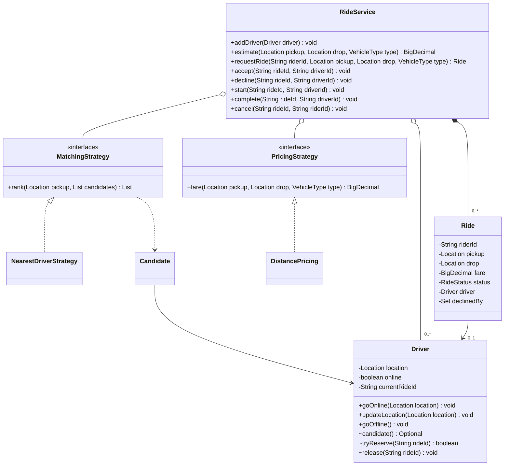
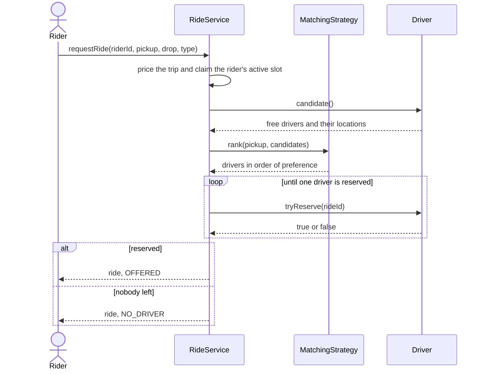

# 19. Ride-Sharing Service (Uber)

**Difficulty:** Hard | **Time:** 75 minutes

## 1. Problem statement

Design the ride booking part of a ride-sharing service.

- A driver has one vehicle type: auto, sedan or SUV.
- A driver goes online with a location, updates it and goes offline.
- A rider gets a fare estimate for a pickup, a drop and a vehicle type.
- A rider requests a ride. The fare is fixed at that moment.
- The system offers the ride to the nearest free driver of that type within a radius.
- The driver accepts or declines. After a decline, the ride is offered to the next driver who has not declined it.
- If no driver is left, the request ends with no driver found.
- An accepted ride is started and then completed by its driver.
- The rider can cancel before the ride starts.
- A driver has at most one active ride, even when many riders request at once.
- A rider has at most one active ride.
- A driver cannot go offline while holding a ride.
- The system runs in one process.

**Out of scope:** payments, ratings, notifications, offer timeouts, cancellation fees, cancellation by the driver, shared rides, road routing, surge pricing and persistence.

## 2. What the interviewer wants to evaluate

| Area | What a strong answer shows |
|---|---|
| Requirement clarification | Asks how matching works, whether drivers can decline and when the fare is set |
| Object modelling | Separates driver availability from the ride lifecycle |
| State management | Defines every ride status and who may change it |
| Concurrency | Never gives one driver two rides |
| Lock design | Uses fine-grained locks in a fixed order, without deadlock |
| Matching | Keeps the matching rule separate and replaceable |
| Authorisation | Only the assigned driver and the owning rider can act on a ride |
| Scale thinking | Explains how to find nearby drivers without scanning all of them |

## 3. Design patterns and principles used

### Design patterns

| Pattern | Where | Why |
|---|---|---|
| Strategy | `MatchingStrategy` | Matching can favour distance, rating or waiting time |
| Strategy | `PricingStrategy` | Pricing rules change independently of booking |
| Facade | `RideService` | One entry point for the ride lifecycle |

State, Observer, Factory and Singleton are deliberately left out. The statuses have few transitions and fit in an enum, notifications are out of scope, object creation is simple and the service can be passed to whoever needs it.

### Design principles

| Principle | How it applies |
|---|---|
| Single Responsibility | `Driver` manages availability, `Ride` holds trip state, `RideService` coordinates |
| Open/Closed | New matching and pricing rules are new classes |
| Liskov Substitution | Any strategy can replace another |
| Dependency Inversion | `RideService` depends on the strategy interfaces |
| Information Expert | `Driver` decides whether it can be reserved |
| Immutability | `Location` and `Candidate` are records |

## 4. Solution

### 4.1 Core entities

| Entity | Responsibility |
|---|---|
| `Location` | Latitude, longitude and distance |
| `VehicleType`, `RideStatus` | Fixed sets of values |
| `Driver` | Online state, location and current ride |
| `Candidate` | A free driver and the location used for ranking |
| `Ride` | Trip details, fare, driver and status |
| `RideService` | Requests, matching and lifecycle |

Riders are identified by an ID.

Ride status changes:

| From | Event | To |
|---|---|---|
| New | A driver is reserved | `OFFERED` |
| New | No driver is free | `NO_DRIVER` |
| `OFFERED` | Driver accepts | `ACCEPTED` |
| `OFFERED` | Driver declines and another is reserved | `OFFERED` |
| `OFFERED` | Driver declines and none is left | `NO_DRIVER` |
| `ACCEPTED` | Driver starts the ride | `STARTED` |
| `STARTED` | Driver completes the ride | `COMPLETED` |
| `OFFERED` or `ACCEPTED` | Rider cancels | `CANCELLED` |

Concurrency rules:

| Risk | Protection |
|---|---|
| Two rides reserve the same driver | `Driver.tryReserve` checks and reserves in one synchronized step. The loser tries the next driver |
| Cancel and accept happen together | All changes to a ride hold that ride's lock |
| One rider sends two requests | `putIfAbsent` on the map of active rides |
| Deadlock | A ride lock may be followed by a driver lock, never the reverse |
| Location changes while ranking | Each candidate carries a fixed copy of the location |

### 4.2 Class diagram



### 4.3 Flow of a ride request



### 4.4 Java code (Java 17+)

#### Basic types

```java
public enum VehicleType { AUTO, SEDAN, SUV }
```

```java
public enum RideStatus { OFFERED, ACCEPTED, STARTED, COMPLETED, CANCELLED, NO_DRIVER }
```

```java
public record Location(double latitude, double longitude) {
    private static final double EARTH_RADIUS_KM = 6371;

    public Location {
        if (!(Math.abs(latitude) <= 90) || !(Math.abs(longitude) <= 180)) {
            throw new IllegalArgumentException("Invalid location");
        }
    }

    /** Straight line distance over the surface (haversine formula). */
    public double distanceKm(Location other) {
        double latitudeDiff = Math.toRadians(other.latitude - latitude);
        double longitudeDiff = Math.toRadians(other.longitude - longitude);
        double a = Math.pow(Math.sin(latitudeDiff / 2), 2)
                + Math.cos(Math.toRadians(latitude))
                * Math.cos(Math.toRadians(other.latitude))
                * Math.pow(Math.sin(longitudeDiff / 2), 2);
        return 2 * EARTH_RADIUS_KM * Math.asin(Math.min(1, Math.sqrt(a)));
    }
}
```

#### Driver

All mutable state is guarded by the driver's own lock. A driver never locks a ride.

```java
import java.util.Objects;
import java.util.Optional;

public class Driver {
    private final String id;
    private final VehicleType vehicleType;
    private Location location;
    private boolean online;
    private String currentRideId;

    public Driver(String id, VehicleType vehicleType) {
        this.id = Objects.requireNonNull(id);
        this.vehicleType = Objects.requireNonNull(vehicleType);
    }

    public String id() {
        return id;
    }

    public VehicleType vehicleType() {
        return vehicleType;
    }

    public synchronized void goOnline(Location location) {
        this.location = Objects.requireNonNull(location);
        online = true;
    }

    public synchronized void updateLocation(Location location) {
        if (!online) {
            throw new IllegalStateException("Driver is offline");
        }
        this.location = Objects.requireNonNull(location);
    }

    public synchronized void goOffline() {
        if (currentRideId != null) {
            throw new IllegalStateException("Finish or decline the ride first");
        }
        online = false;
    }

    /** The driver's app uses this to see an offered or active ride. */
    public synchronized Optional<String> currentRideId() {
        return Optional.ofNullable(currentRideId);
    }

    synchronized Optional<Candidate> candidate() {
        return online && currentRideId == null
                ? Optional.of(new Candidate(this, location))
                : Optional.empty();
    }

    synchronized boolean tryReserve(String rideId) {
        if (!online || currentRideId != null) {
            return false;
        }
        currentRideId = rideId;
        return true;
    }

    synchronized void release(String rideId) {
        if (rideId.equals(currentRideId)) {
            currentRideId = null;
        }
    }
}
```

```java
public record Candidate(Driver driver, Location location) { }
```

#### Ride

Only `RideService` changes a ride, and always while holding the ride's lock.

```java
import java.math.BigDecimal;
import java.util.HashSet;
import java.util.Optional;
import java.util.Set;
import java.util.UUID;

public class Ride {
    private final String id = UUID.randomUUID().toString();
    private final String riderId;
    private final Location pickup;
    private final Location drop;
    private final VehicleType vehicleType;
    private final BigDecimal fare;

    // Guarded by this ride's lock
    final Set<String> declinedBy = new HashSet<>();
    RideStatus status;
    Driver driver;

    Ride(String riderId, Location pickup, Location drop,
         VehicleType vehicleType, BigDecimal fare) {
        this.riderId = riderId;
        this.pickup = pickup;
        this.drop = drop;
        this.vehicleType = vehicleType;
        this.fare = fare;
    }

    public String id() {
        return id;
    }

    public String riderId() {
        return riderId;
    }

    public Location pickup() {
        return pickup;
    }

    public Location drop() {
        return drop;
    }

    public VehicleType vehicleType() {
        return vehicleType;
    }

    public BigDecimal fare() {
        return fare;
    }

    public synchronized RideStatus status() {
        return status;
    }

    public synchronized Optional<String> driverId() {
        return Optional.ofNullable(driver).map(Driver::id);
    }
}
```

#### Matching

```java
import java.util.List;

public interface MatchingStrategy {
    /** Returns the suitable candidates, best first. */
    List<Candidate> rank(Location pickup, List<Candidate> candidates);
}
```

```java
import java.util.Comparator;
import java.util.List;

public class NearestDriverStrategy implements MatchingStrategy {
    private final double radiusKm;

    public NearestDriverStrategy(double radiusKm) {
        if (!(radiusKm > 0)) {
            throw new IllegalArgumentException("Radius must be positive");
        }
        this.radiusKm = radiusKm;
    }

    @Override
    public List<Candidate> rank(Location pickup, List<Candidate> candidates) {
        return candidates.stream()
                .filter(c -> pickup.distanceKm(c.location()) <= radiusKm)
                .sorted(Comparator
                        .<Candidate>comparingDouble(c -> pickup.distanceKm(c.location()))
                        .thenComparing(c -> c.driver().id()))
                .toList();
    }
}
```

#### Pricing

```java
import java.math.BigDecimal;

public interface PricingStrategy {
    BigDecimal fare(Location pickup, Location drop, VehicleType type);
}
```

```java
import java.math.BigDecimal;
import java.math.RoundingMode;
import java.util.Map;

public class DistancePricing implements PricingStrategy {
    public record Rate(BigDecimal base, BigDecimal perKm) { }

    private final Map<VehicleType, Rate> rates;

    public DistancePricing(Map<VehicleType, Rate> rates) {
        if (rates.size() != VehicleType.values().length) {
            throw new IllegalArgumentException("Every vehicle type needs a rate");
        }
        this.rates = Map.copyOf(rates);
    }

    @Override
    public BigDecimal fare(Location pickup, Location drop, VehicleType type) {
        Rate rate = rates.get(type);
        BigDecimal distance = BigDecimal.valueOf(pickup.distanceKm(drop));
        return rate.base().add(rate.perKm().multiply(distance))
                .setScale(2, RoundingMode.HALF_UP);
    }
}
```

#### Ride service

```java
import java.math.BigDecimal;
import java.util.List;
import java.util.Map;
import java.util.Objects;
import java.util.Optional;
import java.util.concurrent.ConcurrentHashMap;

public class RideService {
    private final MatchingStrategy matching;
    private final PricingStrategy pricing;
    private final Map<String, Driver> drivers = new ConcurrentHashMap<>();
    private final Map<String, Ride> rides = new ConcurrentHashMap<>();
    private final Map<String, String> activeRides = new ConcurrentHashMap<>(); // rider to ride

    public RideService(MatchingStrategy matching, PricingStrategy pricing) {
        this.matching = matching;
        this.pricing = pricing;
    }

    public void addDriver(Driver driver) {
        if (drivers.putIfAbsent(driver.id(), driver) != null) {
            throw new IllegalArgumentException("Duplicate driver");
        }
    }

    public BigDecimal estimate(Location pickup, Location drop, VehicleType type) {
        return pricing.fare(pickup, drop, type);
    }

    public Ride requestRide(String riderId, Location pickup, Location drop,
                            VehicleType type) {
        Objects.requireNonNull(riderId);
        BigDecimal fare = estimate(pickup, drop, type);
        Ride ride = new Ride(riderId, pickup, drop, type, fare);
        synchronized (ride) {
            if (activeRides.putIfAbsent(riderId, ride.id()) != null) {
                throw new IllegalStateException("Rider already has an active ride");
            }
            rides.put(ride.id(), ride);
            offerToNextDriver(ride);
        }
        return ride;
    }

    public void accept(String rideId, String driverId) {
        Ride ride = find(rideId);
        synchronized (ride) {
            requireDriver(ride, driverId, RideStatus.OFFERED);
            ride.status = RideStatus.ACCEPTED;
        }
    }

    public void decline(String rideId, String driverId) {
        Ride ride = find(rideId);
        synchronized (ride) {
            requireDriver(ride, driverId, RideStatus.OFFERED);
            ride.declinedBy.add(driverId);
            ride.driver.release(rideId);
            ride.driver = null;
            offerToNextDriver(ride);
        }
    }

    public void start(String rideId, String driverId) {
        Ride ride = find(rideId);
        synchronized (ride) {
            requireDriver(ride, driverId, RideStatus.ACCEPTED);
            ride.status = RideStatus.STARTED;
        }
    }

    public void complete(String rideId, String driverId) {
        Ride ride = find(rideId);
        synchronized (ride) {
            requireDriver(ride, driverId, RideStatus.STARTED);
            end(ride, RideStatus.COMPLETED);
        }
    }

    public void cancel(String rideId, String riderId) {
        Ride ride = find(rideId);
        synchronized (ride) {
            if (!ride.riderId().equals(riderId)) {
                throw new IllegalStateException("Ride belongs to another rider");
            }
            if (ride.status != RideStatus.OFFERED && ride.status != RideStatus.ACCEPTED) {
                throw new IllegalStateException("Cannot cancel, ride is " + ride.status);
            }
            end(ride, RideStatus.CANCELLED);
        }
    }

    /** The caller must hold the ride's lock. */
    private void offerToNextDriver(Ride ride) {
        List<Candidate> free = drivers.values().stream()
                .filter(d -> d.vehicleType() == ride.vehicleType())
                .filter(d -> !ride.declinedBy.contains(d.id()))
                .map(Driver::candidate)
                .flatMap(Optional::stream)
                .toList();

        for (Candidate candidate : matching.rank(ride.pickup(), free)) {
            if (candidate.driver().tryReserve(ride.id())) { // may lose to another ride
                ride.driver = candidate.driver();
                ride.status = RideStatus.OFFERED;
                return;
            }
        }
        end(ride, RideStatus.NO_DRIVER);
    }

    /** The caller must hold the ride's lock. */
    private void end(Ride ride, RideStatus status) {
        if (ride.driver != null) {
            ride.driver.release(ride.id());
        }
        ride.status = status;
        activeRides.remove(ride.riderId(), ride.id());
    }

    private void requireDriver(Ride ride, String driverId, RideStatus expected) {
        if (ride.status != expected) {
            throw new IllegalStateException("Ride is " + ride.status);
        }
        if (!ride.driver.id().equals(driverId)) {
            throw new IllegalStateException("Ride is not assigned to this driver");
        }
    }

    private Ride find(String rideId) {
        Ride ride = rides.get(rideId);
        if (ride == null) {
            throw new IllegalArgumentException("Unknown ride");
        }
        return ride;
    }
}
```

#### Demo

```java
import java.math.BigDecimal;
import java.util.Map;

public class RideSharingDemo {
    public static void main(String[] args) {
        RideService service = new RideService(
                new NearestDriverStrategy(5),
                new DistancePricing(Map.of(
                        VehicleType.AUTO, rate("30", "12"),
                        VehicleType.SEDAN, rate("50", "18"),
                        VehicleType.SUV, rate("80", "25"))));

        Driver ravi = new Driver("ravi", VehicleType.SEDAN);
        Driver meera = new Driver("meera", VehicleType.SEDAN);
        service.addDriver(ravi);
        service.addDriver(meera);
        ravi.goOnline(new Location(18.521, 73.856));
        meera.goOnline(new Location(18.530, 73.860));

        Location pickup = new Location(18.520, 73.855);
        Location drop = new Location(18.560, 73.900);

        Ride first = service.requestRide("asha", pickup, drop, VehicleType.SEDAN);
        System.out.println("Offered to " + first.driverId().orElseThrow()
                + " for " + first.fare());

        service.decline(first.id(), "ravi");
        System.out.println("Offered to " + first.driverId().orElseThrow());
        service.accept(first.id(), "meera");

        Ride second = service.requestRide("kiran", pickup, drop, VehicleType.SEDAN);
        System.out.println("Kiran offered to " + second.driverId().orElseThrow());

        Ride third = service.requestRide("neha", pickup, drop, VehicleType.SEDAN);
        System.out.println("Neha: " + third.status());

        service.start(first.id(), "meera");
        service.complete(first.id(), "meera");
        service.cancel(second.id(), "kiran");
        System.out.println("Asha: " + first.status() + ", Kiran: " + second.status());
    }

    private static DistancePricing.Rate rate(String base, String perKm) {
        return new DistancePricing.Rate(new BigDecimal(base), new BigDecimal(perKm));
    }
}
```

Output:

```text
Offered to ravi for 167.05
Offered to meera
Kiran offered to ravi
Neha: NO_DRIVER
Asha: COMPLETED, Kiran: CANCELLED
```

### 4.5 Complexity

Let D be the number of drivers and F the number who declined a ride.

| Operation | Time |
|---|---|
| Estimate a fare | O(1) |
| Request a ride | O(D log D) |
| Decline and offer again | O(D log D) |
| Accept, start, complete or cancel | O(1) average |
| Update a driver's location | O(1) |

Space is O(D) for drivers, plus O(1 + F) for each ride.

## 5. Follow-up questions

| Question | Answer outline |
|---|---|
| How would you find nearby drivers at scale? | Index drivers by grid cell using geohash, a quadtree or hexagonal cells. Search the pickup cell and its neighbours |
| What if a driver never replies? | Give each offer a deadline and an offer number. On expiry offer the next driver, and reject late replies to old offers |
| Could you offer a ride to several drivers at once? | Yes. The first accept wins through an atomic update on the ride, and the others are told it is taken |
| What changes with many servers? | Partition by city or region. Reserve a driver with a conditional database update that succeeds only if the driver is free |
| What if a request is sent twice after a network error? | Have the client send a request ID and return the existing ride for a repeated ID |
| What if the driver cancels after accepting? | Release the driver, record the refusal and offer the ride again |
| How would you add surge pricing? | Wrap `PricingStrategy` in another that multiplies the fare based on local demand and supply |
| How would you notify riders and drivers? | Publish ride status events to listeners outside the lock |
| How would you add shared rides? | Give the vehicle a seat capacity and a route with several stops, and match on added detour |
| How would you add payments? | Create a payment after completion with its own status and retries, so a failed payment does not change the ride |
