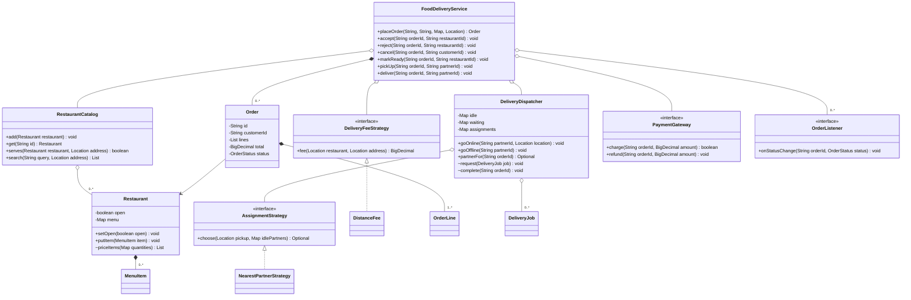
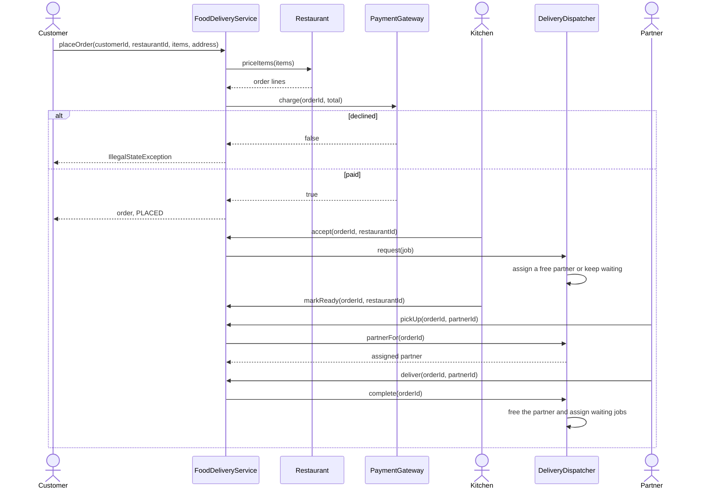

# 20. Food Delivery Service (Swiggy)

**Difficulty:** Hard | **Time:** 75 minutes

## 1. Problem statement

Design the ordering and delivery part of a food delivery service.

- A restaurant has a location, can be open or closed, and has menu items with a price and availability.
- A customer searches nearby open restaurants by restaurant name or dish.
- A customer orders items from one restaurant, with a quantity for each.
- The restaurant must be within the delivery radius of the address.
- The order total is the item prices plus a delivery fee. Prices are fixed when the order is placed.
- An order is created only if payment succeeds.
- The restaurant accepts or rejects a new order. A rejected order is refunded.
- The customer can cancel, with a refund, until the restaurant accepts or rejects.
- After acceptance, the system assigns the nearest free delivery partner within a radius of the restaurant. If none is free, the order waits, and older waiting orders are served first.
- The restaurant marks the food ready, and the assigned partner picks it up and delivers it.
- A partner carries one order at a time.
- Registered listeners are told about every status change.
- The system runs in one process.

**Out of scope:** cart storage, coupons, cancellation after acceptance, partners declining orders, batching orders, live tracking, ratings and persistence.

## 2. What the interviewer wants to evaluate

| Area | What a strong answer shows |
|---|---|
| Requirement clarification | Asks when payment happens, who can cancel and when a partner is assigned |
| Object modelling | Separates menu, order, dispatch and payment |
| State management | Defines every order status and who may change it |
| Independent processes | Lets cooking and partner assignment progress separately |
| Concurrency | Never gives a partner two orders or refunds an order twice |
| Waiting work | Assigns waiting orders as soon as a partner becomes free |
| Data correctness | Keeps the ordered prices even when the menu changes |
| Extensibility | Changes fees, assignment and notifications without editing the order flow |

## 3. Design patterns and principles used

### Design patterns

| Pattern | Where | Why |
|---|---|---|
| Strategy | `AssignmentStrategy` | The rule for choosing a partner can change |
| Strategy | `DeliveryFeeStrategy` | Fee rules change independently of ordering |
| Observer | `OrderListener` | Customers, restaurants and partners react to status changes |
| Adapter | `PaymentGateway` implementations | Each payment provider is wrapped behind one interface |
| Facade | `FoodDeliveryService` | One entry point for the order lifecycle |

State, Factory and Singleton are deliberately left out. Each status change is a single checked step that fits an enum, object creation is simple and services are passed in.

### Design principles

| Principle | How it applies |
|---|---|
| Single Responsibility | `RestaurantCatalog` searches, `DeliveryDispatcher` assigns, `FoodDeliveryService` manages orders |
| Open/Closed | New fee rules, assignment rules and listeners are new classes |
| Liskov Substitution | Any implementation of an interface can replace another |
| Interface Segregation | Each interface covers one concern |
| Dependency Inversion | The service depends on interfaces for payment, fees and notifications |
| Immutability | `MenuItem`, `OrderLine`, `DeliveryJob` and `Location` are records |

## 4. Solution

### 4.1 Core entities

| Entity | Responsibility |
|---|---|
| `Location` | Coordinates and distance |
| `Restaurant` | Menu, open state and pricing of requested items |
| `MenuItem`, `OrderLine` | Current menu entry and the price snapshot in an order |
| `Order` | Customer, items, amounts and status |
| `RestaurantCatalog` | Search and delivery radius |
| `DeliveryDispatcher` | Idle partners, waiting jobs and assignments |
| `FoodDeliveryService` | Payment, status changes and notifications |

Customers and delivery partners are identified by an ID.

Order status changes:

| From | Event | To |
|---|---|---|
| New | Payment succeeds | `PLACED` |
| `PLACED` | Restaurant accepts | `ACCEPTED` |
| `PLACED` | Restaurant rejects | `REJECTED` |
| `PLACED` | Customer cancels | `CANCELLED` |
| `ACCEPTED` | Restaurant marks food ready | `READY` |
| `READY` | Assigned partner picks up | `PICKED_UP` |
| `PICKED_UP` | Assigned partner delivers | `DELIVERED` |

Partner assignment is not an order status. It happens at any time after acceptance, while the food is being cooked or after it is ready.

Concurrency rules:

| Risk | Protection |
|---|---|
| Accept and cancel happen together | Status is checked and changed under the order's lock, so only one succeeds |
| An order is refunded twice | Only the thread that rejects or cancels the order sends the refund |
| A partner gets two orders | All assignment decisions happen under the dispatcher's lock |
| A partner becomes free just as an order starts waiting | Adding jobs, freeing partners and matching share that lock |
| Menu changes during ordering | The restaurant checks and prices all items in one synchronized step |
| Slow payment blocks others | The gateway is called without holding a lock |

The order lock may be followed by the dispatcher lock. The dispatcher never locks an order, so the two cannot deadlock.

### 4.2 Class diagram



### 4.3 Flow of an order



Listeners are notified after each status change.

### 4.4 Java code (Java 17+)

#### Basic types

```java
public enum OrderStatus {
    PLACED, ACCEPTED, READY, PICKED_UP, DELIVERED, REJECTED, CANCELLED
}
```

```java
public record Location(double latitude, double longitude) {
    public Location {
        if (!(Math.abs(latitude) <= 90) || !(Math.abs(longitude) <= 180)) {
            throw new IllegalArgumentException("Invalid location");
        }
    }

    /** Straight line distance over the surface (haversine formula). */
    public double distanceKm(Location other) {
        double latitudeDiff = Math.toRadians(other.latitude - latitude);
        double longitudeDiff = Math.toRadians(other.longitude - longitude);
        double a = Math.pow(Math.sin(latitudeDiff / 2), 2)
                + Math.cos(Math.toRadians(latitude))
                * Math.cos(Math.toRadians(other.latitude))
                * Math.pow(Math.sin(longitudeDiff / 2), 2);
        return 2 * 6371 * Math.asin(Math.min(1, Math.sqrt(a)));
    }
}
```

#### Restaurant and menu

```java
import java.math.BigDecimal;

public record MenuItem(String id, String name, BigDecimal price, boolean available) {
    public MenuItem {
        if (price.signum() <= 0) {
            throw new IllegalArgumentException("Price must be positive");
        }
    }
}
```

```java
import java.math.BigDecimal;

public record OrderLine(String itemId, String name, BigDecimal unitPrice, int quantity) {
    public BigDecimal total() {
        return unitPrice.multiply(BigDecimal.valueOf(quantity));
    }
}
```

```java
import java.util.ArrayList;
import java.util.HashMap;
import java.util.List;
import java.util.Locale;
import java.util.Map;

public class Restaurant {
    private final String id;
    private final String name;
    private final Location location;
    private final Map<String, MenuItem> menu = new HashMap<>();
    private boolean open = true;

    public Restaurant(String id, String name, Location location) {
        this.id = id;
        this.name = name;
        this.location = location;
    }

    public String id() {
        return id;
    }

    public String name() {
        return name;
    }

    public Location location() {
        return location;
    }

    public synchronized void setOpen(boolean open) {
        this.open = open;
    }

    /** Adds an item, or replaces the item with the same ID. */
    public synchronized void putItem(MenuItem item) {
        menu.put(item.id(), item);
    }

    /** Whether the restaurant is open and its name or an available dish matches. */
    synchronized boolean matches(String query) {
        String wanted = query.toLowerCase(Locale.ROOT);
        return open && (name.toLowerCase(Locale.ROOT).contains(wanted)
                || menu.values().stream().anyMatch(item -> item.available()
                        && item.name().toLowerCase(Locale.ROOT).contains(wanted)));
    }

    synchronized List<OrderLine> priceItems(Map<String, Integer> quantities) {
        if (!open) {
            throw new IllegalStateException("Restaurant is closed");
        }
        if (quantities.isEmpty()) {
            throw new IllegalArgumentException("Order has no items");
        }
        List<OrderLine> lines = new ArrayList<>();
        quantities.forEach((itemId, quantity) -> {
            MenuItem item = menu.get(itemId);
            if (item == null || !item.available()) {
                throw new IllegalStateException("Item " + itemId + " is not available");
            }
            if (quantity <= 0) {
                throw new IllegalArgumentException("Quantity must be positive");
            }
            lines.add(new OrderLine(itemId, item.name(), item.price(), quantity));
        });
        return lines;
    }
}
```

```java
import java.util.Comparator;
import java.util.List;
import java.util.Map;
import java.util.concurrent.ConcurrentHashMap;

public class RestaurantCatalog {
    private final double radiusKm;
    private final Map<String, Restaurant> restaurants = new ConcurrentHashMap<>();

    public RestaurantCatalog(double radiusKm) {
        this.radiusKm = radiusKm;
    }

    public void add(Restaurant restaurant) {
        if (restaurants.putIfAbsent(restaurant.id(), restaurant) != null) {
            throw new IllegalArgumentException("Duplicate restaurant");
        }
    }

    public Restaurant get(String id) {
        Restaurant restaurant = restaurants.get(id);
        if (restaurant == null) {
            throw new IllegalArgumentException("Unknown restaurant");
        }
        return restaurant;
    }

    public boolean serves(Restaurant restaurant, Location address) {
        return restaurant.location().distanceKm(address) <= radiusKm;
    }

    /** Nearest first. */
    public List<Restaurant> search(String query, Location address) {
        return restaurants.values().stream()
                .filter(r -> serves(r, address))
                .filter(r -> r.matches(query))
                .sorted(Comparator
                        .<Restaurant>comparingDouble(r -> r.location().distanceKm(address))
                        .thenComparing(Restaurant::id))
                .toList();
    }
}
```

#### Order

```java
import java.math.BigDecimal;
import java.util.List;

public class Order {
    private final String id;
    private final String customerId;
    private final Restaurant restaurant;
    private final Location address;
    private final List<OrderLine> lines;
    private final BigDecimal total;
    OrderStatus status = OrderStatus.PLACED; // guarded by this order's lock

    Order(String id, String customerId, Restaurant restaurant, Location address,
          List<OrderLine> lines, BigDecimal total) {
        this.id = id;
        this.customerId = customerId;
        this.restaurant = restaurant;
        this.address = address;
        this.lines = List.copyOf(lines);
        this.total = total;
    }

    public String id() {
        return id;
    }

    public String customerId() {
        return customerId;
    }

    public Restaurant restaurant() {
        return restaurant;
    }

    public Location address() {
        return address;
    }

    public List<OrderLine> lines() {
        return lines;
    }

    public BigDecimal total() {
        return total;
    }

    public synchronized OrderStatus status() {
        return status;
    }
}
```

#### Dispatch

```java
public record DeliveryJob(String orderId, Location pickup, Location drop) { }
```

```java
import java.util.Map;
import java.util.Optional;

public interface AssignmentStrategy {
    /** Returns one of the idle partners, or empty if none is suitable. */
    Optional<String> choose(Location pickup, Map<String, Location> idlePartners);
}
```

```java
import java.util.Comparator;
import java.util.Map;
import java.util.Optional;

public class NearestPartnerStrategy implements AssignmentStrategy {
    private final double radiusKm;

    public NearestPartnerStrategy(double radiusKm) {
        this.radiusKm = radiusKm;
    }

    @Override
    public Optional<String> choose(Location pickup, Map<String, Location> idlePartners) {
        return idlePartners.entrySet().stream()
                .filter(e -> pickup.distanceKm(e.getValue()) <= radiusKm)
                .min(Comparator.comparingDouble(
                        (Map.Entry<String, Location> e) -> pickup.distanceKm(e.getValue()))
                        .thenComparing(Map.Entry::getKey))
                .map(Map.Entry::getKey);
    }
}
```

Waiting jobs are kept in arrival order. Every event that could make a match runs `assignWaiting`. A job with no suitable partner does not block the jobs behind it.

```java
import java.util.Collections;
import java.util.HashMap;
import java.util.Iterator;
import java.util.LinkedHashMap;
import java.util.Map;
import java.util.Optional;

public class DeliveryDispatcher {
    private record Assignment(String partnerId, DeliveryJob job) { }

    private final AssignmentStrategy strategy;
    private final Map<String, Location> idle = new HashMap<>();
    private final Map<String, DeliveryJob> waiting = new LinkedHashMap<>(); // by order ID
    private final Map<String, Assignment> assignments = new HashMap<>(); // by order ID

    public DeliveryDispatcher(AssignmentStrategy strategy) {
        this.strategy = strategy;
    }

    /** Also used by an idle partner to update its location. */
    public synchronized void goOnline(String partnerId, Location location) {
        requireFree(partnerId);
        idle.put(partnerId, location);
        assignWaiting();
    }

    public synchronized void goOffline(String partnerId) {
        requireFree(partnerId);
        idle.remove(partnerId);
    }

    public synchronized Optional<String> partnerFor(String orderId) {
        return Optional.ofNullable(assignments.get(orderId)).map(Assignment::partnerId);
    }

    synchronized void request(DeliveryJob job) {
        waiting.put(job.orderId(), job);
        assignWaiting();
    }

    /** Frees the partner at the delivery address. */
    synchronized void complete(String orderId) {
        Assignment done = assignments.remove(orderId);
        if (done == null) {
            throw new IllegalStateException("Order has no assigned partner");
        }
        idle.put(done.partnerId(), done.job().drop());
        assignWaiting();
    }

    private void requireFree(String partnerId) {
        boolean busy = assignments.values().stream()
                .anyMatch(a -> a.partnerId().equals(partnerId));
        if (busy) {
            throw new IllegalStateException("Partner has an active delivery");
        }
    }

    private void assignWaiting() {
        Iterator<DeliveryJob> jobs = waiting.values().iterator();
        while (jobs.hasNext() && !idle.isEmpty()) {
            DeliveryJob job = jobs.next();
            Optional<String> chosen =
                    strategy.choose(job.pickup(), Collections.unmodifiableMap(idle));
            if (chosen.isPresent()) {
                idle.remove(chosen.get());
                assignments.put(job.orderId(), new Assignment(chosen.get(), job));
                jobs.remove();
            }
        }
    }
}
```

#### Fees, payment and notifications

```java
import java.math.BigDecimal;

public interface DeliveryFeeStrategy {
    BigDecimal fee(Location restaurant, Location address);
}
```

```java
import java.math.BigDecimal;
import java.math.RoundingMode;

public class DistanceFee implements DeliveryFeeStrategy {
    private final BigDecimal base;
    private final BigDecimal perKm;

    public DistanceFee(BigDecimal base, BigDecimal perKm) {
        this.base = base;
        this.perKm = perKm;
    }

    @Override
    public BigDecimal fee(Location restaurant, Location address) {
        BigDecimal distance = BigDecimal.valueOf(restaurant.distanceKm(address));
        return base.add(perKm.multiply(distance)).setScale(2, RoundingMode.HALF_UP);
    }
}
```

```java
import java.math.BigDecimal;

public interface PaymentGateway {
    boolean charge(String orderId, BigDecimal amount);

    void refund(String orderId, BigDecimal amount);
}
```

```java
public interface OrderListener {
    /** Called while the order is locked, to keep events in order. Must return quickly. */
    void onStatusChange(String orderId, OrderStatus status);
}
```

#### Food delivery service

```java
import java.math.BigDecimal;
import java.util.List;
import java.util.Map;
import java.util.Objects;
import java.util.UUID;
import java.util.concurrent.ConcurrentHashMap;
import java.util.function.Predicate;

public class FoodDeliveryService {
    private final RestaurantCatalog catalog;
    private final DeliveryDispatcher dispatcher;
    private final DeliveryFeeStrategy fees;
    private final PaymentGateway gateway;
    private final List<OrderListener> listeners;
    private final Map<String, Order> orders = new ConcurrentHashMap<>();

    public FoodDeliveryService(RestaurantCatalog catalog, DeliveryDispatcher dispatcher,
                               DeliveryFeeStrategy fees, PaymentGateway gateway,
                               List<OrderListener> listeners) {
        this.catalog = catalog;
        this.dispatcher = dispatcher;
        this.fees = fees;
        this.gateway = gateway;
        this.listeners = List.copyOf(listeners);
    }

    public Order placeOrder(String customerId, String restaurantId,
                            Map<String, Integer> items, Location address) {
        Objects.requireNonNull(customerId);
        Restaurant restaurant = catalog.get(restaurantId);
        if (!catalog.serves(restaurant, address)) {
            throw new IllegalStateException("Address is too far from the restaurant");
        }
        List<OrderLine> lines = restaurant.priceItems(items);
        BigDecimal total = lines.stream()
                .map(OrderLine::total)
                .reduce(fees.fee(restaurant.location(), address), BigDecimal::add);

        String orderId = UUID.randomUUID().toString();
        if (!gateway.charge(orderId, total)) {
            throw new IllegalStateException("Payment declined");
        }
        Order order = new Order(orderId, customerId, restaurant, address, lines, total);
        synchronized (order) {
            orders.put(orderId, order);
            publish(order);
        }
        return order;
    }

    public void accept(String orderId, String restaurantId) {
        Order order = move(orderId, OrderStatus.PLACED, OrderStatus.ACCEPTED,
                o -> o.restaurant().id().equals(restaurantId));
        dispatcher.request(new DeliveryJob(
                orderId, order.restaurant().location(), order.address()));
    }

    public void reject(String orderId, String restaurantId) {
        refund(move(orderId, OrderStatus.PLACED, OrderStatus.REJECTED,
                o -> o.restaurant().id().equals(restaurantId)));
    }

    public void cancel(String orderId, String customerId) {
        refund(move(orderId, OrderStatus.PLACED, OrderStatus.CANCELLED,
                o -> o.customerId().equals(customerId)));
    }

    public void markReady(String orderId, String restaurantId) {
        move(orderId, OrderStatus.ACCEPTED, OrderStatus.READY,
                o -> o.restaurant().id().equals(restaurantId));
    }

    public void pickUp(String orderId, String partnerId) {
        move(orderId, OrderStatus.READY, OrderStatus.PICKED_UP,
                o -> isAssigned(o, partnerId));
    }

    public void deliver(String orderId, String partnerId) {
        move(orderId, OrderStatus.PICKED_UP, OrderStatus.DELIVERED,
                o -> isAssigned(o, partnerId));
        dispatcher.complete(orderId);
    }

    private boolean isAssigned(Order order, String partnerId) {
        return dispatcher.partnerFor(order.id()).filter(partnerId::equals).isPresent();
    }

    /** Checks the caller and the current status, then changes it in one locked step. */
    private Order move(String orderId, OrderStatus from, OrderStatus to,
                       Predicate<Order> allowed) {
        Order order = orders.get(orderId);
        if (order == null) {
            throw new IllegalArgumentException("Unknown order");
        }
        synchronized (order) {
            if (order.status != from) {
                throw new IllegalStateException("Order is " + order.status);
            }
            if (!allowed.test(order)) {
                throw new IllegalStateException("Not allowed for this caller");
            }
            order.status = to;
            publish(order);
        }
        return order;
    }

    private void refund(Order order) {
        gateway.refund(order.id(), order.total());
    }

    private void publish(Order order) {
        for (OrderListener listener : listeners) {
            try {
                listener.onStatusChange(order.id(), order.status);
            } catch (RuntimeException e) { // a listener must not break the order flow
                System.err.println("Listener failed: " + e.getMessage());
            }
        }
    }
}
```

#### Demo

```java
import java.math.BigDecimal;
import java.util.List;
import java.util.Map;

public class FoodDeliveryDemo {
    public static void main(String[] args) {
        Restaurant restaurant = new Restaurant(
                "r1", "Spice House", new Location(18.520, 73.855));
        restaurant.putItem(new MenuItem(
                "i1", "Paneer Biryani", new BigDecimal("220"), true));
        restaurant.putItem(new MenuItem(
                "i2", "Lassi", new BigDecimal("60"), true));

        RestaurantCatalog catalog = new RestaurantCatalog(8);
        catalog.add(restaurant);
        DeliveryDispatcher dispatcher =
                new DeliveryDispatcher(new NearestPartnerStrategy(5));

        PaymentGateway gateway = new PaymentGateway() {
            @Override
            public boolean charge(String orderId, BigDecimal amount) {
                System.out.println("Charged " + amount);
                return true;
            }

            @Override
            public void refund(String orderId, BigDecimal amount) {
                System.out.println("Refunded " + amount);
            }
        };

        FoodDeliveryService service = new FoodDeliveryService(
                catalog, dispatcher,
                new DistanceFee(new BigDecimal("25"), new BigDecimal("8")),
                gateway,
                List.of((orderId, status) -> System.out.println("Order " + status)));

        Location home = new Location(18.540, 73.870);
        Restaurant found = catalog.search("biryani", home).get(0);
        System.out.println("Found " + found.name());

        Order order = service.placeOrder(
                "asha", found.id(), Map.of("i1", 2, "i2", 1), home);
        service.accept(order.id(), "r1");
        System.out.println("Partner: " + dispatcher.partnerFor(order.id()).orElse("waiting"));

        dispatcher.goOnline("ravi", new Location(18.522, 73.857));
        System.out.println("Partner: " + dispatcher.partnerFor(order.id()).orElse("waiting"));

        service.markReady(order.id(), "r1");
        service.pickUp(order.id(), "ravi");
        service.deliver(order.id(), "ravi");

        Order second = service.placeOrder("asha", "r1", Map.of("i2", 2), home);
        service.cancel(second.id(), "asha");
    }
}
```

Output:

```text
Found Spice House
Charged 546.83
Order PLACED
Order ACCEPTED
Partner: waiting
Partner: ravi
Order READY
Order PICKED_UP
Order DELIVERED
Charged 166.83
Order PLACED
Order CANCELLED
Refunded 166.83
```

### 4.5 Complexity

Let R be the number of restaurants, M the menu items across them, K the items in an order, P the idle partners, W the waiting jobs, A the active assignments and L the listeners.

| Operation | Time |
|---|---|
| Search | O(R log R + M), treating name comparison as constant |
| Place an order | O(K + L), plus the gateway call |
| Accept | O(W × P + L) in the worst case |
| Reject, cancel, mark ready or pick up | O(L), plus any refund call |
| Deliver | O(W × P + L) in the worst case |
| Partner goes online | O(A + W × P) |
| Partner goes offline | O(A) |

Space is O(R + M) for the catalogue, O(P + W + A) for dispatch, plus all orders and their lines.

## 5. Follow-up questions

| Question | Answer outline |
|---|---|
| What if the same order is submitted twice? | Have the client send a request ID and return the existing order for a repeated ID |
| What if the payment result is unknown? | Save a pending order before charging, then ask the gateway for the result and confirm or refund |
| What if a refund fails? | Record that it is due and retry from a queue until it succeeds |
| What if the restaurant never responds? | Reject automatically after a deadline and refund |
| How would you allow cancellation after acceptance? | Charge a fee based on status, remove the waiting job or free the partner, and tell the restaurant |
| How would you let partners decline? | Offer the job with a deadline, remember who declined and try the next partner |
| How would you assign partners sooner or later? | Estimate cooking and travel time, and request a partner so that arrival matches readiness |
| How would you batch deliveries? | Let a partner hold several jobs with compatible routes up to a capacity |
| How would you find nearby partners and restaurants at scale? | Use a grid index such as geohash, and run one dispatcher per area |
| What changes with many servers? | Keep state in a database, change status with conditional updates, and publish events from an outbox table |
| How would you add coupons and taxes? | Build the total through a list of pricing rules and store each amount in the order |
| How would you handle limited stock? | Reserve the quantity before payment and release it if the order fails |
