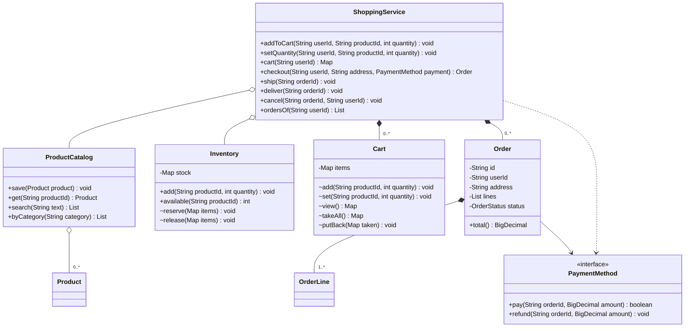
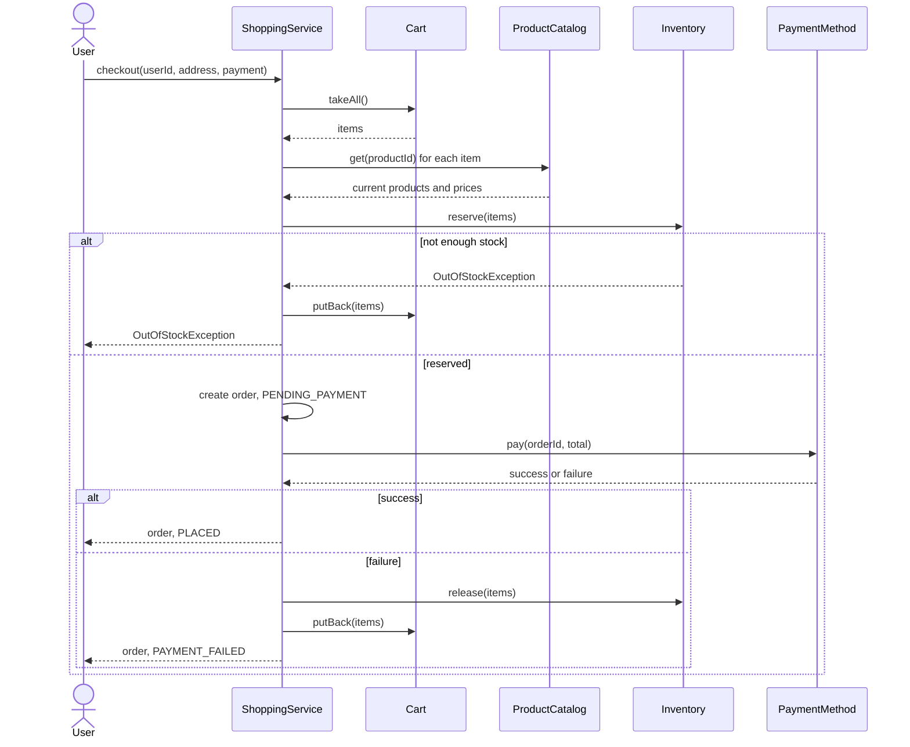

# 21. Online Shopping System (Amazon)

**Difficulty:** Hard | **Time:** 75 minutes

## 1. Problem statement

Design the shopping and ordering part of an online store.

- A product has a name, category and price. The store keeps a stock count for each product.
- A user searches products by name or lists a category.
- A user has a cart, and can add products, change quantities and remove them.
- Adding to a cart does not reserve stock.
- Checkout orders everything in the cart. Stock is reserved for all items or none.
- Prices are fixed at checkout. Later price changes do not affect the order.
- The user chooses a payment method for each checkout.
- A successful payment places the order. A failed payment releases the stock and returns the items to the cart.
- Stock is never oversold, even when many users buy at once.
- One cart cannot create two orders from the same items, even if checkout is clicked twice.
- A placed order is shipped and then delivered.
- The user can cancel before shipping. Cancellation restores the stock and refunds the payment.
- A user can see their orders.
- The system runs in one process.

**Out of scope:** sellers, coupons, taxes, shipping charges, multiple warehouses, returns, reviews, recommendations, notifications, login and persistence.

## 2. What the interviewer wants to evaluate

| Area | What a strong answer shows |
|---|---|
| Requirement clarification | Asks when stock is reserved, how payment fails and when cancellation is allowed |
| Object modelling | Separates product details, stock, cart and order |
| Concurrency | Prevents overselling across several products |
| Atomicity | Leaves no partial reservation behind |
| Failure handling | Undoes earlier steps when payment fails |
| State management | Defines every order status and transition |
| Data correctness | Keeps an order unchanged when the catalogue changes |
| Scale thinking | Explains reservations, repeated requests and contention across servers |

## 3. Design patterns and principles used

### Design patterns

| Pattern | Where | Why |
|---|---|---|
| Strategy | `PaymentMethod` | The user picks how to pay, and checkout treats every method alike |
| Facade | `ShoppingService` | One entry point for carts, checkout and the order lifecycle |

State, Observer, Factory, Command and Singleton are deliberately left out. The order statuses fit an enum, notifications are out of scope, object creation is simple, the single undo step in checkout needs no command objects and the services can be passed in.

### Design principles

| Principle | How it applies |
|---|---|
| Single Responsibility | `ProductCatalog` describes products, `Inventory` counts stock, `Cart` holds choices |
| Open/Closed | A new payment method is a new class |
| Liskov Substitution | Any payment method can replace another |
| Dependency Inversion | Checkout depends on the `PaymentMethod` interface |
| Information Expert | `Inventory` alone decides whether stock can be reserved |
| Immutability | `Product` and `OrderLine` are records |

## 4. Solution

### 4.1 Core entities

| Entity | Responsibility |
|---|---|
| `Product` | Current name, category and price |
| `ProductCatalog` | Stores and searches products |
| `Inventory` | Available stock and reservations |
| `Cart` | Product quantities chosen by one user |
| `Order`, `OrderLine` | What was bought, at what price, and its status |
| `PaymentMethod` | Takes and returns money |
| `ShoppingService` | Coordinates carts, checkout and orders |

Users are identified by an ID.

Order status changes:

| From | Event | To |
|---|---|---|
| New | Stock is reserved | `PENDING_PAYMENT` |
| `PENDING_PAYMENT` | Payment succeeds | `PLACED` |
| `PENDING_PAYMENT` | Payment fails | `PAYMENT_FAILED` |
| `PLACED` | Warehouse ships | `SHIPPED` |
| `SHIPPED` | Order is delivered | `DELIVERED` |
| `PLACED` | User cancels | `CANCELLED` |

Checkout is a series of steps, each with a way to undo it:

| Step | If a later step fails |
|---|---|
| 1. Take all items out of the cart | Put them back |
| 2. Price the items and reserve stock | Release the stock |
| 3. Take payment | Nothing follows it |

Concurrency rules:

| Risk | Protection |
|---|---|
| Two users buy the last unit | `Inventory.reserve` checks and subtracts in one synchronized step |
| Only some items are reserved | All items are checked before any stock is subtracted |
| Checkout is clicked twice | Taking the cart's items is atomic, so the second request finds the cart empty |
| Cancel and ship happen together | The status is checked and changed under the order's lock |
| Slow payment blocks others | No lock is held during payment |

### 4.2 Class diagram



### 4.3 Flow of a checkout



### 4.4 Java code (Java 17+)

#### Products

```java
import java.math.BigDecimal;

public record Product(String id, String name, String category, BigDecimal price) {
    public Product {
        if (price.signum() <= 0) {
            throw new IllegalArgumentException("Price must be positive");
        }
    }
}
```

```java
import java.util.Comparator;
import java.util.List;
import java.util.Locale;
import java.util.Map;
import java.util.concurrent.ConcurrentHashMap;
import java.util.function.Predicate;

public class ProductCatalog {
    private final Map<String, Product> products = new ConcurrentHashMap<>();

    /** Adds a product, or replaces the product with the same ID. */
    public void save(Product product) {
        products.put(product.id(), product);
    }

    public Product get(String productId) {
        Product product = products.get(productId);
        if (product == null) {
            throw new IllegalArgumentException("Unknown product " + productId);
        }
        return product;
    }

    public List<Product> search(String text) {
        String wanted = text.toLowerCase(Locale.ROOT);
        return find(p -> p.name().toLowerCase(Locale.ROOT).contains(wanted));
    }

    public List<Product> byCategory(String category) {
        return find(p -> p.category().equalsIgnoreCase(category));
    }

    private List<Product> find(Predicate<Product> condition) {
        return products.values().stream()
                .filter(condition)
                .sorted(Comparator.comparing(Product::name).thenComparing(Product::id))
                .toList();
    }
}
```

#### Inventory

One lock covers all stock, so a reservation across several products is atomic without any lock ordering. The work inside it is short and entirely in memory.

```java
public class OutOfStockException extends RuntimeException {
    private static final long serialVersionUID = 1L;

    public OutOfStockException(String productId) {
        super("Not enough stock for " + productId);
    }
}
```

```java
import java.util.HashMap;
import java.util.Map;

public class Inventory {
    private final Map<String, Integer> stock = new HashMap<>();

    public synchronized void add(String productId, int quantity) {
        if (quantity <= 0) {
            throw new IllegalArgumentException("Quantity must be positive");
        }
        stock.merge(productId, quantity, Math::addExact);
    }

    public synchronized int available(String productId) {
        return stock.getOrDefault(productId, 0);
    }

    /** Reserves every item, or throws without changing anything. */
    synchronized void reserve(Map<String, Integer> items) {
        items.forEach((productId, quantity) -> {
            if (available(productId) < quantity) {
                throw new OutOfStockException(productId);
            }
        });
        items.forEach((productId, quantity) ->
                stock.merge(productId, -quantity, Integer::sum));
    }

    synchronized void release(Map<String, Integer> items) {
        items.forEach((productId, quantity) ->
                stock.merge(productId, quantity, Math::addExact));
    }
}
```

#### Cart

```java
import java.util.LinkedHashMap;
import java.util.Map;

class Cart {
    private final Map<String, Integer> items = new LinkedHashMap<>();

    synchronized void add(String productId, int quantity) {
        if (quantity <= 0) {
            throw new IllegalArgumentException("Quantity must be positive");
        }
        items.merge(productId, quantity, Math::addExact);
    }

    /** A quantity of zero removes the product. */
    synchronized void set(String productId, int quantity) {
        if (quantity < 0) {
            throw new IllegalArgumentException("Quantity cannot be negative");
        }
        if (quantity == 0) {
            items.remove(productId);
        } else {
            items.put(productId, quantity);
        }
    }

    synchronized Map<String, Integer> view() {
        return Map.copyOf(items);
    }

    /** Empties the cart and returns what was in it, in one step. */
    synchronized Map<String, Integer> takeAll() {
        Map<String, Integer> taken = new LinkedHashMap<>(items);
        items.clear();
        return taken;
    }

    /** Merges with anything added since the items were taken. */
    synchronized void putBack(Map<String, Integer> taken) {
        taken.forEach((productId, quantity) ->
                items.merge(productId, quantity, Math::addExact));
    }
}
```

#### Order and payment

```java
public enum OrderStatus {
    PENDING_PAYMENT, PLACED, SHIPPED, DELIVERED, CANCELLED, PAYMENT_FAILED
}
```

```java
import java.math.BigDecimal;

public record OrderLine(String productId, String name, BigDecimal unitPrice, int quantity) {
    public BigDecimal total() {
        return unitPrice.multiply(BigDecimal.valueOf(quantity));
    }
}
```

```java
import java.math.BigDecimal;

public interface PaymentMethod {
    /** Returns false, or throws, only if no money was taken. */
    boolean pay(String orderId, BigDecimal amount);

    void refund(String orderId, BigDecimal amount);
}
```

```java
import java.math.BigDecimal;
import java.util.LinkedHashMap;
import java.util.List;
import java.util.Map;
import java.util.UUID;

public class Order {
    private final String id = UUID.randomUUID().toString();
    private final String userId;
    private final String address;
    private final List<OrderLine> lines;
    final PaymentMethod payment; // kept for refunds
    OrderStatus status = OrderStatus.PENDING_PAYMENT; // guarded by this order's lock

    Order(String userId, String address, List<OrderLine> lines, PaymentMethod payment) {
        this.userId = userId;
        this.address = address;
        this.lines = List.copyOf(lines);
        this.payment = payment;
    }

    public String id() {
        return id;
    }

    public String userId() {
        return userId;
    }

    public String address() {
        return address;
    }

    public List<OrderLine> lines() {
        return lines;
    }

    public BigDecimal total() {
        return lines.stream()
                .map(OrderLine::total)
                .reduce(BigDecimal.ZERO, BigDecimal::add);
    }

    public synchronized OrderStatus status() {
        return status;
    }

    /** Product quantities, in the form the inventory uses. */
    Map<String, Integer> quantities() {
        Map<String, Integer> result = new LinkedHashMap<>();
        lines.forEach(line -> result.put(line.productId(), line.quantity()));
        return result;
    }
}
```

#### Shopping service

```java
import java.util.List;
import java.util.Map;
import java.util.Objects;
import java.util.concurrent.ConcurrentHashMap;

public class ShoppingService {
    private final ProductCatalog catalog;
    private final Inventory inventory;
    private final Map<String, Cart> carts = new ConcurrentHashMap<>(); // by user ID
    private final Map<String, Order> orders = new ConcurrentHashMap<>();

    public ShoppingService(ProductCatalog catalog, Inventory inventory) {
        this.catalog = catalog;
        this.inventory = inventory;
    }

    public void addToCart(String userId, String productId, int quantity) {
        catalog.get(productId); // rejects unknown products
        cartOf(userId).add(productId, quantity);
    }

    public void setQuantity(String userId, String productId, int quantity) {
        catalog.get(productId);
        cartOf(userId).set(productId, quantity);
    }

    public Map<String, Integer> cart(String userId) {
        return cartOf(userId).view();
    }

    public Order checkout(String userId, String address, PaymentMethod payment) {
        Objects.requireNonNull(address);
        Objects.requireNonNull(payment);
        Cart cart = cartOf(userId);
        Map<String, Integer> items = cart.takeAll();
        if (items.isEmpty()) {
            throw new IllegalStateException("Cart is empty");
        }

        Order order;
        try {
            List<OrderLine> lines = items.entrySet().stream()
                    .map(e -> line(e.getKey(), e.getValue()))
                    .toList();
            order = new Order(userId, address, lines, payment);
            inventory.reserve(items);
        } catch (RuntimeException e) {
            cart.putBack(items);
            throw e;
        }
        orders.put(order.id(), order);

        boolean paid = false;
        try {
            paid = payment.pay(order.id(), order.total()); // no lock held
        } finally { // also runs if pay throws
            synchronized (order) {
                order.status = paid ? OrderStatus.PLACED : OrderStatus.PAYMENT_FAILED;
            }
            if (!paid) {
                inventory.release(items);
                cart.putBack(items);
            }
        }
        return order;
    }

    public void ship(String orderId) {
        move(find(orderId), OrderStatus.PLACED, OrderStatus.SHIPPED);
    }

    public void deliver(String orderId) {
        move(find(orderId), OrderStatus.SHIPPED, OrderStatus.DELIVERED);
    }

    public void cancel(String orderId, String userId) {
        Order order = find(orderId);
        if (!order.userId().equals(userId)) {
            throw new IllegalStateException("Order belongs to another user");
        }
        move(order, OrderStatus.PLACED, OrderStatus.CANCELLED);
        // Only the thread that cancelled the order reaches these lines
        inventory.release(order.quantities());
        order.payment.refund(order.id(), order.total());
    }

    public List<Order> ordersOf(String userId) {
        return orders.values().stream()
                .filter(o -> o.userId().equals(userId))
                .toList();
    }

    private OrderLine line(String productId, int quantity) {
        Product product = catalog.get(productId);
        return new OrderLine(productId, product.name(), product.price(), quantity);
    }

    private void move(Order order, OrderStatus from, OrderStatus to) {
        synchronized (order) {
            if (order.status != from) {
                throw new IllegalStateException("Order is " + order.status);
            }
            order.status = to;
        }
    }

    private Cart cartOf(String userId) {
        return carts.computeIfAbsent(userId, id -> new Cart());
    }

    private Order find(String orderId) {
        Order order = orders.get(orderId);
        if (order == null) {
            throw new IllegalArgumentException("Unknown order");
        }
        return order;
    }
}
```

#### Demo

```java
import java.math.BigDecimal;

public class ShoppingDemo {
    record DemoPayment(boolean succeeds) implements PaymentMethod {
        @Override
        public boolean pay(String orderId, BigDecimal amount) {
            System.out.println((succeeds ? "Paid " : "Declined ") + amount);
            return succeeds;
        }

        @Override
        public void refund(String orderId, BigDecimal amount) {
            System.out.println("Refunded " + amount);
        }
    }

    public static void main(String[] args) {
        ProductCatalog catalog = new ProductCatalog();
        catalog.save(new Product("p1", "Laptop", "Computers", new BigDecimal("55000")));
        catalog.save(new Product("p2", "Mouse", "Computers", new BigDecimal("600")));
        Inventory inventory = new Inventory();
        inventory.add("p1", 1);
        inventory.add("p2", 10);
        ShoppingService shop = new ShoppingService(catalog, inventory);

        shop.addToCart("asha", "p1", 1);
        shop.addToCart("asha", "p2", 2);
        shop.addToCart("ravi", "p1", 1);

        Order failed = shop.checkout("asha", "Pune", new DemoPayment(false));
        System.out.println(failed.status() + ", laptops left: " + inventory.available("p1"));

        Order order = shop.checkout("asha", "Pune", new DemoPayment(true));
        System.out.println(order.status() + ", laptops left: " + inventory.available("p1"));

        try {
            shop.checkout("ravi", "Mumbai", new DemoPayment(true));
        } catch (OutOfStockException e) {
            System.out.println(e.getMessage() + ", Ravi's cart: " + shop.cart("ravi"));
        }

        catalog.save(new Product("p1", "Laptop", "Computers", new BigDecimal("60000")));
        shop.cancel(order.id(), "asha");
        System.out.println(order.status() + ", laptops left: " + inventory.available("p1"));
    }
}
```

Output:

```text
Declined 56200
PAYMENT_FAILED, laptops left: 1
Paid 56200
PLACED, laptops left: 0
Not enough stock for p1, Ravi's cart: {p1=1}
Refunded 56200
CANCELLED, laptops left: 1
```

### 4.5 Complexity

Let N be the number of products, M the number of matching products, K the distinct products in a cart or order and R the number of orders.

| Operation | Time |
|---|---|
| Search or list a category | O(N + M log M), treating name comparison as constant |
| Add to cart or change a quantity | O(1) average |
| View a cart | O(K) |
| Checkout | O(K) average, plus the payment call |
| Ship or deliver | O(1) average |
| Cancel | O(K) average, plus the refund call |
| List a user's orders | O(R) |

Space is O(N) for products and stock, plus all cart entries and order lines.

## 5. Follow-up questions

| Question | Answer outline |
|---|---|
| How do you prevent overselling across many servers? | In one database transaction, subtract stock only where it is at least the quantity wanted, and roll back if any item fails. Update products in a fixed order to avoid deadlock |
| Would one inventory lock become a bottleneck? | Possibly. Use a lock per product taken in sorted order, or split stock by product or warehouse |
| What if a request is repeated after a network error? | Have the client send a request ID and return the existing order for a repeated ID |
| What if the payment result is unknown? | Keep the order pending, query the provider using the order ID, then place it or release the stock |
| What if payment is completed later on another page? | Give the reservation an expiry time, handle the provider's callback once, and refund late payments |
| What if the server crashes during checkout? | Save the order and reservation together, and let a recovery job finish or undo pending orders |
| What if a refund fails? | Record that it is due and retry from a queue until it succeeds |
| How would you handle a flash sale? | Queue buyers, limit quantity per user and split a popular product's stock into several counters |
| How would you add coupons? | Apply a list of pricing rules at checkout and store each discount in the order |
| How would you support several warehouses? | Track stock per warehouse, choose warehouses with a strategy and allow split shipments |
| How would you make search faster? | Use a search index updated from catalogue changes, and keep an index of orders by user |
